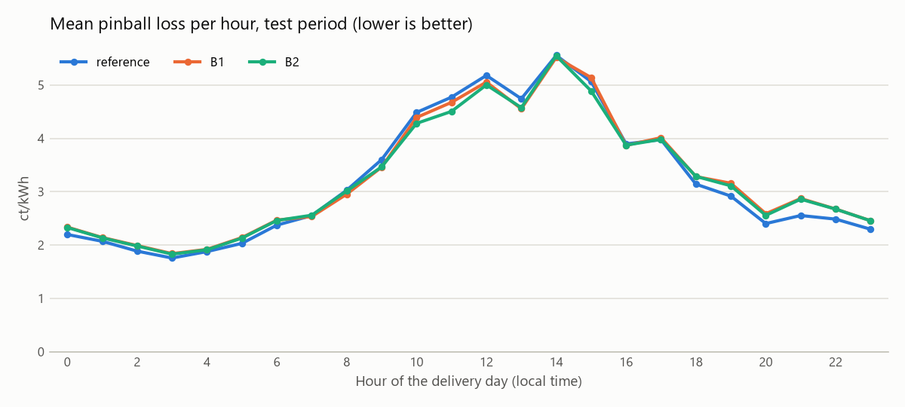
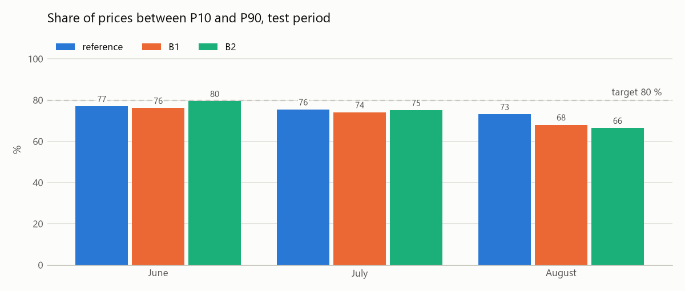
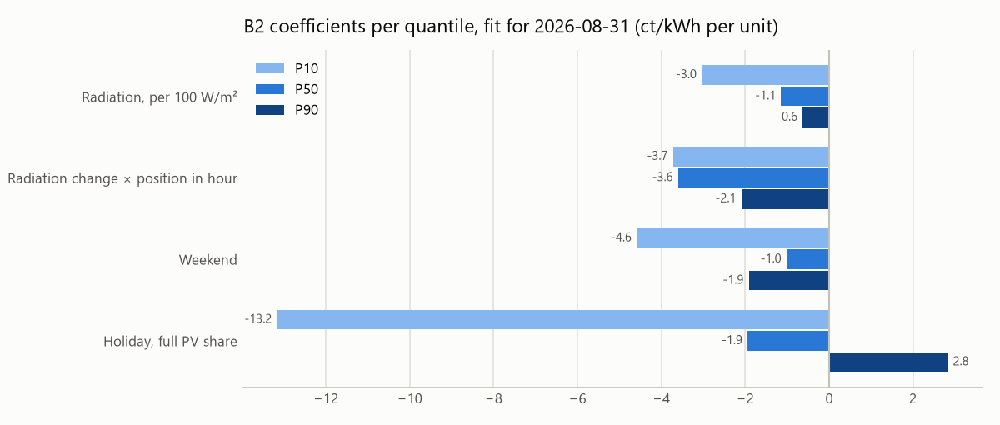

# Baseline: lineare Quantilregression

> Issue [#6](https://github.com/ibidreli/energy_price_prediction/issues/6). Stand: 2026-10-13. Code in `src/energy_price/model/`, Tests in `tests/test_model_*.py`.

## Neu in diesem Branch

| Datei | Inhalt |
|---|---|
| `src/energy_price/model/dataset.py` | Modellierungstabelle: eine Zeile pro Viertelstunde mit Zielwert und Merkmalen |
| `src/energy_price/model/scores.py` | Pinball-Loss, MAE, Abdeckung, Breite, Skill Score, Pinball-Loss pro Tag |
| `src/energy_price/model/models.py` | Historische Referenz und lineare Quantilregression (Merkmalsstufen B1, B2) |
| `src/energy_price/model/backtest.py` | Backtest Tag für Tag mit dem Wissensstand um 11:00 an D−1; Abstimmung, Test, gesperrter Holdout; optional Logging nach W&B |
| `tests/test_model_dataset.py`, `tests/test_model_scores.py`, `tests/test_model_models.py`, `tests/test_model_backtest.py` | Tests, vor allem gegen Datenlecks |
| `pyproject.toml`, `requirements.lock` | neue Abhängigkeit `scikit-learn` (mit `scipy`, `joblib`, `threadpoolctl`) |
| `Makefile` | `make baseline-tune` (Abstimmung) und `make baseline` (Test), mit `TRACK=1` zusätzlich nach W&B |
| `.gitignore` | `reports/`: Prognosen, Kennzahlen und Laufinfo des Backtests, nicht versioniert |
| `docs/figures/baseline_test_*.png` | Pinball-Loss pro Stunde, Abdeckung pro Monat, Koeffizienten von B2 |
| `README.md` | Verweis auf dieses Dokument und `make baseline` |

## Begriffe

| Begriff | Bedeutung |
|---|---|
| **D, D−1, D−2** | Liefertag; Vortag, an dem um 11:00 prognostiziert wird; letzter Tag, dessen Swissgrid-Preise um 11:00 vollständig bekannt sind |
| **P10, P50, P90** | Quantile des Preises: Nur in 10 % der Fälle liegt der Preis unter P10 beziehungsweise über P90. P50 ist der Median, die Punktprognose |
| **Datenleck** | Ein Merkmal enthält Information, die um 11:00 an D−1 noch unbekannt war. Der Test sieht dann besser aus als die Praxis |
| **Referenz** | P10, P50 und P90 der Preise derselben Uhrzeit in den letzten 56 Tagen bis D−2 |
| **B1, B2** | Modell nur mit Kalendermerkmalen; Modell mit Kalender und Strahlungsprognose |
| **Pinball-Loss** | Hauptmetrik, siehe [Bewertung](#bewertung) |
| **Abdeckung, Breite** | Anteil der Preise zwischen P10 und P90 (Ziel 80 %); mittlerer Abstand P90 − P10 |
| **Skill Score** | 1 − Pinball-Loss Modell / Pinball-Loss Referenz. Über 0 ist das Modell besser; 0.10 heisst 10 % tieferer Verlust |

## Modellwahl

### Entscheid

Eine **lineare Quantilregression** sagt P10, P50 und P90 direkt vorher. Sie muss eine **historische Referenz** schlagen. Komplexere Modelle (Gradient Boosting, neuronale Netze) müssen später ihrerseits diese Baseline schlagen.

### Begründung

1. **Der Preis besteht aus zwei Verteilungen.** Bei Unterdeckung (short) liegt der Median bei 18.9 ct/kWh und der Preis ist nie negativ, bei Überschuss (long) bei 5.6 ct/kWh mit Werten bis −688 ct/kWh ([`data.md`](data.md#3-swissgrid-regelzonenbilanz)). Die Richtung lässt sich um 11:00 kaum vorhersagen (EDA aus PR #5, `docs/eda.md`, H2: 54 % gegenüber 50.5 % Zufall). Eine gewöhnliche Regression (OLS) schätzt den bedingten Mittelwert, der oft zwischen den beiden Verteilungen liegt. Die Quantilregression schätzt für jedes Quantil eine eigene Gleichung: Die Sonne darf P10 stark senken und P90 kaum verändern.
2. **Unsicherheit ohne Verteilungsannahme.** Die Quantile kommen direkt aus dem Modell, mit dem Pinball-Loss als Verlustfunktion (Koenker und Bassett 1978).
3. **Erklärbar.** Jeder Koeffizient ist eine Verschiebung des Quantils in ct/kWh pro Einheit des Merkmals.
4. **Lineare Modelle sind ernsthafte Benchmarks.** Lago et al. (2021) vergleichen regularisierte lineare Modelle mit neuronalen Netzen und verlangen, neue Methoden gegen einfache Modelle zu prüfen. Ihre Daten sind allerdings Day-Ahead-Handelspreise, nicht Ausgleichsenergiepreise.
5. **Erwartung ehrlich gesetzt.** Für Ausgleichspreise am Vortag fanden Klæboe et al. (2015) keine informativen Punktprognosen; das Review von Verstraeten et al. (2026) beschreibt Ausgleichspreise als deutlich volatiler als Day-Ahead-Preise, die meisten Studien arbeiten mit Horizonten von wenigen Stunden. Ein Gewinn ist darum eher bei der Unsicherheit als beim MAE zu erwarten.

### Verworfene oder spätere Alternativen

| Ansatz | Warum nicht als Baseline |
|---|---|
| OLS oder Ridge plus Fehlerintervalle | Zielt auf den Mittelwert; die Unsicherheit braucht einen zweiten Schritt |
| Zweischritt: zuerst short/long, dann Preis (Dumas et al. 2019) | Passt zur Preisformel (A bei short, B bei long), aber die Richtung ist um 11:00 kaum vorhersagbar. Späterer Kandidat |
| Gradient Boosting, neuronale Netze | Für rund 240 Liefertage und eine erklärbare Baseline zu aufwendig. Spätere Herausforderer |

## Aufbau

### Daten (`dataset.py`)

Eine Zeile pro Viertelstunde des Liefertags in Schweizer Lokalzeit (92 Viertelstunden bei der Umstellung auf Sommerzeit, 100 bei der Umstellung auf Winterzeit). Zielwert ist `aep_ct_kwh` ab 01.01.2026 (Owner-Entscheid).

| Merkmal | Quelle | Um 11:00 an D−1 bekannt, weil |
|---|---|---|
| Stunde (Lokalzeit) | Kalender | fest |
| Position in der Stunde (−1.5, −0.5, 0.5, 1.5 für :00 bis :45) | Kalender | fest |
| Wochenende | Kalender | fest |
| Anteil der PV-Leistung in Kantonen mit Feiertag | `holidays_ch.csv`, `pv_capacity_by_canton.csv` | gesetzlich festgelegt |
| Strahlung: PV-gewichtetes Mittel der sechs Standorte in W/m² | ECMWF, Lauf D−2 18 UTC | spätestens D−1 02:00 verfügbar ([`data.md`](data.md#1-die-regel-gegen-datenlecks)) |
| Änderung der Strahlung: (nächste − vorige Stunde) / 2 | wie oben | wie oben |

Eine Strahlungsangabe mit Zeitstempel h:00 ist das Mittel der Stunde davor. Die Viertelstunden h:00 bis h:45 erhalten darum den Wert mit Stempel h+1:00. Der Stempel D 00:00 gehört zum Lauf für D und wird für D−1 nie verwendet; diesen Fall prüft ein Test.

### Referenz (`models.py`)

Für jede Uhrzeit des Tages die empirischen Quantile 0.1, 0.5 und 0.9 der Preise derselben Uhrzeit über **56 Tage, D−57 bis D−2**. Die Daten werden mit `known_at_issue()` ausgewählt. Das Fenster von 56 Tagen war in der EDA (H11) die beste Variante der historischen Quantile.

### Lineare Quantilregression (`models.py`)

Für jedes Quantil τ eine Gleichung:

```
Preisquantil_τ = Grundwert + Stundeneffekt + Trend innerhalb der Stunde × Stunde
               + Wochenende + Feiertagsanteil
               [+ Strahlung + Strahlungsänderung × Position]   nur B2
```

| Stufe | Merkmale | Parameter je Quantil |
|---|---|---|
| **B1** | 23 Stunden-Dummies, 24 Trends innerhalb der Stunde (Position × Stunde), Wochenende, Feiertagsanteil | 50 |
| **B2** | B1 plus Strahlung (pro 100 W/m²) und Strahlungsänderung × Position | 52 |

Der Trend innerhalb der Stunde bildet ab, dass die Systembilanz zur vollen Stunde in die eine und bis :45 in die andere Richtung kippt, je nach Tageszeit (EDA, H8). Die Strahlungsänderung verschiebt dieses Kippen mit Sonnenauf- und -untergang.

- Geschätzt mit `sklearn.linear_model.QuantileRegressor` (Löser HiGHS) und L1-Regularisierung `alpha`.
- Die Merkmale werden mit Mittelwert und Standardabweichung **nur der Trainingsdaten** standardisiert. Die Koeffizienten werden für die Auswertung in die ursprünglichen Einheiten zurückgerechnet.
- Kreuzen sich die Quantile, werden sie pro Viertelstunde sortiert.
- Der Löser enthält keinen Zufall: gleiche Daten ergeben gleiche Koeffizienten, es braucht keinen Seed.

### Bewertung

| Kennzahl | Bedeutung | Gut ist |
|---|---|---|
| **Mittlerer Pinball-Loss** (Hauptmetrik) | Mittel über P10, P50 und P90; bewertet Lage und Breite des Bands zugleich | tiefer als die Referenz |
| MAE von P50 | Mittlere Abweichung der Punktprognose in ct/kWh | tief |
| Abdeckung | Anteil der Preise zwischen P10 und P90 | nahe 80 % |
| Breite | Mittel von P90 − P10 | schmal bei 80 % Abdeckung |
| Skill Score | 1 − Pinball-Loss Modell / Pinball-Loss Referenz | über 0 |

Pinball-Loss für das Quantil τ, Prognose q und echten Preis y: τ · (y − q), wenn y ≥ q, sonst (1 − τ) · (q − y). Er ist eine *proper scoring rule*: Am besten schneidet ab, wer die wahren Quantile trifft. Ein künstlich schmales oder breites Band verschlechtert ihn. Bei τ = 0.5 ist er der halbe absolute Fehler.

**Hinweis:** Der mittlere Pinball-Loss als Hauptmetrik ist ein Vorschlag. Issue #6 verlangt ihn für die Quantile; eine teamweite Festlegung der Hauptmetrik steht noch aus.

### Zahlenbeispiel

Erfundene Koeffizienten, nur Strahlung S in W/m²:

| | P10 = 3 − 0.04 · S | P50 = 13 − 0.01 · S | P90 = 24 |
|---|---|---|---|
| bedeckt, S = 0 | 3 | 13 | 24 |
| sonniger Mittag, S = 600 | −21 | 7 | 24 |

Die Sonne zieht vor allem P10 nach unten, P90 bleibt. Ist der echte Preis am sonnigen Mittag −30 ct/kWh, beträgt der Pinball-Loss für P10 0.9 · 9 = 8.1, für P50 0.5 · 37 = 18.5 und für P90 0.1 · 54 = 5.4, im Mittel 10.7. Der Test `test_pinball_matches_the_worked_example` rechnet genau dieses Beispiel nach.

## Backtest

Der Backtest spielt die Vergangenheit Tag für Tag so nach, wie die Prognose um 11:00 an D−1 entstanden wäre (`backtest.py`).

| Regel | Umsetzung | Test |
|---|---|---|
| Training nur mit Preisen bis D−2 | `training_rows` wählt mit `known_at_issue()` | `test_training_ends_before_d_minus_1_for_every_day_of_the_fold` |
| Wöchentliches Nachtraining | Das Modell für den ersten Tag einer Woche dient auch den sechs folgenden Tagen; diese sehen also eher ältere Daten, nie neuere | `test_folds_are_weekly_blocks_in_order` |
| Trainingsfenster | wachsend ab 01.01.2026 oder gleitend über 56 Tage (D−57 bis D−2) | `test_rolling_window_starts_at_d_minus_57` |
| Gleiche Tage für alle Modelle | Fehlt einem Modell an einem Tag eine Prognose (z. B. Wetterlücke am 24.06.2026) oder fehlt der Preis, fällt der Tag für alle Modelle weg | `test_models_are_compared_on_the_same_days_only` |
| Holdout gesperrt | September und Oktober nur mit `--unlock-holdout` | `test_holdout_is_locked_unless_released` |

| Zeitraum | Liefertage | Zweck |
|---|---|---|
| Abstimmung | 01.04. bis 31.05.2026 | Merkmalsstufe, Fenster und Regularisierung `alpha` wählen (`make baseline-tune`) |
| Test | 01.06. bis 31.08.2026 | Referenz gegen B1 gegen B2 mit den gewählten Einstellungen (`make baseline`) |
| Holdout | ab 01.09.2026 | einmaliger Schlusstest, sobald die finalen Septemberpreise vorliegen (bis etwa 21.10.2026) |

Januar bis März dienen nur als Trainingsdaten. Die EDA hat Januar bis August bereits angeschaut; Abstimmung und Test sind darum nicht völlig unberührt. Der Holdout ist es.

**Ausgabe** in `reports/baseline/`: Prognosen (`*_forecasts.parquet`), Kennzahlen (`*_scores.csv`), Pinball-Loss pro Tag, Koeffizienten jedes wöchentlichen Fits und `*_run_info.json` mit Git-Commit, Datenversion und Paketversionen.

**W&B:** `make baseline TRACK=1` loggt Referenz, B1 und B2 als je einen Lauf (Job-Typ `eval`, Gruppe `issue-6`). Voraussetzung ist die Einrichtung nach [`experiment_tracking.md`](experiment_tracking.md). Weil das Modell keinen Zufall enthält, ergibt ein späterer Lauf mit Tracking dieselben Zahlen.

## Ergebnisse

### Kurzfassung

1. **Die Baseline schlägt die Referenz im Test nicht.** Über Juni bis August liegt der Pinball-Loss von B2 0.7 % über dem der Referenz (Skill Score −0.007); B2 ist an 53 % der Tage besser. Praktisch sind beide gleich gut. Das passt zur Literatur, nach der Ausgleichspreise am Vortag kaum vorhersagbar sind.
2. **Die Strahlung hilft, aber nur in sonnigen Stunden und bei negativen Preisen.** B2 ist besser als B1 und zwischen 9 und 16 Uhr besser als die Referenz. In Viertelstunden mit negativem Preis senkt B2 den Pinball-Loss gegenüber der Referenz um 4 %.
3. **Alle Bänder sind zu schmal.** Die Abdeckung liegt bei 73 bis 75 % statt 80 %, im August bei B2 nur bei 66 %.
4. **Die Einstellungen aus April und Mai übertragen sich nicht vollständig.** In der Abstimmung war B2 4.0 % besser als die Referenz, im Test nicht mehr. Die Einstellungen wurden nach dem Blick auf den Test bewusst nicht geändert; das wäre ein Datenleck über die Modellwahl.

### Abstimmung (April und Mai, 61 Liefertage)

`make baseline-tune` prüft je Merkmalsstufe 2 Fenster und 3 Werte für `alpha` (Auszug, ganze Tabelle in `reports/baseline/tune_scores.csv`):

| Variante | Pinball-Loss | MAE P50 | Abdeckung | Breite | Skill Score |
|---|---|---|---|---|---|
| Referenz | 3.449 | 9.98 | 77.6 % | 26.1 | 0 |
| B1, wachsend, alpha 0 | 3.489 | 10.06 | 73.7 % | 22.5 | −0.012 |
| B1, 56 Tage, alpha 0.01 | 3.548 | 10.26 | 78.1 % | 25.2 | −0.029 |
| **B2, wachsend, alpha 0** | **3.311** | **9.72** | 78.3 % | 25.8 | **+0.040** |
| B2, 56 Tage, alpha 0.01 | 3.470 | 10.22 | 79.9 % | 26.9 | −0.006 |
| B2, wachsend, alpha 0.1 | 3.686 | 10.52 | 74.8 % | 21.2 | −0.069 |

Gewählt wurde für B1 und B2 das **wachsende Fenster ohne Regularisierung** (`CHOSEN` in `backtest.py`). Bei `alpha = 0.1` setzt die Regularisierung die Strahlung auf null; B2 wird dann identisch mit B1.

### Test (Juni bis August, 91 Liefertage)

Der 24.06.2026 fällt für alle Modelle weg (Wetterlücke im Archiv).

| Modell | Pinball-Loss | MAE P50 | Abdeckung | Breite | Skill Score | Tage besser als Referenz |
|---|---|---|---|---|---|---|
| Referenz | **3.202** | 9.92 | **75.2 %** | 26.3 | 0 | – |
| B1 | 3.251 | 9.94 | 72.7 % | 24.4 | −0.015 | 53 % |
| B2 | 3.225 | **9.81** | 73.6 % | 25.5 | −0.007 | 53 % |

Pinball-Loss, MAE und Breite in ct/kWh.

| Monat | Referenz | B1 | B2 |
|---|---|---|---|
| Juni | 3.09 | 3.14 | **3.06** |
| Juli | 3.20 | 3.20 | **3.16** |
| August | **3.31** | 3.41 | 3.44 |

| Nur Viertelstunden mit negativem Preis | Pinball-Loss | MAE P50 | Abdeckung |
|---|---|---|---|
| Referenz | 7.48 | 23.3 | 57 % |
| B1 | 8.27 | 26.0 | 46 % |
| B2 | **7.18** | **22.6** | **61 %** |



B2 ist in den Sonnenstunden von 9 bis 16 Uhr besser als die Referenz, abends von 18 bis 23 Uhr deutlich und nachts leicht schlechter. Abends fehlt ein Merkmal für die Lastrampe (EDA, H8 und Teamfrage zur ENTSO-E-Lastprognose).



Alle Modelle decken weniger als 80 % ab. Bei B2 sinkt die Abdeckung von 80 % im Juni auf 66 % im August.



Koeffizienten des letzten Fits (für den 31.08., 23'036 Viertelstunden Training), in ct/kWh pro Einheit:

- **Strahlung:** pro 100 W/m² sinkt P10 um 3.0, P50 um 1.1 und P90 nur um 0.6 ct/kWh. Bei 800 W/m² liegt P10 damit 24 ct/kWh tiefer, P90 nur 5. Das ist die erwartete Asymmetrie: Sonne macht negative Preise wahrscheinlicher, ändert aber wenig an den hohen Preisen.
- **Strahlungsänderung × Position:** negativ für alle Quantile. Steigt die Sonne, sinkt der Preis gegen :45 hin; das passt zum Kippen der Systembilanz Richtung long (EDA, H8).
- **Wochenende:** senkt vor allem P10 (−4.6).
- **Feiertag:** P10 −13.2, P90 +2.8, also ein breiteres Band. Beruht auf wenigen Feiertagen und ist entsprechend unsicher.

### Einordnung

- **Warum der Abstand zur Referenz klein ist:** Die Referenz kennt das Tagesprofil der letzten 56 Tage, und das Tagesprofil erklärt einen grossen Teil der vorhersagbaren Struktur. Der zusätzliche Beitrag der Strahlung ist auf wenige Stunden und Tage beschränkt.
- **Warum B2 im August zurückfällt:** Das wachsende Fenster mischt Winter und Frühling mit Sommer; Grundniveau und Stundenprofil gelten für alle Monate gleich. Die Referenz passt sich mit ihrem 56-Tage-Fenster laufend an. Das ist eine Vermutung; geprüft ist nur, dass das gleitende Fenster in der Abstimmung schlechter war.
- **Zu schmale Bänder** zeigt schon die EDA für historische Quantile (H11). Die Quantilregression trifft die 80 % im Training genau (80.0 % beim Fit für den 31.08.), aber nicht auf neuen Tagen.

### Nächste Schritte (Vorschlag)

Vorab festgelegt, damit der Holdout nicht zur Modellwahl verwendet wird:

1. **Holdout September** einmal mit den unveränderten Einstellungen auswerten, sobald die finalen Preise vorliegen.
2. **Kalibrierung der Bänder:** P10 und P90 mit den Fehlern der letzten Wochen nachträglich verbreitern (z. B. Conformal Prediction) und auf der Abdeckung prüfen.
3. **Saison:** ein Trainingsfenster ab April oder eine stärkere Gewichtung jüngerer Tage gegen das wachsende Fenster testen.
4. **Merkmal für die Abendstunden:** ENTSO-E-Lastprognose, sobald ihre Verfügbarkeit um 11:00 belegt ist.

### Checkliste aus Issue #6

| Punkt | Stand |
|---|---|
| Leakage guard: keine Information nach D−1 11:00 | erfüllt; Swissgrid-Daten nur bis D−2, Wetter nur aus dem Lauf D−2 18 UTC, mit Tests. Restrisiken unter [Grenzen](#grenzen) |
| Determinismus | erfüllt; der Löser hat keinen Zufall, `*_run_info.json` hält Git-Commit, Datenversion und Paketversionen fest |
| Vergleich mit einer Referenz | erfüllt; historische Quantile über 56 Tage. Eine reine Persistenz von D−2 wäre schwächer (EDA, H11: Rangkorrelation 0.16) |
| Artefakte | Prognosen, Kennzahlen, Koeffizienten und Laufinfo in `reports/baseline/`; Grafiken in `docs/figures/`. W&B-Logging vorbereitet (`make baseline TRACK=1`), Lauf folgt nach der Einrichtung des Zugangs |

## Grenzen

- **Grenze D−2 ist eine Annahme.** Ob Swissgrid die Datei täglich aktualisiert, wird bis etwa 18.10.2026 geprüft ([`data.md`](data.md#prüfung-des-aktualisierungsrhythmus)).
- **Finale statt provisorischer Preise.** Training und Referenz verwenden finale Preise; um 11:00 waren nur provisorische bekannt. Die Ergebnisse sind darum leicht zu optimistisch.
- **Wenig Daten.** Rund 240 Liefertage seit 01.01.2026, ohne Herbst und mit einem Bruch im Frühling (EDA, H12). Die etwa 23'000 Viertelstunden sind nicht unabhängig; die eigentliche Stichprobe sind die Tage.
- **Wechselwirkungen** bildet ein lineares Modell nur über gezielt gebaute Merkmale ab.

## Quellen

- R. Koenker, G. Bassett (1978): *Regression Quantiles.* Econometrica 46(1), S. 33 bis 50.
- J. Lago, G. Marcjasz, B. De Schutter, R. Weron (2021): *Forecasting day-ahead electricity prices: A review of state-of-the-art algorithms, best practices and an open-access benchmark.* Applied Energy 293, 116983. [arXiv:2008.08004](https://arxiv.org/abs/2008.08004)
- G. Klæboe, A. L. Eriksrud, S.-E. Fleten (2015): *Benchmarking time series based forecasting models for electricity balancing market prices.* Energy Systems 6(1), S. 43 bis 61. [Working Paper](https://ideas.repec.org/p/gwc/wpaper/2013-006.html)
- J. Dumas et al. (2019): *Probabilistic Forecasting of Imbalance Prices in the Belgian Context.* 16th International Conference on the European Energy Market. [arXiv:2106.07361](https://arxiv.org/abs/2106.07361)
- A. Verstraeten, M. M. Mascarenhas, H. Kazmi (2026): *A review of imbalance price forecasting in Europe: algorithms, metrics and the way forward.* EEM 2026. [arXiv:2605.17054](https://arxiv.org/abs/2605.17054)
- [scikit-learn: QuantileRegressor](https://scikit-learn.org/stable/modules/generated/sklearn.linear_model.QuantileRegressor.html)
