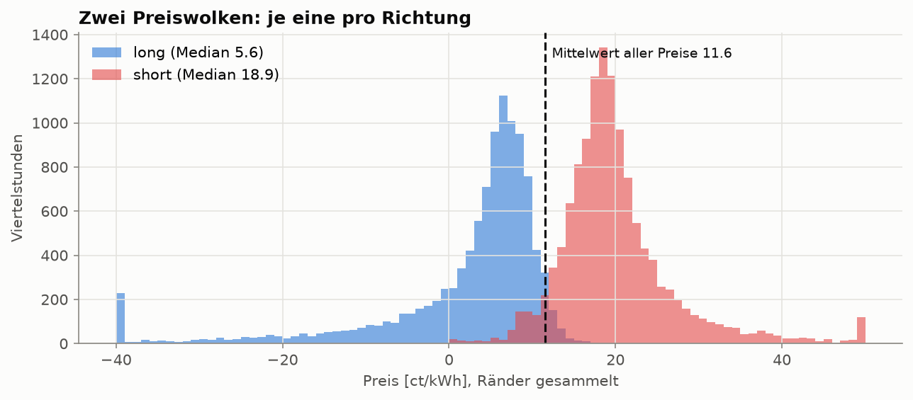
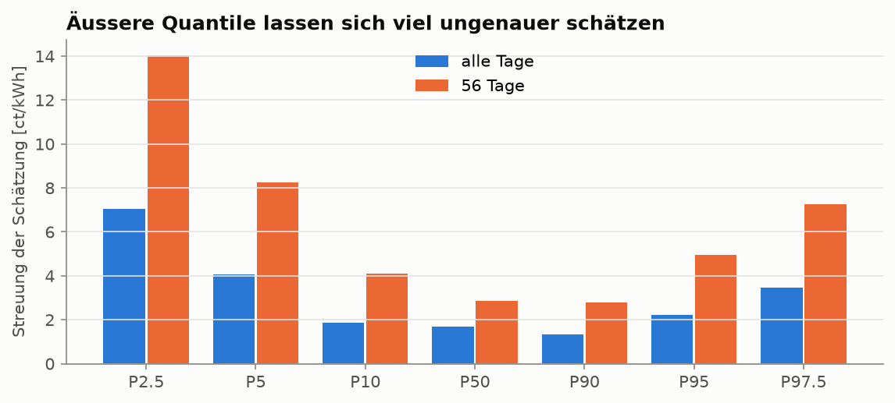
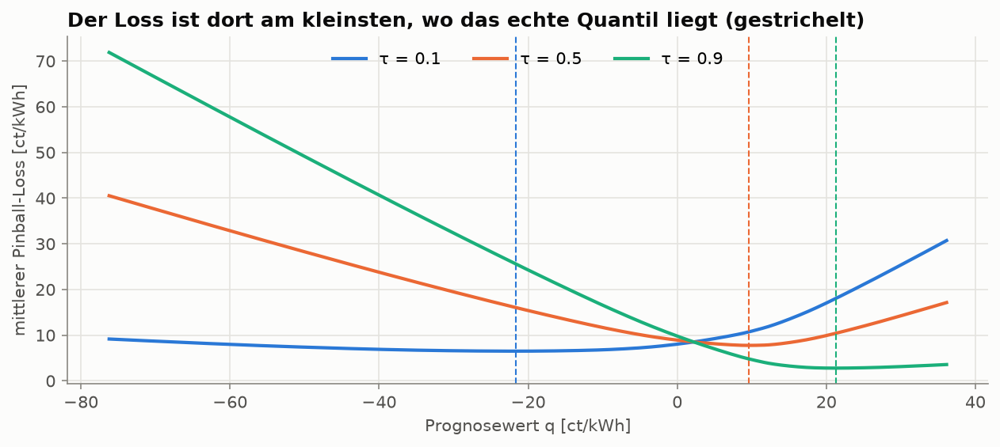

# Bewertung der Prognose: Metriken, Referenz und Verfahren

> Gültiges Dokument für Ausgabe, Metriken, Referenz und Bewertungsverfahren. Es ersetzt `docs/metric.md`. Die Metriken wurden am 06.10.2026 entschieden (Luca Manna) und am 14.11.2026 mit den Daten hergeleitet (#41). Die Herleitung mit Code und Grafiken steht im Notebook [`notebooks/01_exploratory_data_analysis.ipynb`](../notebooks/01_exploratory_data_analysis.ipynb), Kapitel 1.4. Umgesetzt in `src/energy_price/metrics.py`, getestet in `tests/test_metrics.py`. Diese Testdatei war bis zum 14.11.2026 versehentlich eine Kopie von `metrics.py` und enthielt keine Tests.

## Entscheid

| Was | Festlegung |
|---|---|
| **Prognosezeitpunkt** | am Vortag D−1 um 11:00, für alle 96 Viertelstunden des Liefertags D |
| **Ausgabe pro Viertelstunde** | drei Quantile des Preises: **P10, P50 und P90** in ct/kWh |
| **Punktprognose** | P50 (Median) |
| **Konfidenzmass** | das Intervall von P10 bis P90, also ein 80-%-Intervall |
| **Hauptmetrik** (entscheidet zwischen Modellen) | **mittlerer Pinball-Loss** über P10, P50 und P90, tiefer ist besser |
| **immer mit ausgewiesen** | **MAE des Medians**, **Abdeckung** des Intervalls P10 bis P90 (Ziel 80 %), **mittlere Intervallbreite** |
| **Referenz** | Quantile je Viertelstunde des Tages aus den letzten **56 Tagen** bis D−2 |

Im Modul zählt laut Flavio Müller vor allem, dass wir die Wahl von Modell und Metrik **erklären und begründen** können (Rückblick Kick-off, 18.09.2026). Darum steht unten die Begründung zu jedem Punkt.

**Regel:** Begründet wird nur mit Daten der EDA und mit Argumenten, die vor den ersten Modellergebnissen feststanden. Der Entscheid für den Pinball-Loss fiel am 06.10.2026, die ersten Backtest-Ergebnisse der Baseline kamen ab dem 13.10.2026 (#6). Die Rangfolge der Modelle kann sich deshalb nicht nachträglich über die Wahl der Metrik verschieben.

## Warum Quantile und nicht Mittelwert ± Standardabweichung

Der Preis besteht aus zwei getrennten Verteilungen, je eine pro Richtung der Systembilanz (Notebook, Kapitel 1.4.3):

| Richtung | Median | P10 bis P90 | negativ | Extremwert |
|---|---|---|---|---|
| short | 18.9 ct/kWh | 13.3 bis 27.8 | 0 % | +171.9 |
| long | 5.6 ct/kWh | −10.2 bis 9.9 | 23 % | −688.5 |



- **Mittelwert dazwischen:** Der Mittelwert aller Preise liegt bei 11.6 ct/kWh, also zwischen den beiden Wolken, wo kaum Preise vorkommen
- **Richtung kaum vorhersagbar:** Welche Wolke gilt, ist um 11:00 an D−1 kaum bekannt. Die Richtung von D−2 stimmt nur in 54 % mit dem Liefertag überein, Zufall wäre 50.4 % (H2 in `docs/eda.md`)
- **Streuung hängt von Uhrzeit und Saison ab:** P10 bis P90 ist um 17:00 rund dreimal so breit wie um 03:15 (H7)

Eine Normalverteilung würde ein symmetrisches Band um den Mittelwert legen. Quantile brauchen keine Verteilungsannahme und dürfen pro Viertelstunde unterschiedlich weit und asymmetrisch sein.

## Warum genau P10 und P90

Je weiter aussen ein Quantil liegt, desto weniger Preise liegen jenseits davon, und desto ungenauer lässt es sich schätzen (Notebook, Kapitel 1.4.4).

- **Preise ausserhalb des Bands:** Je Monat und Seite liegen bei einem 80-%-Band rund 270 bis 300 Viertelstunden ausserhalb, bei 95 % nur noch 67 bis 74. Das reicht kaum, um die Abdeckung je Monat zu prüfen
- **Genauigkeit der Schätzung:** Bootstrap über ganze Tage, Streuung der geschätzten Quantile in ct/kWh

| Quantil | alle 243 Tage | 56 Tage wie die Referenz |
|---|---|---|
| P2.5 | 7.1 | 14.1 |
| P10 | 1.9 | 4.1 |
| P50 | 1.7 | 2.9 |
| P90 | 1.3 | 2.8 |
| P97.5 | 3.5 | 7.3 |



P10 und P90 lassen sich auch mit 56 Tagen auf wenige ct/kWh genau schätzen. Ein 95-%-Band hinge dagegen an wenigen Extremereignissen (H4: 153 Extrem-Viertelstunden in acht Monaten).

## Warum der Pinball-Loss als Hauptmetrik

Für das Quantil τ und eine Prognose q gilt pro Viertelstunde mit dem echten Preis y:

```
Pinball(y, q, τ) = τ · (y − q)        wenn y ≥ q   (Prognose zu tief)
                   (1 − τ) · (q − y)  wenn y < q   (Prognose zu hoch)
```

Der mittlere Pinball-Loss ist das Mittel über alle Viertelstunden und die drei Quantile.

- **Er ist eine „proper scoring rule“:** Den kleinsten erwarteten Loss erreicht, wer die echten Quantile vorhersagt (Gneiting und Raftery 2007). Mit unseren Preisen von 12:00 bis 13:45, April bis August, liegt das Minimum jeweils beim empirischen Quantil: −21.7, 9.7 und 21.3 ct/kWh für τ = 0.1, 0.5 und 0.9 (Notebook, Kapitel 1.4.5)
- **Er bewertet Treffsicherheit und Schärfe zugleich:** Ein zu breites Band kostet über die Abstände, ein zu schmales über die Treffer ausserhalb
- **Er wächst linear mit dem Fehler, nicht quadratisch:** Ein einzelner Preis von −688 ct/kWh dominiert ihn nicht so wie einen quadratischen Fehler (RMSE)
- **Er ist ein übliches Mass** in der Literatur zur probabilistischen Strompreisprognose, zusammen mit dem CRPS (Nowotarski und Weron 2018). Das Mittel über viele Quantile nähert den CRPS an, mit drei Quantilen ist es eine grobe, aber gut erklärbare Version davon
- **Für τ = 0.5 ist er die Hälfte des MAE.** Der Median-Teil ist also direkt mit der Punktgenauigkeit verbunden, und der Median ist die Punktprognose, die den MAE minimiert (Gneiting 2011)



## Warum die Zusatzmetriken

| Metrik | Frage, die sie beantwortet | gut ist |
|---|---|---|
| **MAE des Medians** | Wie weit liegt die Punktprognose im Mittel daneben, in ct/kWh? | tief, vergleichbar mit der Referenz |
| **Abdeckung P10 bis P90** | Ist das Band ehrlich? Liegen wirklich etwa 80 % der Preise darin? | nahe 80 %. Deutlich darunter: Band zu schmal, das Modell ist zu sicher. Deutlich darüber: Band unnötig breit |
| **Mittlere Intervallbreite** | Wie nützlich ist das Band? | so schmal wie möglich bei Abdeckung nahe 80 % |

- **MAE statt RMSE:** Das grösste 1 % der Abweichungen macht 10.5 % des absoluten, aber 52.2 % des quadratischen Fehlers aus (Notebook, Kapitel 1.4.6)
- **Abdeckung nur als Diagnose:** Ein festes Band P10 bis P90 aller Preise deckt insgesamt per Definition 80 % ab, je Stunde aber nur 67.8 % (12 Uhr) bis 95.7 % (4 Uhr). Abdeckung und Breite werden deshalb immer zusammen und je Uhrzeit, Monat und Richtung ausgewiesen, aber nie allein zur Auswahl der Modelle genutzt

**Verworfen:**
- **MAE allein:** bewertet die Unsicherheit gar nicht
- **RMSE:** wird von wenigen Extrempreisen beherrscht
- **CRPS:** braucht viele Quantile oder eine Verteilungsannahme
- **Winkler- bzw. Interval-Score:** bewertet nur das Intervall, nicht den Median

## Referenz

- **Definition:** Für jede Viertelstunde des Tages die Quantile P10, P50 und P90 der Preise der letzten 56 Tage bis D−2 (`reference_forecast` in `src/energy_price/models/shared/reference.py`)
- **Warum 56 Tage:** Dieses Fenster deckte in der EDA am besten ab (H11: 75 % statt 80 %) und enthält jeden Wochentag gleich oft
- **Bedeutung:** Ein Modell muss die Referenz im mittleren Pinball-Loss schlagen, sonst lohnt es sich nicht
- **Abgelöst:** Die frühere Baseline aus `docs/metric.md` (Median der gleichen Viertelstunde an D−2 bis D−8) gilt nicht mehr. Sie steckt noch in `baseline_quantiles` von `src/energy_price/metrics.py` und wird nur beim Kommandozeilen-Aufruf `python -m energy_price.metrics` verwendet

## Bewertungsverfahren

> Dieser Teil wird mit #36 (Pipeline neu aufbauen, Luca Manna) überarbeitet. Stand 14.11.2026.

- **Rollierender Backtest:** pro Liefertag einmal um 11:00 an D−1 prognostizieren, nur mit dem damaligen Wissensstand (Meeting vom 01.10.2026, `known_at_issue()`), kein zufälliger Split
- **Perioden heute** (`PERIODS` in `src/energy_price/evaluation/backtest.py`):
    - Training ab Januar
    - Auswahl der Settings auf April und Mai
    - Vergleich auf Juni bis August
    - Holdout September und Oktober, gesperrt
- **Geplant in #36:** tägliches Walk-forward, Auswahl über mehrere Blöcke und eine einzige Testperiode am Schluss
- **Alle Metriken zusätzlich aufgeschlüsselt** nach Uhrzeit, Monat und Richtung (short/long), weil sich der Preis dort stark unterscheidet (H1, H7, H8 in `docs/eda.md`)
- **Kreuzende Quantile** (P10 über P90) lehnt `metrics.py` ab. Das Modell muss sie vorher sortieren oder korrigieren
- **Leakage aus der EDA, gelöst mit #50:** Das Notebook schneidet Preis, Systembilanz und Wetter direkt nach dem Laden vor dem 01.09.2026 ab. H2 und H3 nutzen seither nur Januar bis August, die Zahlen in `docs/eda.md` sind nachgeführt
    - **Vorbehalt:** keine Preisbewertung auf Sep/Okt, aber TSI und Wetter daraus wurden in einer früheren Fassung der EDA betrachtet (H2, H3); Kapitel 1.5.4 liest die TSI vom 26.10. bis 31.10. aus dem Test (Umstellung auf Viertelstunden, ohne Preise). Die Periode heisst deshalb „Testperiode mit Vorbehalt“
    - Ausnahme im Notebook: Kapitel 1.5.4 (Umstellung auf Viertelstunden) liest die Systembilanz ab September, ohne Preise

```python
from energy_price.metrics import score

score(actual, p10=p10, p50=p50, p90=p90)
# {"mean_pinball": ..., "mae_p50": ..., "coverage_p10_p90": ..., "width_p10_p90": ...}
```

## Quellen

- T. Gneiting, A. E. Raftery (2007): *Strictly Proper Scoring Rules, Prediction, and Estimation.* Journal of the American Statistical Association 102(477), S. 359 bis 378.
- T. Gneiting (2011): *Making and Evaluating Point Forecasts.* Journal of the American Statistical Association 106(494), S. 746 bis 762.
- J. Nowotarski, R. Weron (2018): *Recent advances in electricity price forecasting: A review of probabilistic forecasting.* Renewable and Sustainable Energy Reviews 81(1), S. 1548 bis 1568. [EconPapers](https://econpapers.repec.org/article/eeerensus/v_3a81_3ay_3a2018_3ai_3ap1_3ap_3a1548-1568.htm)
- Energy Data Hackdays 2025, Challenge „Predict Imbalance Price“ (HEIG-VD): verlangt Backtesting und eine klar begründete Metrik. [Archiv](https://www.energydatahackdays.ch/archiv/predict-imbalance-price)
- Modul CDS1, Rückblick Kick-off vom 18.09.2026 (FHNW Space): Fokus der Bewertung auf der Begründung von Modell und Metrik.
