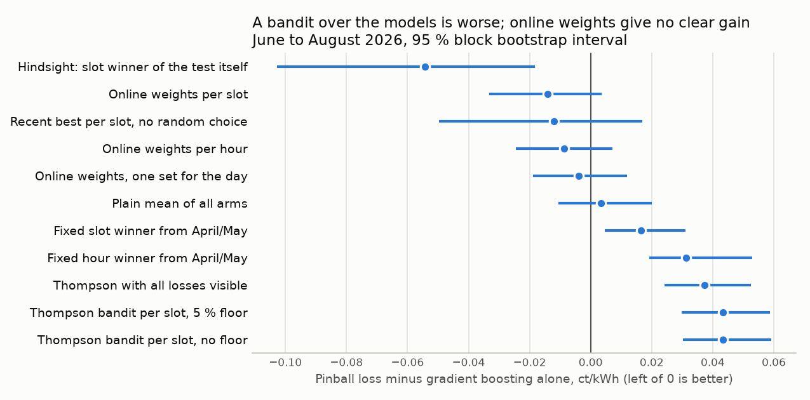

# Bandit über die Modelle: explorative Architekturprüfung

**Einordnung:** explorative Architekturprüfung, kein Modellkandidat nach Standardablauf ([Issue #21](https://github.com/ibidreli/energy_price_prediction/issues/21)).

**Ergebnis:** für dieses Problem ungeeignet, nicht weiterverfolgt. Der Holdout wurde nicht verwendet.

Lesbarer Einstieg: [`notebooks/03_bandit_architektur.ipynb`](../../../notebooks/03_bandit_architektur.ipynb).

## Herkunft und Frage

Die Idee stammt aus einem Vortrag von CH Media ([Folien](slides/)): Dort verteilt ein Bandit mit Thompson Sampling den Traffic live auf mehrere Empfehlungs-Blends, weil sich die Nachfrage mit der Nachrichtenlage ändert.

**Frage:** Kann ein Bandit pro Viertelstunde das beste bestehende Modell laufend wählen und so `gbm_quantile` im Pinball Loss schlagen (3.1633, Juni bis August)?

**Kriterium:** Pinball Loss tiefer als `gbm_quantile`, und das 95-%-Intervall der täglichen Differenz liegt ganz unter 0 (Block-Bootstrap über Tage, Blöcke von 7 Tagen, 5000 Wiederholungen).

## Ablauf und Grenzen der Aussage

1. Der [Vorlauf](vorlauf/) mit fünf Modellen, inklusive Regime-Modell, wertete die Testmonate am 05.11.2026 aus.
2. Erst danach wurden Frage und Kriterium festgehalten, und danach entstand diese versionierte Fassung mit vier Modellen.

Der Test ist deshalb **nicht blind**. Die Einstellungen stammen aber nur aus April und Mai. Der Vergleich mit den regulären Modellen ist nicht gleichwertig, weil diese Prüfung vom [Standardablauf](../../models/README.md) abweicht:

| | Standardablauf | Diese Prüfung |
|---|---|---|
| Start | `make backtest MODEL=<name>` | `make bandit-exploration STEP=tune\|test` |
| Rückmeldung | wöchentlich neu trainiert | täglich, sobald Fehler bis D−2 bekannt sind |
| Reihenfolge | Hypothese vor dem Test | Hypothese nach dem Vorlauf |
| Holdout | einmal am Schluss | keiner |

Weitere Grenzen: nur eine Saison und ein Dutzend verglichene Strategien ohne Korrektur für Mehrfachtests. Ein kleiner Nutzen laufender Gewichte in einer anderen Saison oder mit unterschiedlicheren Modellen ist damit nicht ausgeschlossen.

## Vorgehen

Die Arme sind die Prognosen von Referenz, B1, B2 und Gradient Boosting aus dem gemeinsamen Backtest. Jede Entscheidung für den Liefertag D nutzt nur Fehler bis D−2.

| Strategie | Was sie tut |
|---|---|
| `thompson_bandit` | Der eigentliche Bandit: pro Viertelstunde ein Modell per Thompson Sampling, lernt nur vom gewählten Modell, jedes Modell behält mindestens 5 % |
| `thompson_bandit_no_floor` | Gleich, ohne Mindestanteil |
| `thompson_full_info` | Thompson Sampling, sieht aber die Fehler aller Modelle |
| `follow_leader_slot` | Pro Viertelstunde das Modell mit dem tiefsten bisherigen Fehler, ohne Zufall |
| `hedge_global`, `hedge_hour`, `hedge_slot` | Gewichtetes Mittel aller Modelle, Gewichte pro Quantil und pro Tag, Stunde oder Viertelstunde, alte Fehler verblassen |
| `slot_winner_from_tune`, `hour_winner_from_tune` | Fester Gewinner pro Viertelstunde oder Stunde aus April und Mai |
| `mean_all` | Einfaches Mittel aller Modelle |

Einstellungen: [`tune_selection.csv`](results/tune_selection.csv). Thompson wird über 200 Seeds gemittelt.

## Ergebnis (Juni bis August, 91 Tage)

Differenz zu `gbm_quantile`, das auch auf April und Mai das beste Einzelmodell war. Alle Werte: [`test_results.csv`](results/test_results.csv).

| Strategie | Pinball Loss | Differenz | 95-%-Intervall (ct/kWh) | Coverage |
|---|---|---|---|---|
| Thompson-Bandit ohne Minimum | 3.207 | +1.37 % | +0.030 bis +0.059 | 74.0 % |
| **Thompson-Bandit, 5 % Minimum** | **3.207** | **+1.37 %** | **+0.030 bis +0.059** | **74.0 %** |
| Referenz | 3.202 | +1.22 % | −0.011 bis +0.095 | 75.2 % |
| Thompson, alle Fehler sichtbar | 3.201 | +1.18 % | +0.024 bis +0.052 | 74.1 % |
| Fester Gewinner pro Stunde aus April/Mai | 3.195 | +0.99 % | +0.019 bis +0.053 | 73.2 % |
| Fester Gewinner pro Viertelstunde aus April/Mai | 3.180 | +0.52 % | +0.005 bis +0.031 | 73.9 % |
| Mittel aller Modelle | 3.167 | +0.11 % | −0.011 bis +0.020 | 75.7 % |
| **Gradient Boosting allein** | **3.163** | | | **74.1 %** |
| Gewichte für den ganzen Tag | 3.159 | −0.13 % | −0.019 bis +0.012 | 76.2 % |
| Gewichte pro Stunde | 3.155 | −0.27 % | −0.025 bis +0.007 | 75.9 % |
| Laufend bester pro Viertelstunde | 3.151 | −0.38 % | −0.050 bis +0.017 | 75.1 % |
| Gewichte pro Viertelstunde | 3.149 | −0.45 % | −0.033 bis +0.004 | 76.0 % |
| *Gewinner pro Viertelstunde im Nachhinein* | 3.109 | −1.72 % | nicht erreichbar | 75.0 % |
| *Bestes Modell für jede einzelne Prognose* | 2.703 | −14.55 % | nicht erreichbar | 80.7 % |



Stabilität der Gewinner ([`test_persistence.csv`](results/test_persistence.csv)) und Anteile im Bandit ([`test_bandit_shares.csv`](results/test_bandit_shares.csv)):

| Prüfung | Wert |
|---|---|
| Anteile im Bandit im Test | Referenz 24.7 %, B1 23.5 %, B2 25.8 %, Boosting 26.1 % (Gleichverteilung wäre 25 %) |
| Gleicher Gewinner pro Viertelstunde, April/Mai gegen Test | 32 % (Zufall wäre etwa 25 %) |
| Gleicher Gewinner, ungerade gegen gerade Testtage | 40 % |
| Gewinner auf den jeweils anderen Testtagen gewählt | nur −0.27 % statt −1.72 % im Nachhinein |
| Tage für 80 % Power beim Vergleich Boosting gegen Referenz in einer Viertelstunde | Median 651, vorhanden sind 91 |

## Einordnung des Ergebnisses

- **Der Bandit lernt praktisch nichts.** Die Anteile bleiben nahe bei je 25 %, er wählt also fast zufällig. Sein Intervall liegt ganz über 0, er ist also klar schlechter als das Gradient Boosting, und auch die Referenz schlägt er nicht.
- **Das Problem des Bandits haben wir nicht.** Ein Bandit ist nötig, wenn nur die Rückmeldung des gewählten Arms sichtbar ist. Hier prognostizieren alle Modelle und alle Fehler werden bekannt („Prediction with Expert Advice“). Exploration kostet Genauigkeit und bringt keine zusätzliche Information.
- **Zu wenig Rückmeldung pro Entscheid.** CH Media verteilt alle 10 Minuten neu. Hier gibt es pro Viertelstunde eine Beobachtung am Tag, erst nach rund zwei Tagen bekannt, bei stark streuenden Verlusten.
- **Das „perfekte Modell pro Slot“ ist überwiegend Rauschen.** Die −14.55 % setzen voraus, dass der Preis schon bekannt ist. Gewinner pro Viertelstunde sind kaum stabil, und aus April/Mai übernommen sind sie schlechter als das Einzelmodell.
- **Die laufende Gewichtung ist kein gesicherter Gewinn.** Alle Intervalle schliessen 0 ein. Die beste Variante ist instabil: Im Vorlauf lag die Gewichtung pro Stunde vorn (−0.46 %), hier die pro Viertelstunde (−0.45 %). Der Bandit war auch im Vorlauf klar schlechter (+1.5 %).
- **Die Coverage bleibt zu tief.** Auch die Gewichtungen erreichen nur rund 76 % statt 80 %. Dafür sind die kalibrierten Bänder vorgesehen (Issue #19).

**Entscheid:** Thompson Sampling passt als Architektur nicht zu diesem Problem, und die laufende Gewichtung bringt keinen gesicherten Vorteil, der die zusätzliche Komplexität rechtfertigt. Beides wird nicht weiterverfolgt.

## Nachrechnen

```bash
make bandit-exploration STEP=tune   # Einstellungen auf April und Mai wählen
make bandit-exploration STEP=test   # CHOSEN auf Juni bis August, schreibt results/
pytest tests/test_bandit_exploration.py
```

- **Code:** [`src/energy_price/exploration/bandit/`](../../../src/energy_price/exploration/bandit/). Die Tests prüfen unter anderem, dass keine Entscheidung Preise nach D−2 sieht und der Bandit nur vom gewählten Modell lernt. Ein Holdout-Schritt existiert nicht.
- **Kontrolle:** Die Arme reproduzieren die dokumentierten Test-Scores der Modelle (Boosting 3.1633, Referenz 3.2018, B2 3.2254).
- **Vorlauf:** [`vorlauf/`](vorlauf/) enthält die Skripte und die Rohausgabe unverändert. Die Skripte brauchen die Prognosen aller fünf Modelle, das Regime-Modell liegt auf dem Branch `exp/16-regime-mixture`.
