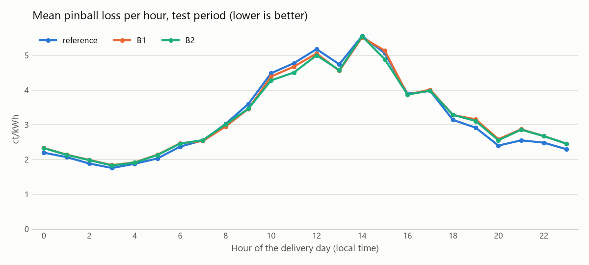
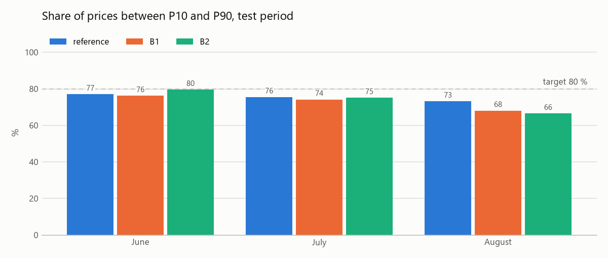
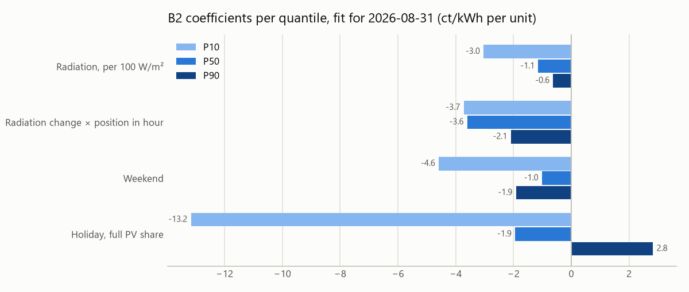

# Baseline: lineare Quantilregression

## Kurzfassung

- **Was:** Am Vortag um 11:00 sagen wir für jede Viertelstunde des nächsten Tages drei Preise voraus: eine untere Grenze (P10), einen mittleren Wert (P50) und eine obere Grenze (P90).
- **Modell:** lineare Quantilregression, ein einfaches und erklärbares Modell. Variante B2 ist der Massstab für alle anderen Modelle.
- **Vergleich:** eine Referenz, die einfach die Preise derselben Uhrzeit der letzten 56 Tage nimmt.
- **Ablauf:** täglich neu trainiert, ausgewählt und verglichen auf April bis August, Test im September und Oktober ([Trainingspipeline](../training_pipeline.md)).
- **Ergebnis:** Auf der Validierung hat B2 einen Pinball Loss von 3.248 und einen MAE von 9.793 ct/kWh, die Referenz 3.301 und 9.943. Der Vorsprung ist nicht gesichert ([Abschnitt 8](#8-ergebnisse-neue-pipeline)).

## 1. Ausführen

```bash
make test                                         # Tests, unter anderem gegen Data Leakage
python -m energy_price.evaluation.experiment baseline_model select --days 2026-04-01 2026-04-03   # Probelauf
make select MODEL=baseline_model                  # 30 Kandidaten auf allen Validierungstagen, mit Grafiken
make select MODEL=baseline_model TRACK=1 JOBS=4   # zusätzlich in W&B (docs/experiment_tracking.md)
make compare                                      # nachdem CHOSEN in model.py festgehalten und committet ist
```

Ergebnisse landen in `reports/baseline_model/select_*` (nicht im Git), Grafiken in `docs/figures/baseline_model/select_*.png`. Den Test rechnet nur `make final-test UNLOCK_TEST=1`, einmal nach dem Freeze (#53). Unter Windows zuerst die Umgebung aktivieren ([README](../../README.md#windows--powershell)).

## 2. Dateien

Für alle Modelle gilt derselbe Aufbau ([Modellstruktur](README.md)). Der Ordner `src/energy_price/models/baseline_model/` enthält nur `model.py` (`GRID`, `WINDOWS`, `CHOSEN`) und `README.md` (Steckbrief). Die übrigen Bausteine wurden für die Baseline gebaut und gelten für alle Modelle:

| Datei | Inhalt | Warum |
|---|---|---|
| `features/dataset.py`, `features/design.py` | Preis und Features pro Viertelstunde, Feature-Sets B1 bis B4 | nur Daten, die um 11:00 bekannt sind |
| `models/shared/linear.py`, `models/shared/base.py` | lineare Quantilregression, Grundgerüst | Standardisierung nur auf Trainingsdaten, sortierte Quantile |
| `models/shared/reference.py` | Referenz aus den letzten 56 Tagen | Massstab für jedes Modell |
| `evaluation/design.py` | Perioden, Fenster, Testsperre | ein Ort für das Design |
| `evaluation/backtest.py`, `evaluation/experiment.py` | tägliches Walk-forward, `select`, `compare`, `final-test` | ein Befehl für jedes Modell |
| `evaluation/scores.py`, `evaluation/figures.py` | Pinball-Loss, MAE, Coverage, Skill Score, Grafiken | für alle Modelle gleich |
| `tests/test_baseline_model.py`, `tests/test_evaluation_*.py` | Tests | prüfen automatisch, dass keine späteren Daten ins Modell gelangen |

## 3. Begriffe

| Begriff | Bedeutung |
|---|---|
| **D** | Liefertag: der Tag, für den wir den Preis vorhersagen |
| **D−1** | Vortag: Um 11:00 wird die Prognose erstellt |
| **D−2** | Letzter Tag, dessen Preise um 11:00 schon bekannt sind |
| **P10** | Untere Grenze: Nur 10 % der Preise liegen darunter |
| **P50** | Mittlere Prognose (Median) |
| **P90** | Obere Grenze: Nur 10 % der Preise liegen darüber |
| **Data Leakage** | Das Modell nutzt Wissen, das um 11:00 noch nicht da war. Der Test sieht dann zu gut aus |
| **Features** | Eingaben des Modells, z. B. Uhrzeit oder Sonneneinstrahlung |
| **Referenz** | Einfachste Prognose ohne Modell: P10, P50 und P90 der Preise derselben Uhrzeit in den letzten 56 Tagen ([Abschnitt 5](#referenz)) |
| **B1** | Modell nur mit Kalender: Uhrzeit, Wochenende, Feiertage |
| **B2** | B1 plus Sonneneinstrahlung aus der Wetterprognose |
| **Backtest** | Die Vergangenheit Tag für Tag nachspielen, jeweils nur mit damals bekannten Daten |
| **Pinball Loss** | Fehler von P10, P50 und P90 zusammen. Tiefer ist besser. Unsere Hauptkennzahl |
| **MAE** | Mittlere Abweichung von P50 zum echten Preis in ct/kWh |
| **Coverage** | Anteil der echten Preise zwischen P10 und P90. Ziel: 80 % |
| **Skill Score** | Um wie viel das Modell besser ist als die Referenz. +10 % heisst 10 % weniger Fehler |

## 4. Warum dieses Modell

### Der Preis hat zwei typische Bereiche

- **Fehlt Strom im Netz (short):** Preis meist um 19 ct/kWh, nie negativ.
- **Hat es zu viel Strom (long):** Preis meist um 6 ct/kWh, teils stark negativ (bis −688 ct/kWh).
- **Welcher Fall eintritt,** lässt sich am Vortag kaum vorhersagen.
- **Ein normales lineares Modell** sagt einen Mittelwert dazwischen voraus, wo kaum echte Preise liegen.

### Die Quantilregression löst das

- Sie lernt für P10, P50 und P90 je eine eigene Gleichung.
- Die Sonne kann so P10 stark senken und P90 kaum verändern.
- Die Unsicherheit kommt direkt aus dem Modell.

### Sie ist erklärbar

- Jeder Koeffizient ist eine Verschiebung in ct/kWh.
- Beispiel: „Pro 100 W/m² Sonne sinkt P10 um 3 ct/kWh.“

### Was die Literatur erwarten lässt

- Lineare Modelle sind übliche Vergleichsmodelle für Strompreise ([Lago et al. 2021](https://arxiv.org/abs/2008.08004)).
- Ausgleichspreise schwanken viel stärker als Day-Ahead-Preise ([Verstraeten et al. 2026](https://arxiv.org/abs/2605.17054)).
- Am Vortag sind sie kaum vorhersagbar ([Klæboe et al. 2015](https://ideas.repec.org/p/gwc/wpaper/2013-006.html)).
- Ein grosser Vorsprung war darum nicht zu erwarten.

## 5. Aufbau

### Referenz

Die Referenz ist die einfachste Prognose, die ohne Modell möglich ist. Unser Modell muss zeigen, dass es mehr bringt.

**So rechnet sie**, Beispiel für die Viertelstunde 12:00 am Liefertag D:

1. Die Preise um 12:00 der letzten 56 Tage nehmen (D−57 bis D−2): 56 Werte.
2. Sortieren, vom tiefsten zum höchsten.
3. Ablesen:
   - **P10:** etwa der 6. tiefste Wert
   - **P50:** der mittlere Wert (Median)
   - **P90:** etwa der 6. höchste Wert

Das sind **Quantile, kein Mittelwert.** Ein Mittelwert würde von einzelnen Extrempreisen (bis −688 ct/kWh) stark verzogen.

**Warum 56 Tage:**

| Grund | Erklärung |
|---|---|
| In der EDA am besten | Verglichen wurden 7, 14, 28, 56 Tage und alle Daten. 56 Tage hatten den kleinsten Fehler und die beste Coverage (EDA H11, PR #5) |
| Ganze Wochen | 56 Tage = 8 Wochen. Jeder Wochentag kommt gleich oft vor |
| Genug Werte | 56 Werte pro Uhrzeit reichen für stabile P10 und P90; bei 7 Tagen wären es nur 7 |
| Aktuell genug | Ältere Daten, etwa aus dem Winter, fallen heraus. Die Referenz passt sich laufend an |

**Hinweis:** Die 56 Tage wurden in der EDA auf den Liefertagen 27.02. bis 31.08. gewählt, also auch auf der Validierung, nicht aber auf dem Test. Das macht die Referenz in der Validierung eher stärker. Der Vergleich ist für unser Modell also eher streng als zu günstig.

### Features

Alle Features sind um 11:00 am Vortag bekannt.

| Feature | B1 | B2 |
|---|---|---|
| Uhrzeit | ja | ja |
| Position der Viertelstunde in der Stunde (der Preis kippt oft innerhalb der Stunde) | ja | ja |
| Wochenende | ja | ja |
| Feiertage, gewichtet nach Solarleistung im Kanton | ja | ja |
| Sonneneinstrahlung, Wetterprognose vom Abend D−2 (sicher vor 11:00 verfügbar) | – | ja |
| Zu- oder Abnahme der Sonne in dieser Stunde | – | ja |

### Bewertung mit dem Pinball Loss

Der Pinball Loss misst, wie gut die drei Grenzen liegen. Er bestraft Bänder, die zu schmal sind (Preis oft ausserhalb), und solche, die unnötig breit sind.

**Beispiel:** sonniger Mittag, der echte Preis ist −30 ct/kWh.

| | P10 | P50 | P90 |
|---|---|---|---|
| Prognose | −21 | 7 | 24 |
| Abstand zum echten Preis | 9 | 37 | 54 |
| Gewicht | 0.9 | 0.5 | 0.1 |
| **Pinball Loss** | **8.1** | **18.5** | **5.4** |

- **Gewicht:** Liegt der Preis *unter* der Prognose, zählt der Abstand mit 1 − Quantil (bei P10 also 0.9), liegt er darüber, mit dem Quantil selbst.
- **Deutung:** P10 hätte tiefer liegen müssen, das kostet viel. Dass P90 weit über dem Preis liegt, kostet wenig, denn P90 soll ja hoch liegen.
- **Gesamt:** Mittel der drei Werte = **10.7**.

## 6. Backtest ohne Data Leakage

Details und Herleitung stehen in der [Trainingspipeline](../training_pipeline.md). Kurz:

- **Jeder Liefertag ist ein Ursprung:** Für D = 03.06. wird am 02.06. um 11:00 prognostiziert, trainiert mit Preisen bis Ende 01.06. (D−2).
- **Täglich neu trainiert**, in jedem der vier Fenster (`expanding`, `rolling_28d`, `rolling_56d`, `rolling_90d`) und ihrem Mittel `window_mean`.
- **Automatisch geprüft:** Die Tests stellen sicher, dass keine späteren Daten ins Modell gelangen.

| Zeitraum | Zweck |
|---|---|
| Januar bis März | nur Training |
| April bis August (153 Tage, fünf Monatsblöcke) | Validierung: Einstellungen wählen (`make select`) und Modelle vergleichen (`make compare`) |
| September und Oktober | Testperiode mit Vorbehalt, im Code gesperrt, einmal nach dem Freeze (#53) |

**Einstellungen:** `GRID` = B1 und B2 × Regularisierung `alpha` 0, 0.01, 0.1 (Bremse gegen zu grosse Koeffizienten). Gewählt in #51: B2 mit `rolling_90d`, B1 mit `window_mean`, beide ohne Regularisierung.

**Restrisiko:** Trainiert wird mit den finalen Preisen. Um 11:00 gab es nur provisorische Werte. Die Ergebnisse sind darum leicht zu gut ([`data.md`](../data.md#bekanntes-restrisiko-swissgrid-überschreibt-werte)).

## 7. Aktuell noch offen

| Punkt | Was zu tun ist |
|---|---|
| **Auswahl** | erledigt in #51, `CHOSEN` festgehalten ([Abschnitt 8](#8-ergebnisse-neue-pipeline)) |
| **Test** | einmal `make final-test UNLOCK_TEST=1` mit unveränderten `CHOSEN` aller Modelle (#53) |

## 8. Ergebnisse (neue Pipeline)

Validierung 01.04. bis 31.08.2026, 152 Tage (der 24.06. fehlt für alle, weil die Strahlungsprognose fehlt), täglich neu trainiert, alle auf denselben Viertelstunden (`make compare`, #51). Werte in ct/kWh, tiefer ist besser.

| Modell | Einstellung | Pinball Loss (Tagesmittel) | MAE P50 | Coverage | gegenüber Referenz [95 %] |
|---|---|---|---|---|---|
| Referenz | 56 Tage | 3.301 | 9.943 | 76.2 % | Massstab |
| B1: Kalender | `window_mean`, `alpha` 0 | 3.309 | 9.973 | 77.1 % | +0.008 (−0.044 bis +0.083) |
| B2: Kalender + Sonne | `rolling_90d`, `alpha` 0 | **3.248** | **9.793** | 76.9 % | −0.053 (−0.105 bis +0.003) |

- **B2 ist der beste von 30 Kandidaten** und an 67.1 % der Tage besser als die Referenz. Das 95-%-Intervall der täglichen Differenz schliesst 0 aber knapp ein: Der Vorsprung ist nicht gesichert.
- **Die Sonne hilft:** B1 ist um 0.061 schlechter als B2 (Intervall +0.012 bis +0.112, ganz über 0).
- **Die Bänder sind weiter zu schmal:** Coverage 76.9 % statt 80 %, im August 74.0 %.

Werte je Monat und die Grafiken stehen im [Steckbrief](../../src/energy_price/models/baseline_model/README.md#4-ergebnisse-neue-pipeline), der Vergleich aller Modelle in der [Trainingspipeline](../training_pipeline.md#7-ergebnisse-auf-den-validierungsblöcken). Die Validierungszahlen sind optimistisch, eine unverzerrte Zahl liefert erst der Test (#53).

## Historie (alte Pipeline)

> Gewählt auf April und Mai, verglichen auf Juni bis August, wöchentlich neu trainiert, Fenster `expanding` oder 56 Tage. Juni bis August waren nicht mehr blind (#21). Ersetzt durch #36.

**Zeiträume damals:** Januar bis März Training, April und Mai Einstellungen wählen, Juni bis August Test, September als Holdout geplant.

**Gewählte Einstellungen:** Auf April und Mai wurden Trainingsfenster (alle Daten ab 01.01. oder nur die letzten 56 Tage) und Regularisierung verglichen. Am besten waren **alle Daten ab 01.01. ohne Regularisierung**, für B1 und B2.

| Juni bis August (91 Tage) | Pinball Loss | MAE P50 | Coverage | gegenüber Referenz |
|---|---|---|---|---|
| Referenz | **3.20** | 9.92 | **75 %** | – |
| B1: Kalender | 3.25 | 9.94 | 73 % | −1.5 % |
| B2: Kalender + Sonne | 3.23 | **9.81** | 74 % | −0.7 % |

- **Gleich gut, nicht besser:** B2 liegt knapp hinter der Referenz und ist an gut der Hälfte der Tage besser.
- **Die Sonne hilft mittags:** Von 9 bis 16 Uhr und bei negativen Preisen ist B2 besser als die Referenz, abends schlechter.
- **Die Bänder sind zu schmal:** Alle Modelle erreichen weniger als 80 % Coverage.
- **Einstellungen:** In der Abstimmung (April und Mai) war B2 noch 4 % besser. Danach wurde nichts mehr angepasst, damit der Test fair bleibt.
- **Ein Tag fehlt:** Der 24.06. ist wegen einer Lücke in den Wetterdaten für alle Modelle ausgenommen.







**Was das Modell gelernt hat:** Pro 100 W/m² Sonne sinkt P10 um 3 ct/kWh, P90 nur um 0.6. Sonne macht tiefe Preise also wahrscheinlicher, hohe kaum seltener.

### Fazit

#### Was verglichen wurde

- **Referenz:** die einfachste Prognose ohne Modell und ohne Wetterdaten: P10, P50 und P90 der Preise derselben Uhrzeit aus den letzten 56 Tagen ([Abschnitt 5](#referenz)).
- **Baseline B2:** unser Modell. Es nutzt zusätzlich Kalender und Sonnenprognose.
- **Frage:** Bringt das Modell mehr als der Blick in die Vergangenheit?

#### Was die Zahlen bedeuten

| Kennzahl | B2 gegenüber Referenz | Einordnung |
|---|---|---|
| Pinball Loss | 3.23 statt 3.20 | Unterschied unter 1 %: praktisch gleich gut |
| Tage besser | 53 % | kaum mehr als ein Münzwurf |
| MAE von P50 | 9.8 statt 9.9 ct/kWh | P50 liegt im Schnitt rund 10 ct/kWh daneben. Bei typischen Preisen von 6 bis 19 ct/kWh ist das viel |
| Coverage | 74 % statt 75 % | Ziel 80 %: Etwa jede vierte statt jede fünfte Viertelstunde liegt ausserhalb des Bands |
| B2 gegenüber B1 | 3.23 statt 3.25 | Die Sonne verbessert das Modell, aber nur leicht |

#### Gesamtfazit

- **Die Antwort auf die Frage ist nein:** Das Modell ist nicht besser als der Blick in die Vergangenheit, aber auch nicht schlechter.
- **Das ist erwartbar:** Laut Literatur sind Ausgleichspreise am Vortag kaum vorhersagbar.
- **Die Sonne hilft punktuell:** mittags und bei negativen Preisen. Abends fehlt Information, etwa eine Lastprognose.
- **Der Nutzen liegt im Band P10 bis P90,** nicht im einzelnen Wert P50. Das Band ist aber noch zu schmal und muss kalibriert werden.
- **Die Baseline steht:** reproduzierbar (ein erneuter Lauf ergibt exakt dieselben Zahlen), gegen Data Leakage getestet und erklärbar.
- **Der Massstab für spätere Modelle:** ein Pinball Loss unter 3.20, also besser als die Referenz.
