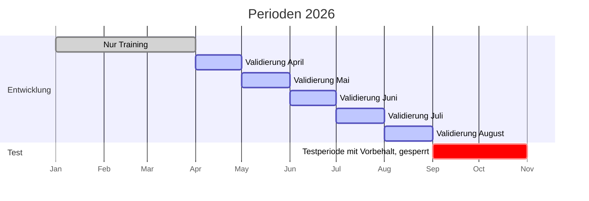
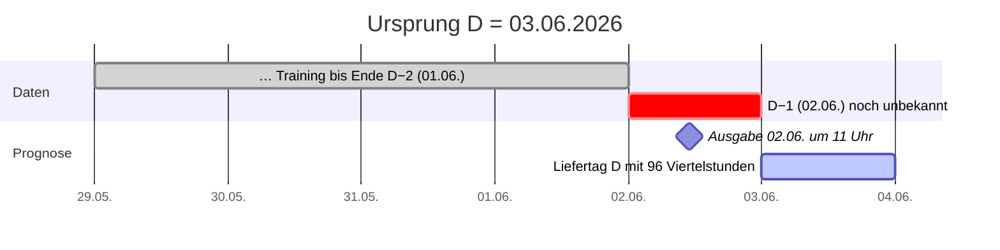
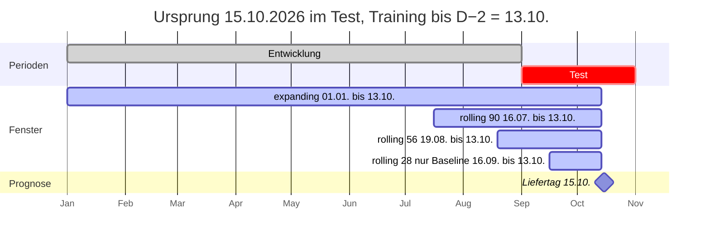
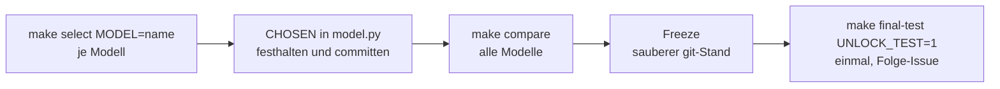

# Trainingspipeline: tägliches Walk-forward

> Konzept zu #36, Stand 17.11.2026. Umgesetzt in #48 (Kern) und #49 (Modelle), Zahlen folgen in #51. Metriken und Referenz stehen in [`evaluation.md`](evaluation.md), die Datengrenze D−2 in [`data.md`](data.md#1-die-regel-gegen-datenlecks).

## 1. Überblick

Jeder Liefertag D ist ein eigener Prognoseursprung: Das Modell wird mit allen Daten bis Ende D−2 neu trainiert und sagt um 11 Uhr an D−1 die Viertelstunden von D voraus. Januar bis März dienen nur als Training. April bis August sind die Validierung: Dort wählt jedes Modell seine Einstellungen und dort werden die Modelle verglichen, ausgewiesen je Monat. September und Oktober sind die Testperiode, im Code gesperrt und erst nach dem Freeze genau einmal ausgewertet (#53).

„Mit Vorbehalt“, weil die EDA TSI und Wetter aus September und Oktober betrachtet hat (H2, H3; TSI 26.10. bis 31.10. in Kapitel 1.5.4), nie aber Preise oder Prognosen (siehe [Einschränkungen](#8-einschränkungen)).

## 2. Wie ein Ursprung funktioniert

Beispiel Liefertag **D = 03.06.2026**: Prognose am 02.06. um 11 Uhr, Training mit Daten bis Ende 01.06. (D−2). Die Preise von D−1 sind um 11 Uhr noch nicht publiziert und fehlen deshalb.

Am nächsten Tag rückt alles um einen Tag weiter: neuer Ursprung, ein Tag mehr Trainingsdaten, neues Modell.

## 3. Rolling Origin und Rolling Window

- **Rolling Origin:** Der Ursprung wandert Tag für Tag durch Validierung (und später Test).
- **Fenster:** wie viel Vergangenheit ein Ursprung zum Training nutzt. `expanding` nimmt alles ab 01.01., `rolling_<w>d` nur die letzten w Tage (D−1−w bis D−2).

Drei aufeinanderfolgende Ursprünge:

| Ursprung D | Prognose am | `expanding` | `rolling_56d` |
|---|---|---|---|
| 01.06. | 31.05., 11 Uhr | 01.01. bis 30.05. (150 Tage) | 05.04. bis 30.05. (56 Tage) |
| 02.06. | 01.06., 11 Uhr | 01.01. bis 31.05. (151 Tage) | 06.04. bis 31.05. (56 Tage) |
| 03.06. | 02.06., 11 Uhr | 01.01. bis 01.06. (152 Tage) | 07.04. bis 01.06. (56 Tage) |

`expanding` wächst, `rolling` gleitet. Dasselbe gilt im Test: Das Training läuft bis D−2 in die Testperiode hinein. Das ist kein Leakage, denn diese Preise sind um 11 Uhr an D−1 publiziert. Beispiel Ursprung 15.10.:

| Fenster | wer | Hinweis |
|---|---|---|
| `expanding`, `rolling_56d`, `rolling_90d` | alle Modelle (Standard) | `calibrated_bands` nur `expanding` |
| `rolling_28d` | nur `baseline_model` (sparsam, B1 und B2) | unter 8 Wochen, siehe [Herleitung](#9-herleitung) |
| `window_mean` („Mittel über die Fenster“) | zusätzlicher Kandidat je Setting | Mittel von P10, P50 und P90 über die Fenster des Modells; bleibt sortiert |

Früh in der Validierung sind Fenster gleich: `rolling_90d` entspricht `expanding` bis Ursprung 02.04., solange die Merkmale ab 01.01. vorliegen (B1, B2), und bis 01.05. bei Merkmalen ab 30.01. (B3, B4, siehe [Mindesthistorie](data.md#mindesthistorie-der-preis--und-bilanzmerkmale)).

## 4. Ablauf mit Befehlen

| Schritt | schreibt |
|---|---|
| `make select MODEL=<name>` | `reports/<name>/select_*`: Prognosen, `scores.csv` je Kandidat und Monat (mit Rang), `selection.json`, `runtime.csv`. Gewählt wird der kleinste mittlere Pinball über alle 153 Validierungstage, jeder Tag gleich gewichtet |
| `CHOSEN` festhalten | `src/energy_price/models/<name>/model.py`, inklusive Fenster; per Commit nachvollziehbar |
| `make compare` | `reports/compare/validation_*` und Tabelle: alle `CHOSEN`, Referenz und B2 auf denselben Viertelstunden, Skill und 95-%-Intervall der täglichen Differenz |
| Freeze | nichts: ab hier ändert sich kein Modell und kein `CHOSEN` mehr |
| `make final-test UNLOCK_TEST=1` | zuerst `docs/test_protocol.json` (Commit, alle `CHOSEN`, Design, Zeitpunkt), dann die Scores auf dem Test. In #36 nur Gerüst, der Lauf folgt in #53 |

Optionen: `JOBS=<n>` (parallel), `TRACK=1` (W&B, siehe [`experiment_tracking.md`](experiment_tracking.md)), `REFIT=<k>`.

## 5. Regeln gegen Leakage

- **Grenze D−2:** Trainingszeilen und Merkmale entstehen nur über `known_at_issue` (Preise und Bilanz bis Ende D−2), [Details](data.md#1-die-regel-gegen-datenlecks).
- **Test abgeschnitten:** In `select` und `compare` schneidet `development_inputs` die Rohdaten am 01.09. ab, bevor `build_table` Merkmale bildet. Auch rollierende Merkmale sehen so keinen Testwert.
- **Anpassungen nur im Fit:** Skalierung, Merkmalsauswahl und Kalibrierung lernen nur aus den Trainingszeilen des jeweiligen Ursprungs. Bei `calibrated_bands` gelten Fenster und Refit-Frequenz der Basis in `fit` und in `predict`.
- **Identische Viertelstunden:** `common_rows` bewertet alle Modelle, Referenz und B2 auf denselben Viertelstunden. Ein Tag zählt nur, wenn jedes Modell alle 92, 96 oder 100 Viertelstunden liefert.
- **Testsperre:** `test_days()` wirft ohne Freigabe `TestLockedError`. `final-test` verlangt einen sauberen git-Stand, schreibt `docs/test_protocol.json` vor der Auswertung und verweigert, wenn die Datei schon existiert.

## 6. Neutraining und Rechenzeit

- **Täglich:** Innerhalb eines Laufs wird je Ursprung neu trainiert (`refit_every = 1`), also 153 Fits je Fenster und Setting in `select`.
- **Ausnahme:** Dauert ein `select`-Lauf eines Modells länger als 8 h, setzt das Modell `REFIT_EVERY = k` (Entscheid je Modell durch Luca). Beispiel k = 7: Das Modell vom 01.06. (Training bis 30.05.) prognostiziert 01.06. bis 07.06.
- **Kein Betrieb:** Läufe startet nur das Team. Im Betrieb wäre tägliches automatisches Training optimal, wird aber mangels Ressourcen nicht betrieben.

**Laufzeit je Modell** (wird in #51 gefüllt, aus `runtime.csv`)

| Modell | Kandidaten | Sekunden je Fit | Dauer `select` | `REFIT_EVERY` |
|---|---|---|---|---|
| `baseline_model` | offen | offen | offen | offen |
| `quantile_lasso` | offen | offen | offen | offen |
| `gbm_quantile` | offen | offen | offen | offen |
| `regime_mixture` | offen | offen | offen | offen |
| `calibrated_bands` | offen | offen | offen | offen |

## 7. Ergebnisse auf den Validierungsblöcken

> Wird in #51 gefüllt, aus `reports/compare/validation_*`. Mittlerer Pinball in ct/kWh, tiefer ist besser.

| Modell (`CHOSEN`) | 2026-04 | 2026-05 | 2026-06 | 2026-07 | 2026-08 | alle |
|---|---|---|---|---|---|---|
| Referenz | offen | offen | offen | offen | offen | offen |
| B2 | offen | offen | offen | offen | offen | offen |
| weitere Modelle | offen | offen | offen | offen | offen | offen |

## 8. Einschränkungen

- **Test zwei statt mindestens zwölf Monate:** Lago et al. empfehlen mindestens ein Jahr (Abschn. 5.1). Das Einpreissystem gilt erst seit 01.01.2026, der Test zeigt also nur den Herbst.
- **Finale statt provisorische Preise:** Um 11 Uhr wären nur provisorische Preise bekannt gewesen. Der Rückblick ist dadurch leicht zu optimistisch, die Grösse ist nicht gemessen ([Restrisiko](data.md#bekanntes-restrisiko-swissgrid-überschreibt-werte)).
- **EDA hat in den Test geschaut:** TSI und Wetter von September und Oktober (H2, H3; TSI 26.10. bis 31.10. für die Umstellung auf Viertelstunden), keine Preise. Darum „Testperiode mit Vorbehalt“.
- **Validierungszahl ist optimistisch:** Das gewählte Setting ist das beste von vielen auf denselben Tagen. Eine unverzerrte Zahl liefert erst der Test.

## 9. Herleitung

| Entscheid | Begründung | Quelle |
|---|---|---|
| Rolling Origin statt eines festen Splits | Das Training „consists only of observations that occurred prior to the observation that forms the test set“, die Genauigkeit ist das Mittel über alle Ursprünge: „The forecast accuracy is computed by averaging over the test sets.“ Die Lücke D−1 entspricht der Mehrschritt-Variante. Rolling-Origin-Auswertungen machen Out-of-sample-Tests effizienter und verlässlicher. Bei nichtstationären Reihen schätzen zeitlich geordnete Out-of-sample-Verfahren am besten | FPP3 5.10; Tashman 2000; Cerqueira et al. 2020 |
| Tägliches Neutraining | „a forecasting model should be retrained on a daily basis as new information is available“ | Lago et al. 5.6 |
| Grenze 8 h, sonst `REFIT_EVERY` | Lago et al. verlangen, die Rechenzeit auszuweisen, weil sie über die Tauglichkeit eines Modells mitentscheidet. Die 8 h selbst sind ein Projektentscheid (Rechenbudget), keine Zahl aus der Literatur | Lago et al. 5.8 |
| Auswahl nur auf der Validierung | Hyperparameter „always performed ex-ante using a validation dataset“, sonst droht „overfitting the test dataset“ | Lago et al. 5.7 |
| Test am Schluss, einmal, gesperrt | Der Test „does never overlap with the training or validation datasets“ und „is always selected as the last segment of the full dataset“ | Lago et al. 5.10 |
| Fünf Monatsblöcke, Kriterium über alle Tage | Mittel über viele Ursprünge statt eines kurzen Blocks; die Ränge je Monat zeigen, ob ein Kandidat nur in einem Block gewinnt | FPP3 5.10 |
| Fenster als Einstellung | Das Kalibrierungsfenster ist „The amount of past data employed for estimation“; nur jüngere Daten, „to avoid estimating effects that no longer play a role“. Ihr Beispiel mit täglichem Neutraining nutzt für 15.02.2017 die Daten „between 18.02.2015 and 14.02.2017“, also unser Schema mit D−1 statt D−2 | Lago et al. 3.7 |
| Mindestens 56 Tage, 28 nur für B1 und B2 | „a minimum of 8 weeks“, weil kürzere Fenster für parameterreiche Modelle zu wenig Information enthalten. Die sparsame Baseline darf darunter | Lago et al. 4.2 |
| `window_mean` als Kandidat | Kombinationen kurzer und langer Fenster können „significantly outperform predictions obtained for the best ex-post selected calibration window“; das LEAR-Ensemble ist das „arithmetic average of forecasts across four calibration window lengths“. Das Mittel über Fenster ist eine robuste Alternative dazu, ein Fenster vorab zu wählen | Lago et al. 2.1 und 4.4; Marcjasz et al. 2018 |
| Vergleich über die tägliche Differenz | Lago et al. verlangen einen statistischen Test und beschreiben den DM-Test auf der täglichen Loss-Differenz, mit Pinball als zulässigem Loss. Wir nutzen dieselbe tägliche Pinball-Differenz, aber mit einem Block-Bootstrap-Intervall statt des DM-Tests | Lago et al. 5.5 |
| Identische Viertelstunden für alle | Projektregel: Unterschiede sollen aus dem Modell kommen, nicht aus anderen bewerteten Tagen | eigener Entscheid |

### Quellen

- J. Lago, G. Marcjasz, B. De Schutter, R. Weron (2021): *Forecasting day-ahead electricity prices: A review of state-of-the-art algorithms, best practices and an open-access benchmark.* Applied Energy 293, 116983. [doi:10.1016/j.apenergy.2021.116983](https://doi.org/10.1016/j.apenergy.2021.116983), [arXiv 2008.08004](https://arxiv.org/abs/2008.08004). Volltext gelesen.
- R. J. Hyndman, G. Athanasopoulos (2021): *Forecasting: Principles and Practice*, 3. Auflage, Abschn. 5.10 „Time series cross-validation“. OTexts. [otexts.com/fpp3/tscv.html](https://otexts.com/fpp3/tscv.html). Gelesen.
- L. J. Tashman (2000): *Out-of-sample tests of forecasting accuracy: an analysis and review.* International Journal of Forecasting 16(4), S. 437 bis 450. [doi:10.1016/S0169-2070(00)00065-0](https://doi.org/10.1016/S0169-2070(00)00065-0). Nur Abstract gelesen.
- G. Marcjasz, T. Serafin, R. Weron (2018): *Selection of Calibration Windows for Day-Ahead Electricity Price Forecasting.* Energies 11(9), 2364. [doi:10.3390/en11092364](https://doi.org/10.3390/en11092364). Nur Abstract gelesen.
- V. Cerqueira, L. Torgo, I. Mozetič (2020): *Evaluating time series forecasting models: an empirical study on performance estimation methods.* Machine Learning 109, S. 1997 bis 2028. [doi:10.1007/s10994-020-05910-7](https://doi.org/10.1007/s10994-020-05910-7). Nur Abstract gelesen.
