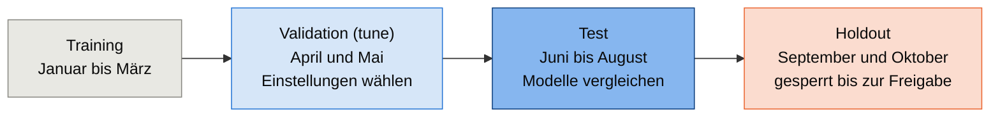
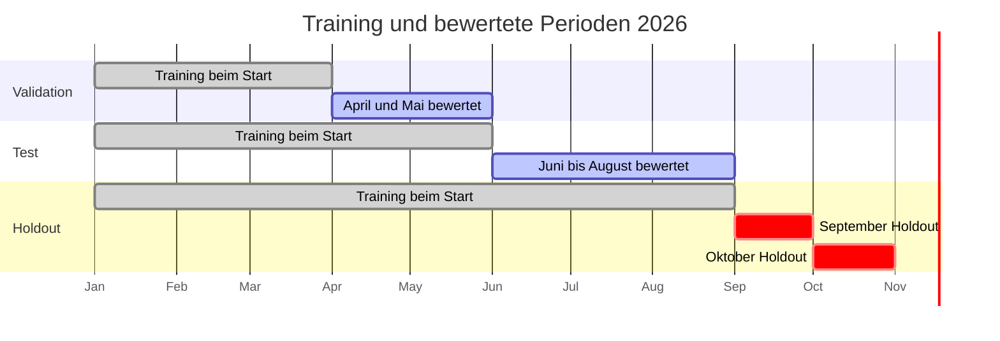

# Trainingspipeline

Der Holdout umfasst September und Oktober 2026 und bleibt gemäss Modell-Dokumentation
gesperrt, bis er ausdrücklich einmal freigegeben wird. Für jedes Liefertag D nutzt
das Training nur Preise bis D−2. Die Verfügbarkeitsgrenze ist D−2, 24:00, basierend
auf der Projektbestätigung vom 22.10.2026. Der Laptop-Task wurde getestet, seine Logs
gingen wegen eines Scriptfehlers verloren; die Projektentscheidung ist, die Daten
aufgrund der verfügbaren Indizien weiter zu verwenden. Details:
[Datengrundlage](data.md#prüfung-des-laptop-tasks).
