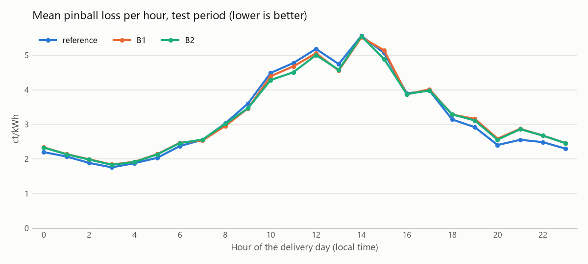
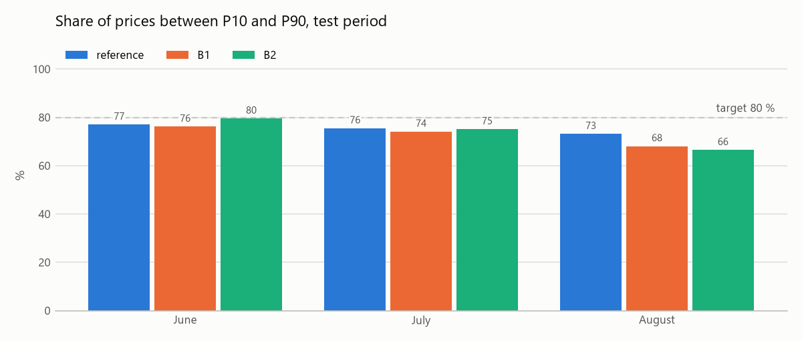

# Baseline: lineare Quantilregression

**Status:** abgeschlossen, Massstab für alle weiteren Modelle · **Verantwortlich:** Rodrigo Urech · **Issue:** #6 · **Stand der Zahlen:** 20.10.2026 · **Ausführliche Doku:** [`docs/models/baseline_model.md`](../../../../docs/models/baseline_model.md)

## 1. Hypothese

Kalendermerkmale und die Sonnenprognose bringen mehr als der Blick in die Vergangenheit, also die Referenz aus den Preisen derselben Uhrzeit der letzten 56 Tage.

## 2. Herleitung

- **Ausgangspunkt aus der EDA:**
    - Die Systembilanz kippt innerhalb jeder Stunde, die Position der Viertelstunde ist deshalb ein starkes Kalendermerkmal (H1, H8)
    - Die Strahlungsprognose hängt mit dem Preisniveau zusammen, vor allem mittags (H3, H7)
    - Feiertage drücken den Preis, gewichtet nach Solarleistung im Kanton (H6)
- **Warum Quantilregression:**
    - Der Preis hat zwei typische Bereiche, short um 19 ct/kWh und long um 6 ct/kWh, und welcher eintritt, ist am Vortag kaum vorhersagbar
    - Ein normales lineares Modell sagt einen Mittelwert dazwischen voraus, wo kaum echte Preise liegen
    - Die Quantilregression lernt für P10, P50 und P90 je eine eigene Gleichung, die Unsicherheit kommt direkt aus dem Modell
- **Warum linear:** erklärbar, jeder Koeffizient ist eine Verschiebung in ct/kWh. Lineare Modelle sind das übliche Vergleichsmodell für Strompreise (Lago et al. 2021)
- **Erwartung aus der Literatur:** Ausgleichspreise sind am Vortag kaum vorhersagbar (Klæboe et al. 2015), ein grosser Vorsprung war deshalb nicht zu erwarten

## 3. Vorgehen

- **Modell:** lineare Quantilregression (`models/shared/linear.py`), eine Gleichung je Quantil P10, P50 und P90
- **Features:**
    - **B1:** Uhrzeit, Position der Viertelstunde in der Stunde, Wochenende, Feiertage gewichtet nach PV-Leistung
    - **B2:** B1 plus PV-gewichtete Strahlung und ihre Änderung in der Stunde (ECMWF-Lauf D−2 18 UTC)
- **Tuning:** April und Mai, Varianten B1 und B2
- **Gewählt:** B2. Im Tuning noch 4 % besser als die Referenz, danach nichts mehr angepasst

## 4. Erkenntnisse

**Das Modell ist nicht besser als der Blick in die Vergangenheit**
- Pinball-Loss 3.23 statt 3.20, Unterschied unter 1 %
- Nur an 53 % der Tage besser als die Referenz, kaum mehr als ein Münzwurf

**Die Sonne hilft punktuell**
- Von 9 bis 16 Uhr und bei negativen Preisen ist B2 besser als die Referenz, abends schlechter
- Abends fehlt Information, etwa eine Lastprognose
- B2 gegenüber B1 nur leicht besser (3.23 statt 3.25)

**Die Bänder sind zu schmal**
- Coverage 74 % statt 80 %, etwa jede vierte statt jede fünfte Viertelstunde liegt ausserhalb
- Der Nutzen liegt im Band P10 bis P90, das aber noch kalibriert werden muss

## 5. Outcome

Test Juni bis August, 91 Tage (der 24.06. fehlt wegen einer Lücke in den Wetterdaten). Preise, Fehler und Breiten in ct/kWh.

| Modell | Pinball-Loss | MAE P50 | Coverage | Intervallbreite |
|---|---|---|---|---|
| Referenz | **3.20** | 9.92 | **75.2 %** | 26.3 |
| B1 | 3.25 | 9.94 | 73 % | – |
| B2 | 3.23 | **9.81** | 73.6 % | 25.5 |





## 6. Entscheid

**Bleibt als Massstab**, weil das Modell gleich gut wie die Referenz, reproduzierbar, gegen Data Leakage getestet und erklärbar ist. Ein späteres Modell muss einen Pinball-Loss unter 3.20 erreichen.

## 7. Belege

- **Issue und PR:** #6, PR #12, Struktur seit #13 (PR #15)
- **Code:** `src/energy_price/models/baseline_model/model.py`, `src/energy_price/models/shared/linear.py`
- **Tests:** `tests/test_baseline_model.py`
- **Ergebnisse:** `reports/baseline_model/` (nicht versioniert), Grafiken in `docs/figures/baseline_model/`
- **Literatur:** [Lago et al. 2021](https://arxiv.org/abs/2008.08004), [Klæboe et al. 2015](https://ideas.repec.org/p/gwc/wpaper/2013-006.html)

```bash
make baseline-tune    # = make backtest MODEL=baseline_model STEP=tune
make baseline         # = make backtest MODEL=baseline_model STEP=test
```
