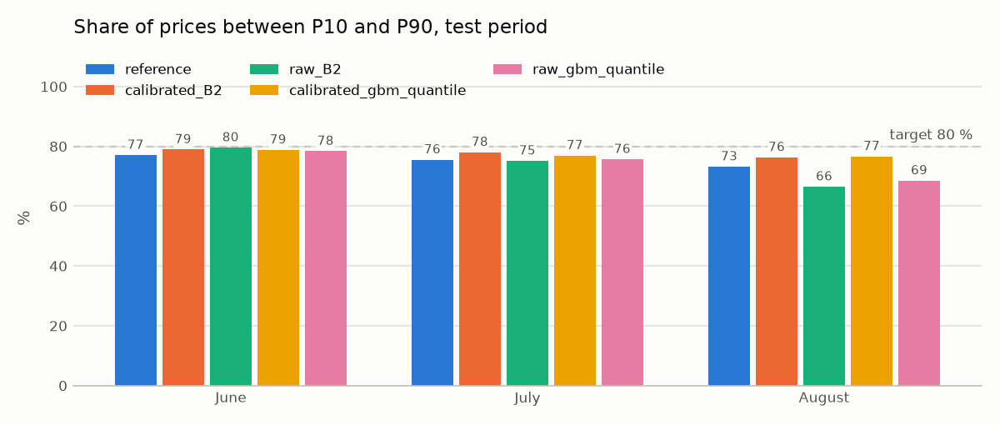
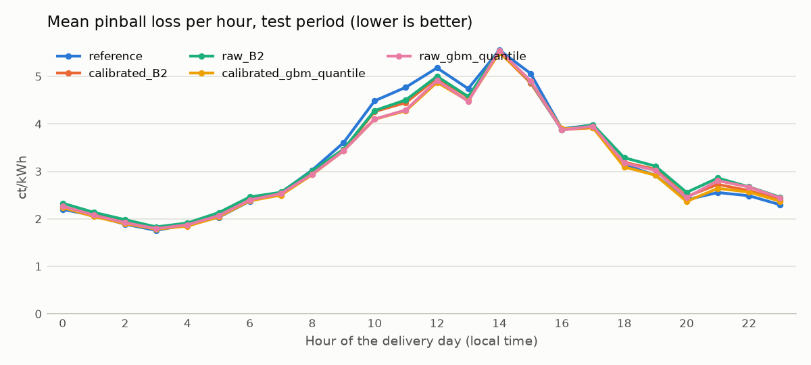

# Kalibrierte Bänder

**Status:** implementiert und getestet; Erfolgskriterium verfehlt, Teamreview offen (Issue #19).

## Hypothese und Erfolgskriterium

Getrennte Korrekturen von P10 und P90 aus vergangenen Prognosefehlern sollen
78 bis 82 % Coverage erreichen. Der mittlere Pinball-Loss darf gegenüber dem
jeweiligen Basismodell höchstens um 1 % steigen. P50 bleibt unverändert.

## Methode und zeitliche Trennung

`models/shared/calibration.py` implementiert die wiederverwendbare Hülle um
`QuantileModel`. `model.py` verwendet die festgelegte Baseline B2 (expanding,
alpha=0) und das festgelegte `gbm_quantile` aus Issue #17, jeweils mit B2-Features.
Keine neuen Datenquellen oder Abhängigkeiten werden benötigt.

Die äusseren Fits erfolgen wie im gemeinsamen Backtest wöchentlich und sehen
nur Preise bis D−2 des ersten Liefertags ihrer Woche. Die Korrektur bleibt für
diese Woche fest. Damit werden an späteren Tagen bewusst ältere Fehler verwendet.
Für die Fehlerhistorie werden eigene wöchentliche Prognosen ab 30. Januar
berechnet. Jeder historische Fit sieht nur Preise bis D−2 seines ersten
Liefertags und verwendet mindestens 28 Tage Training seit 1. Januar. Keine
Kalibrierungszeile liegt im Training ihres historischen Prognosemodells.

Im gewählten Fehlerfenster sind die einseitigen Fehler `q10 - y` und `y - q90`.
Für jeden wird der Rang `ceil((n+1)*0.9)` gewählt. P10 wird um den ersten Wert
verringert, P90 um den zweiten erhöht. Negative Korrekturen erlauben ein engeres
Band; die Grenzen werden an P50 begrenzt, damit die Quantile geordnet bleiben.
Fehlende oder nicht endliche Fehler werden ausgeschlossen. Gruppen mit weniger
als 20 Fehlern verwenden die gepoolte Korrektur; ist auch diese nicht bestimmbar,
scheitert der Fit ausdrücklich. Fehlende Prognosen bleiben fehlend.

Die Zeitabhängigkeit der Fehler erlaubt keine verteilungsfreie Garantie für
80 % Coverage. Deshalb wird die Abdeckung empirisch und je Monat überprüft.

## Tuning und Reproduktion

Vor dem Test festgelegtes Raster: 28 oder 56 Tage Fehlerhistorie, jeweils
gepoolt, nach vier 6-Stunden-Blöcken oder nach 24 Stunden getrennt. Beide
unkalibrierten Basismodelle werden im selben Lauf als Kontrolle berechnet.
Alle Varianten und die Referenz werden auf denselben vollständigen Tagen bewertet.

Je Basismodell wird auf April/Mai die Variante mit dem niedrigsten Pinball-Loss
unter denjenigen gewählt, die beide Erfolgskriterien erfüllen. Falls keine Variante
diese erfüllt, wird die mit dem niedrigsten Pinball-Loss ausgewählt und der
Misserfolg dokumentiert. Juni bis August werden danach genau mit diesen Settings
ausgewertet. September/Oktober bleiben gesperrt.

```bash
make backtest MODEL=calibrated_bands STEP=tune JOBS=1
# chosen aus reports/calibrated_bands/tune_selection.json als CHOSEN festschreiben
make backtest MODEL=calibrated_bands STEP=test JOBS=1
```

`TRACK=1` aktiviert das bestehende W&B-Tracking. Ergebnisse, tägliche Scores,
Auswertungen nach Monat/Stunde und Reproduktionsmetadaten stehen unter
`reports/calibrated_bands/`, Grafiken unter `docs/figures/calibrated_bands/`.
Der lokale Joblib-Cache unter `reports/calibrated_bands/cache/` speichert
historische Basisprognosen anhand von Daten und Basisparametern. Änderungen
am Python-Quellcode oder an den numerischen Paketversionen erzeugen automatisch
einen neuen Cache-Namensraum. Der Cache ist wie die übrigen Reports nicht versioniert.

## Tuning April/Mai

| Modell | Pinball-Loss | MAE P50 | Coverage | Breite |
|---|---:|---:|---:|---:|
| calibrated_B2 | 3.3271 | 9.7192 | 83.54 % | 29.3776 |
| raw_B2 | 3.3112 | 9.7192 | 78.26 % | 25.8234 |
| calibrated_gbm_quantile | 3.3177 | 9.7887 | 81.83 % | 30.1369 |
| raw_gbm_quantile | 3.3087 | 9.7887 | 76.35 % | 25.6868 |

Werte für 61 gemeinsame Tage, Preiskennzahlen in ct/kWh. B2: 56 Tage,
gepoolt (Pinball +0.48 %, Coverage 83.54 %). Keine B2-Variante erfüllt beide
Kriterien; gewählt wurde die Variante mit dem niedrigsten Pinball-Loss.
GBM: 56 Tage, 6-Stunden-Blöcke (Pinball +0.27 %, Coverage 81.83 %),
beide Kriterien im Tuning erfüllt. Diese Settings wurden vor dem Test festgeschrieben.

## Test Juni bis August

Vergleich auf 91 gemeinsamen Tagen (8736 Viertelstunden), Juni bis August 2026.
Der 24. Juni entfällt wegen fehlender Wettermerkmale bei allen Modellen.
Preismasse und Intervallbreite in ct/kWh.

| Modell | Pinball-Loss | MAE P50 | Coverage | Breite |
|---|---:|---:|---:|---:|
| reference | 3.2018 | 9.9171 | 75.21 % | 26.3184 |
| raw_B2 | 3.2254 | 9.8063 | 73.60 % | 25.5145 |
| calibrated_B2 | 3.1745 | 9.8063 | 77.72 % | 26.2495 |
| raw_gbm_quantile | 3.1633 | 9.7923 | 74.08 % | 24.8447 |
| calibrated_gbm_quantile | 3.1254 | 9.7923 | 77.44 % | 26.5877 |

| Variante | Pinball gegenüber Basis | Coverage 78 bis 82 % | Loss höchstens +1 % | Beide erfüllt |
|---|---:|---|---|---|
| B2 | -1.58 % | nein | ja | nein |
| gbm_quantile | -1.20 % | nein | ja | nein |

### Coverage nach Monat

| Modell | Juni | Juli | August |
|---|---:|---:|---:|
| raw_B2 | 79.56 % | 75.13 % | 66.50 % |
| calibrated_B2 | 78.92 % | 78.02 % | 76.31 % |
| raw_gbm_quantile | 78.38 % | 75.64 % | 68.51 % |
| calibrated_gbm_quantile | 78.81 % | 76.95 % | 76.65 % |

Bei beiden kalibrierten Modellen sinkt die Coverage von Juni über Juli bis August.
Auch der monatliche Pinball-Loss steigt: bei B2 von 3.0555 über 3.1431 auf 3.3173,
bei GBM von 3.0154 über 3.1356 auf 3.2179 ct/kWh. Die Prognosequalität nimmt
damit über die drei untersuchten Testmonate ab. Das Experiment erklärt die
Ursache dieses zeitlichen Verlaufs nicht.

**Entscheid:** Beide Varianten verfehlen das vorab definierte Erfolgskriterium.
Die Kalibrierung verbessert den Pinball-Loss und die August-Coverage deutlich,
erreicht im gesamten Test aber weniger als 78 % Coverage. Die GBM-Kalibrierung
hat den niedrigsten Test-Loss der verglichenen Modelle; sie gilt trotzdem nicht
als erfolgreich kalibriert. Die Settings werden nach diesem Test nicht geändert.
Weitere Kalibrierungsansätze benötigen ein gesondertes Experiment mit sauberem
Validierungsprotokoll. Der Holdout bleibt für den gemeinsamen Abschluss gesperrt.

P50 ist für beide Paare über alle Prognosezeilen exakt identisch zum Basismodell.
Die Quantilordnung wurde über alle vollständigen Prognosen geprüft.





## Prüfung

`tests/test_calibrated_bands.py` prüft innere und äussere D−2-Grenzen,
Unabhängigkeit von späteren Preisen, getrennte Korrekturen, unverändertes P50,
Quantilordnung, fehlende Werte, kleine Gruppen und die Auswahl je Basismodell.
