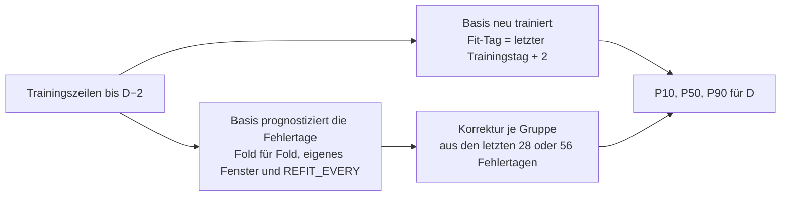
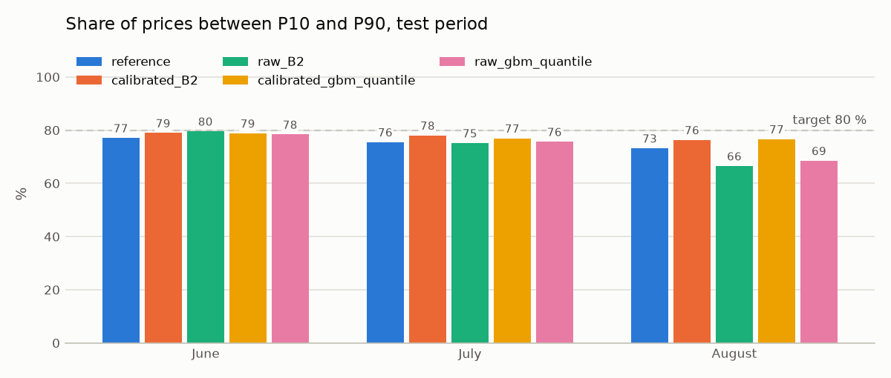
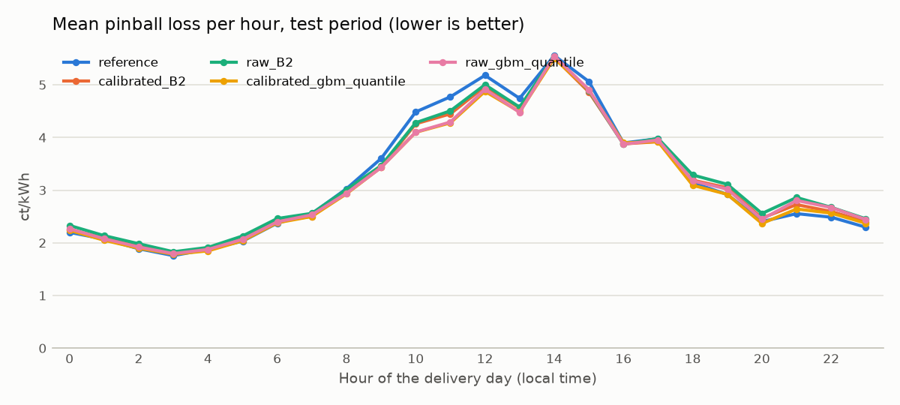

# Kalibrierte Bänder

**Status:** Auswahl in der neuen Pipeline offen (#51) · **Verantwortlich:** Luca Manna · **Issue:** #19 · **Ablauf:** [`docs/training_pipeline.md`](../../../../docs/training_pipeline.md)

## 1. Hypothese

Getrennte Korrekturen von P10 und P90 aus vergangenen Prognosefehlern heben die Coverage auf 78 bis 82 %. Der mittlere Pinball-Loss steigt gegenüber dem jeweiligen Basismodell höchstens um 1 %, P50 bleibt unverändert.

## 2. Herleitung

- **Ausgangspunkt:** Die Bänder der Baseline B2 und des Gradient Boosting waren zu schmal, nur rund 74 % der Preise lagen zwischen P10 und P90 statt 80 % ([Historie](#historie-alte-pipeline)). Ein verlässliches Band ist für den Use Case zentral, weil eine Bilanzgruppe damit ihr Risiko abschätzt
- **Erwarteter Vorteil:** Die Korrektur ist eine Hülle um ein bestehendes Modell. Sie verbessert die Bänder, ohne P50 und damit den MAE zu verändern, und lässt sich auf jedes Basismodell anwenden
- **Verworfene Alternative:** eine gemeinsame, symmetrische Verbreiterung beider Ränder. Fehler unter P10 und über P90 können unterschiedlich gross sein und werden deshalb getrennt korrigiert

## 3. Vorgehen

- **Modell:** Hülle `CalibratedQuantileModel` in `models/shared/calibration.py` um zwei Basen: `baseline_model:B2` und `gbm_quantile:gbm_quantile`, jeweils mit deren `CHOSEN`. Keine neuen Datenquellen
- **Korrektur:** einseitige Fehler `q10 - y` und `y - q90` im Fehlerfenster, je Rang `ceil((n+1)*0.9)`. P10 sinkt um den ersten Wert, P90 steigt um den zweiten, begrenzt an P50. Gruppen mit weniger als 20 Fehlern nutzen die gepoolte Korrektur
- **Zeitliche Trennung:**



- Jede historische Basisprognose sieht nur Zeilen bis D−2 ihres Fold-Tags, erste nach 28 Tagen Daten. Keine Kalibrierungszeile liegt im Training ihres Prognosemodells. Wegen der Zeitabhängigkeit gibt es keine Garantie für 80 %, die Coverage wird je Monatsblock geprüft
- **Auswahl:** 2 Basen × 28 oder 56 Fehlertage × gepoolt, 6-Stunden-Blöcke oder 24 Stunden = 12 Kandidaten, plus je Basis die unkalibrierte Basis: **14 Kandidaten**, nur `expanding` (die Basis behält ihr eigenes Fenster), deshalb kein `window_mean`
- **Regel (`select_candidates`):** je Basis der kleinste mittlere tägliche Pinball-Loss unter den Kandidaten mit Coverage 78 bis 82 % und höchstens +1 % Loss gegenüber der unkalibrierten Basis, sonst der kleinste insgesamt. Ein verfehltes Kriterium steht in `select_selection.json` unter `chosen`
- **Gewählt:** `CHOSEN` mit vier Varianten (`calibrated_B2`, `raw_B2`, `calibrated_gbm_quantile`, `raw_gbm_quantile`). Bis #51 provisorisch: B2 mit 56 Tagen gepoolt, Boosting mit 56 Tagen und 6-Stunden-Blöcken (aus der alten Pipeline)

## 4. Ergebnisse (neue Pipeline)

Folgt nach den Auswahlläufen in #51.

## 5. Belege

- **Code:** `src/energy_price/models/calibrated_bands/model.py`, `src/energy_price/models/shared/calibration.py`
- **Tests:** `tests/test_calibrated_bands.py` prüft D−2-Grenzen innen und aussen, Fenster und Refit der Basis, unverändertes P50, Quantilordnung, kleine Gruppen und die Auswahl je Basis
- **Ergebnisse:** `reports/calibrated_bands/select_*` (nicht versioniert): `scores.csv` je Kandidat und Monatsblock mit Rang, `selection.json` mit `chosen` und `dropped_days`, `runtime.csv`, `forecasts.parquet`, `breakdowns.csv`. Grafiken in `docs/figures/calibrated_bands/select_*.png`. W&B-Gruppe `issue-19`
- **Cache:** `reports/calibrated_bands/cache/` speichert historische Basisprognosen. Der Schlüssel enthält Daten, Basisparameter, Fenster und Refit-Frequenz, Code- und Paketänderungen erzeugen einen neuen Namensraum

```bash
python -m energy_price.evaluation.experiment calibrated_bands select --days 2026-04-01 2026-04-03   # Probelauf
make select MODEL=calibrated_bands JOBS=1 TRACK=1   # 14 Kandidaten, Auswahl je Basis
# chosen aus select_selection.json als CHOSEN festhalten und committen, dann:
make compare
```

## Historie (alte Pipeline)

> Gewählt auf April und Mai, verglichen auf Juni bis August, wöchentlich neu trainiert, Fenster `expanding` oder 56 Tage. Juni bis August waren nicht mehr blind (#21). Ersetzt durch #36. Stand der Zahlen 10.11.2026, Issue und PR: #19, PR #24.

Äussere Fits wöchentlich, Fehlerhistorie aus eigenen wöchentlichen Prognosen ab 30. Januar mit mindestens 28 Tagen Training. **Tuning April und Mai**, 61 gemeinsame Tage:

| Variante | Pinball-Loss | MAE P50 | Coverage | Intervallbreite |
|---|---|---|---|---|
| Baseline B2 | 3.311 | 9.72 | 78.3 % | 25.8 |
| B2 kalibriert, 56 Tage, gepoolt | 3.327 | 9.72 | 83.5 % | 29.4 |
| Gradient Boosting | 3.309 | 9.79 | 76.4 % | 25.7 |
| **Boosting kalibriert, 56 Tage, 6-Stunden-Blöcke** | **3.318** | 9.79 | 81.8 % | 30.1 |

Gewählt: B2 mit 56 Tagen gepoolt (keine B2-Variante erfüllte beide Kriterien), Boosting mit 56 Tagen und 6-Stunden-Blöcken (beide Kriterien erfüllt).

**Test Juni bis August**, 91 Tage (8736 Viertelstunden, ohne 24. Juni), ct/kWh:

| Modell | Pinball-Loss | MAE P50 | Coverage | Intervallbreite |
|---|---|---|---|---|
| Referenz | 3.20 | 9.92 | 75.2 % | 26.3 |
| Baseline B2 | 3.23 | 9.81 | 73.6 % | 25.5 |
| B2 kalibriert | 3.17 | 9.81 | **77.7 %** | 26.2 |
| Gradient Boosting | 3.16 | **9.79** | 74.1 % | 24.8 |
| Boosting kalibriert | **3.13** | **9.79** | 77.4 % | 26.6 |

| Variante | Pinball gegenüber Basis | Coverage 78 bis 82 % | Loss höchstens +1 % | Beide erfüllt |
|---|---|---|---|---|
| B2 | −1.58 % | nein | ja | nein |
| Boosting | −1.20 % | nein | ja | nein |

| Coverage nach Monat | Juni | Juli | August |
|---|---|---|---|
| Baseline B2 | 79.6 % | 75.1 % | 66.5 % |
| B2 kalibriert | 78.9 % | 78.0 % | 76.3 % |
| Gradient Boosting | 78.4 % | 75.6 % | 68.5 % |
| Boosting kalibriert | 78.8 % | 77.0 % | 76.7 % |

- **Die Kalibrierung verbessert den Pinball-Loss:** gegenüber der Basis B2 −1.6 %, Boosting −1.2 %, gegenüber der Referenz −0.9 % und −2.4 %. P50 ist exakt identisch zum Basismodell
- **Das Coverage-Ziel wird knapp verfehlt:** im Tuning 83.5 % und 81.8 %, im Test 77.7 % und 77.4 %. Die Korrektur aus den Wochen davor überträgt sich nicht vollständig
- **Die Prognosequalität nimmt über den Sommer ab:** Ohne Kalibrierung fällt die Coverage auf 67 bis 69 % im August, mit Kalibrierung 76 bis 77 %. Der monatliche Pinball-Loss steigt bei B2 von 3.06 über 3.14 auf 3.32, bei Boosting von 3.02 über 3.14 auf 3.22
- **Entscheid:** Erfolgskriterium verfehlt, Ansatz weiterverfolgen. Beide Varianten verbessern den Pinball-Loss und stabilisieren die Coverage im August, verfehlen aber das vorab festgelegte Ziel von 78 bis 82 %. Der Holdout September und Oktober blieb gesperrt




