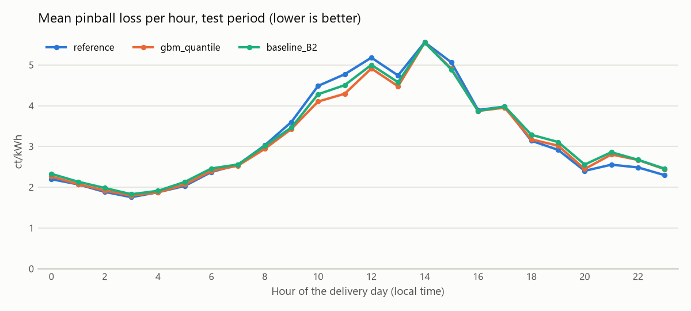
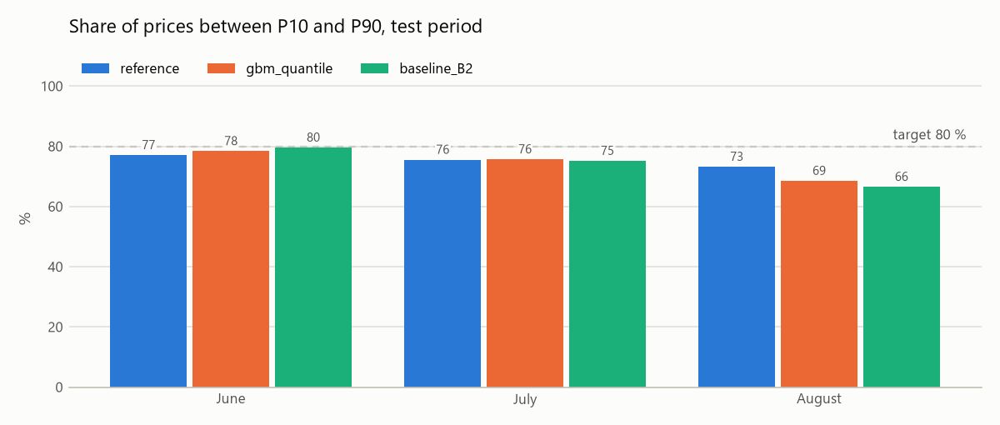

# Gradient Boosting mit Quantil-Loss

**Status:** implementiert, auf April/Mai abgestimmt und auf Juni bis August ausgewertet
(Issue #17). Die tägliche Swissgrid-Verfügbarkeit bis D−2 wurde am 22.10.2026 durch den
Nutzer im Projekt bestätigt. Der Holdout wurde nicht geöffnet; Teamreview steht aus.

## Hypothese

Der Einfluss der Sonnenstrahlung auf den Preis hängt von Uhrzeit und Position innerhalb
der Stunde ab. Gradient Boosting bildet diese nichtlinearen Zusammenhänge flexibler ab
als die lineare Baseline B2 und schlägt die Referenz im Pinball-Loss. Die Hypothese wurde
auf Juni bis August geprüft; der Referenzwert von 3.20 stammt aus diesem Testzeitraum.

## Modell und Features

`GradientBoostingQuantileModel` in `models/shared/boosting.py` nutzt je einen
`HistGradientBoostingRegressor(loss="quantile")` für P10, P50 und P90. Das bestehende
`PerQuantileModel` übernimmt fehlende Werte, die Feature-Auswahl und sortierte Quantile.
Die Bäume brauchen keine Standardisierung. Early Stopping ist deaktiviert, damit keine
zufällige interne Validierung stattfindet; der Seed ist 0.

Es werden exakt dieselben **B2-Features** wie bei der linearen Baseline verwendet:
Uhrzeit, Position innerhalb der Stunde, Wochenende, PV-gewichteter Feiertagsanteil,
Strahlungsprognose und Strahlungsänderung × Position. Zusätzliche Wettervariablen oder
Regelzonenbilanz-Merkmale sind nicht enthalten. Die tatsächliche Richtung short/long
wird ausschliesslich nach der Prognose für die Auswertung verknüpft.

## Tuning April und Mai

Zeitlicher Backtest über 61 Tage bzw. 5'856 Viertelstunden, neun wöchentliche Fits.
Trainiert wird jeweils nur mit Preisen bis D−2. Diese Verfügbarkeitsgrenze wurde am
22.10.2026 im Projekt bestätigt. Alle Modelle werden auf denselben Viertelstunden bewertet.

Das kleine Grid vergleicht vier Konfigurationen mit jeweils zwei Trainingsfenstern:

| Konfiguration | Lernrate | maximale Blätter | Mindestwerte pro Blatt |
|---|---|---|---|
| Ausgangspunkt | 0.05 | 7 | 50 |
| Höhere Lernrate | 0.10 | 7 | 50 |
| Grössere Bäume | 0.05 | 15 | 50 |
| Mehr Werte pro Blatt | 0.05 | 7 | 100 |

Für alle Varianten gelten 150 Boosting-Iterationen und L2-Regularisierung 1.0.
Trainingsfenster: alle Daten seit Januar (`expanding`) oder die letzten 56 Tage.

**Gewählt:** `expanding`, Lernrate 0.05, 7 Blätter, mindestens 50 Werte pro Blatt.
Das Setting hat den tiefsten Tuning-Pinball-Loss und wurde vor dem Test als `CHOSEN`
festgelegt. Es wird nicht anhand von Testergebnissen nachjustiert.

| Modell | Pinball Loss | MAE P50 | Coverage | Intervallbreite |
|---|---|---|---|---|
| Referenz | 3.4485 | 9.9821 | 77.60 % | 26.0844 |
| Baseline B2 | 3.3112 | 9.7192 | 78.26 % | 25.8234 |
| Quantile Boosting | **3.3087** | 9.7887 | 76.35 % | 25.6868 |

Preise, Fehler und Breiten in ct/kWh. Diese Zahlen beziehen sich **nur auf April/Mai**
und dürfen nicht direkt mit dem Test-Referenzwert 3.20 verglichen werden.

### Bedeutung der Datenquellen

Die wiederverwendbare Funktion in `models/shared/importance.py` permutiert die rohen
Merkmale einer Quelle gemeinsam; abgeleitete Interaktionen werden danach neu berechnet.
`evaluation/diagnostics.py` trainiert dafür jedes Wochenmodell auf der Vergangenheit und
bewertet ausschliesslich die folgende Validierungswoche. Fünf Permutationen je Quelle
und Woche ergeben 45 Messungen pro Quelle. Es wird nicht auf Validierungszielen trainiert.

| Quelle | Anstieg Pinball-Loss | Streuung über Wochen und Wiederholungen |
|---|---|---|
| Strahlung | 0.4318 | 0.1616 |
| Kalender | 0.2926 | 0.1016 |
| Feiertage | 0.0263 | 0.0589 |

Die Mittelwerte sind nach der Anzahl gültiger Viertelstunden gewichtet. Die Streuung ist
eine deskriptive Standardabweichung, kein Konfidenzintervall. Die zeilenweise Permutation
verändert zeitliche Abhängigkeiten und Kombinationen zwischen Quellen. Sie zeigt die
Abhängigkeit dieses Modells von seinen Eingaben, keine Kausalität und keine additiven
Beiträge zum Preis. Die Importance wird auf dem auch zur Modellauswahl verwendeten
Tuning-Zeitraum berechnet und ist entsprechend explorativ.

### Interpretation

- Gegenüber der historischen Referenz sinkt der Pinball-Loss im Tuning um **4.05 %**.
  Gegenüber der linearen Baseline beträgt der Unterschied aber nur **0.08 %**:
  bisher kein überzeugender zusätzlicher Nutzen der komplexeren Modellform.
- Bei short ist der Loss mit 2.1935 niedriger als bei der Baseline (2.3131), bei long
  mit 4.6908 höher (Baseline 4.5482). Die flexiblere Modellform hilft nicht beiden
  Preissituationen gleichermassen.
- Strahlung und Kalender sind die wichtigsten genutzten Quellen. Der Feiertagseffekt
  ist schwach und instabil. Unter der Definition «PV-Feiertagsanteil > 0» fallen nur
  sechs Tuning-Tage in diese Gruppe; ihre Coverage beträgt lediglich 63.72 %.
- Die gesamte Coverage bleibt mit 76.35 % unter 80 %. Boosting löst das Problem zu
  schmaler Bänder nicht automatisch; eine separate Kalibrierung bleibt sinnvoll.
- Das gewählte Setting nutzt kleine Bäume und die vollständige Historie. Mehr Blätter
  und das kurze Trainingsfenster bringen im untersuchten Grid keine Verbesserung.

## Ergebnis (Test Juni bis August)

Der finale Lauf vom 22.10.2026 verwendet das unveränderte `CHOSEN` aus dem Tuning,
14 wöchentliche Fits und den Code-Commit `161b317`. Ausgewertet werden 91 Tage bzw.
8'736 Viertelstunden: Der 24.06. fehlt wegen unvollständiger Wetterdaten für alle drei
Modelle. Die gespeicherten B2-Features und Zielwerte der Baseline wurden vor dem Lauf
gegen die aktuellen Daten geprüft und stimmen überein. Die Run-Metadaten vermerken
einen sauberen Git-Stand und die D−2-Bestätigung samt Datum und Quelle.

| Modell | MAE P50 | Pinball Loss | Coverage | Intervallbreite |
|---|---|---|---|---|
| Referenz | 9.9171 | 3.2018 | 75.21 % | 26.3184 |
| Baseline B2 | 9.8063 | 3.2254 | 73.60 % | 25.5145 |
| Gradient Boosting | **9.7923** | **3.1633** | 74.08 % | 24.8447 |

Preise, Fehler und Breiten in ct/kWh. Boosting verbessert den Pinball-Loss gegenüber
der Referenz um **1.20 %** und gegenüber B2 um **1.93 %**. An 58.24 % der Testtage
liegt sein Loss unter der Referenz. Diese Verbesserungen sind klein; ein statistisch
abgesicherter Vorteil wurde nicht nachgewiesen.

- **Die Testhypothese ist im Mittel erfüllt.** Der Vorteil zeigt sich gegenüber beiden
  Vergleichsmodellen. Die MAE-Verbesserung gegenüber B2 ist mit 0.0140 ct/kWh sehr gering.
- **Die Wirkung hängt von der Richtung ab:** Bei short sinkt der Loss gegenüber B2
  von 3.3041 auf 3.0836, bei long steigt er von 3.1360 auf 3.2539. Das Modell löst
  die Unsicherheit über die tatsächliche Netzrichtung weiterhin nicht auf.
- **Die Intervalle bleiben zu schmal:** 74.08 % Coverage statt 80 %, im August sogar
  nur 68.51 %. Das engere Band ist deshalb nicht allein als Verbesserung zu werten.
  Der August-Loss ist mit 3.3153 zudem praktisch gleich wie bei der Referenz (3.3136).
- **Feiertage bleiben schwierig:** Nur fünf Testtage fallen unter die Definition
  «PV-Feiertagsanteil > 0». Dort beträgt die Coverage 61.67 %; eine belastbare
  Aussage über einzelne Feiertagseffekte lässt sich daraus nicht ableiten.
- **Die grafische Auswertung zeigt Tageszeitunterschiede:** vormittags bis mittags
  bringt Boosting Vorteile; abends ist die historische Referenz häufig besser.





**Entscheid:** Quantile Boosting bleibt als Kandidat für den gemeinsamen Holdout
erhalten. Es schlägt die Referenz im vorab definierten Test leicht, erreicht aber noch
keine verlässliche 80-%-Abdeckung. Eine Kalibrierung ist separat zu untersuchen;
`CHOSEN` wird anhand dieser Testauswertung nicht geändert. Das Restrisiko nachträglich
revidierter Swissgrid-Preise bleibt bestehen, siehe [Datengrundlage](../../../../docs/data.md).

## Starten

```bash
make backtest MODEL=gbm_quantile STEP=tune TRACK=1 JOBS=2
# D−2-Verfügbarkeit am 22.10.2026 bestätigt; finaler Test bereits durchgeführt:
make backtest MODEL=gbm_quantile STEP=test TRACK=1 JOBS=2
```

Alternativ unter PowerShell, direkt mit dem bestehenden Environment:

```powershell
.venv/Scripts/python.exe -m energy_price.evaluation.experiment gbm_quantile tune --jobs 2 --track
```

Ergebnisse und Auswahlprotokoll stehen in `reports/gbm_quantile/` (nicht versioniert).
Der finale Test erzeugt zusätzlich Grafiken in `docs/figures/gbm_quantile/`.
W&B enthält unter Gruppe `issue-17` zehn Tuning-Läufe und drei finale Testläufe
(Referenz, Boosting, Baseline B2), jeweils mit Summary-Metriken und täglichen
Pinball-Kurven. Die gewählte Tuning-Variante enthält auch die Importance-Grafik.
Der finale Boosting-Lauf enthält Auswertungstabellen und ein Artefakt mit aggregierten
Ergebnissen und dem tatsächlich verwendeten Quellcode. Die lokalen Run-Links stehen
ausschliesslich in `reports/gbm_quantile/tune_wandb_urls.json` und `test_wandb_urls.json`.

Die Leakage-, Reproduzierbarkeits-, Importance- und Integrationstests stehen in
`tests/test_gbm_quantile.py`, `tests/test_model_importance.py` und
`tests/test_evaluation_experiment.py`.
