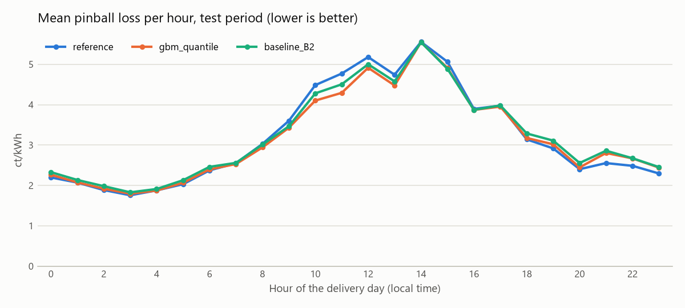
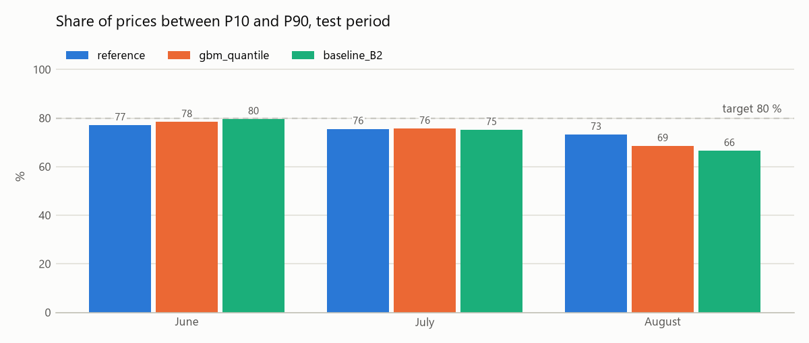

# Gradient Boosting mit Quantil-Loss

**Status:** Auswahl in der neuen Pipeline offen (#51) · **Verantwortlich:** Elias Pulver · **Issue:** #17 · **Ablauf:** [`docs/training_pipeline.md`](../../../../docs/training_pipeline.md)

## 1. Hypothese

Der Einfluss der Sonnenstrahlung auf den Preis hängt von Uhrzeit und Position innerhalb der Stunde ab. Gradient Boosting bildet diese nichtlinearen Zusammenhänge flexibler ab als die lineare Baseline B2 und schlägt die Referenz im Pinball-Loss.

## 2. Herleitung

- **Ausgangspunkt aus der EDA:**
    - Die Sonne wirkt je nach Uhrzeit und Jahreszeit anders, das Mittagsloch des Preises gibt es erst ab April (H3, H7)
    - Die Richtung des Kippens innerhalb der Stunde hängt von der Uhrzeit ab (H8)
- **Erwarteter Vorteil:** Ein lineares Modell bildet solche Wechselwirkungen nur ab, wenn man sie von Hand vorgibt. Ein Baummodell findet sie selbst
- **Gleiche Features wie die Baseline:** Damit zeigt der Vergleich nur den Effekt der Modellform, nicht neuer Daten
- **Erklärbarkeit:** Die gruppierte Permutation Importance zeigt, wie stark das Modell auf Kalender, Feiertage und Strahlung angewiesen ist. Das wurde im Review verlangt

## 3. Vorgehen

- **Modell:** `GradientBoostingQuantileModel` in `models/shared/boosting.py`, je ein `HistGradientBoostingRegressor(loss="quantile")` für P10, P50 und P90
    - `PerQuantileModel` übernimmt fehlende Werte, die Feature-Auswahl und sortierte Quantile
    - keine Standardisierung nötig, Early Stopping deaktiviert, damit keine zufällige interne Validierung stattfindet, Seed 0
- **Features:** exakt die **B2-Features** der Baseline: Uhrzeit, Position innerhalb der Stunde, Wochenende, PV-gewichteter Feiertagsanteil, Strahlungsprognose und Strahlungsänderung × Position. Keine Merkmale der Regelzonenbilanz
- **Auswahl:** vier Konfigurationen, alle mit 150 Iterationen und L2-Regularisierung 1.0

| Konfiguration | Lernrate | maximale Blätter | Mindestwerte pro Blatt |
|---|---|---|---|
| Ausgangspunkt | 0.05 | 7 | 50 |
| Höhere Lernrate | 0.10 | 7 | 50 |
| Grössere Bäume | 0.05 | 15 | 50 |
| Mehr Werte pro Blatt | 0.05 | 7 | 100 |

- **Kandidaten:** 4 Konfigurationen × 3 Fenster (`expanding`, `rolling_56d`, `rolling_90d`) + 4 `window_mean` = **16 Kandidaten**, jeder mit 153 täglichen Ursprüngen. Gewählt wird der kleinste mittlere tägliche Pinball-Loss über alle Validierungstage
- **Neutraining:** täglich (`REFIT_EVERY` nicht gesetzt). Dauert `select` länger als 8 h, entscheidet Luca über `REFIT_EVERY`
- **Importance:** `IMPORTANCE_GROUPS` (Kalender, Feiertage, Strahlung, je 5 Permutationen) für den gewählten Kandidaten, nur in den Folds nach dem jeweiligen Training. Für ein `window_mean` entfällt sie, weil es kein einzelnes Modell gibt
- **Gewählt:** bis #51 provisorisch `expanding`, Lernrate 0.05, 7 Blätter, mindestens 50 Werte pro Blatt (aus der alten Pipeline)

## 4. Ergebnisse (neue Pipeline)

Folgt nach den Auswahlläufen in #51.

## 5. Belege

- **Code:** `src/energy_price/models/gbm_quantile/model.py`, `src/energy_price/models/shared/boosting.py`, `src/energy_price/models/shared/importance.py`
- **Tests:** `tests/test_gbm_quantile.py`, `tests/test_model_importance.py`, `tests/test_evaluation_experiment.py`
- **Ergebnisse:** `reports/gbm_quantile/select_*` (nicht versioniert): `scores.csv` je Kandidat und Monatsblock mit Rang, `selection.json` mit `dropped_days`, `runtime.csv`, `forecasts.parquet`, `breakdowns.csv`, `feature_importance.csv`. Grafiken in `docs/figures/gbm_quantile/select_*.png`. W&B-Gruppe `issue-17`

```bash
python -m energy_price.evaluation.experiment gbm_quantile select --days 2026-04-01 2026-04-03   # Probelauf
make select MODEL=gbm_quantile TRACK=1 JOBS=2   # 16 Kandidaten auf allen Validierungstagen
# CHOSEN in model.py festhalten und committen, dann:
make compare
```

## Historie (alte Pipeline)

> Gewählt auf April und Mai, verglichen auf Juni bis August, wöchentlich neu trainiert, Fenster `expanding` oder 56 Tage. Juni bis August waren nicht mehr blind (#21). Ersetzt durch #36. Stand der Zahlen 22.10.2026, Issue und PR: #17, PR #18.

**Tuning April und Mai** (61 Tage, neun wöchentliche Fits, nicht direkt mit dem Test vergleichbar). Gewählt: `expanding`, Lernrate 0.05, 7 Blätter, mindestens 50 Werte pro Blatt. Mehr Blätter und das kurze Trainingsfenster brachten keine Verbesserung.

| Modell | Pinball-Loss | MAE P50 | Coverage | Intervallbreite |
|---|---|---|---|---|
| Referenz | 3.4485 | 9.9821 | 77.60 % | 26.0844 |
| Baseline B2 | 3.3112 | 9.7192 | 78.26 % | 25.8234 |
| Quantile Boosting | **3.3087** | 9.7887 | 76.35 % | 25.6868 |

**Test Juni bis August**, 91 Tage bzw. 8'736 Viertelstunden (ohne 24.06.), Lauf vom 22.10.2026 mit unverändertem `CHOSEN`, 14 wöchentlichen Fits und Commit `161b317`. Der Holdout wurde nicht geöffnet.

| Modell | Pinball-Loss | MAE P50 | Coverage | Intervallbreite |
|---|---|---|---|---|
| Referenz | 3.2018 | 9.9171 | 75.21 % | 26.3184 |
| Baseline B2 | 3.2254 | 9.8063 | 73.60 % | 25.5145 |
| Gradient Boosting | **3.1633** | **9.7923** | 74.08 % | 24.8447 |

**Kleiner Vorteil, vor allem gegenüber der Referenz**
- Im Tuning 4.05 % weniger Loss als die Referenz, aber nur 0.08 % weniger als die lineare Baseline
- Im Test 1.20 % weniger als die Referenz und 1.93 % weniger als B2, an 58.24 % der Testtage besser als die Referenz
- Die MAE-Verbesserung gegenüber B2 ist mit 0.0140 ct/kWh sehr gering. Ein statistisch abgesicherter Vorteil wurde nicht nachgewiesen

**Die Wirkung hängt von der Richtung ab**
- Bei short sinkt der Test-Loss gegenüber B2 von 3.3041 auf 3.0836, bei long steigt er von 3.1360 auf 3.2539
- Im Tuning dasselbe Bild, bei short 2.1935 gegenüber 2.3131 der Baseline, bei long 4.6908 gegenüber 4.5482
- Das Modell löst die Unsicherheit über die Richtung im Netz nicht auf

**Strahlung und Kalender tragen das Modell** (Permutation Importance, Tuning, explorativ)

| Quelle | Anstieg Pinball-Loss | Streuung über Wochen und Wiederholungen |
|---|---|---|
| Strahlung | 0.4318 | 0.1616 |
| Kalender | 0.2926 | 0.1016 |
| Feiertage | 0.0263 | 0.0589 |

- Fünf Permutationen je Quelle und Woche, 45 Messungen pro Quelle. Die Werte zeigen die Abhängigkeit dieses Modells von seinen Eingaben, keine Kausalität

**Die Bänder bleiben zu schmal**
- Coverage im Test 74.08 % statt 80 %, im August nur 68.51 %. Der August-Loss ist mit 3.3153 praktisch gleich wie bei der Referenz (3.3136)
- Boosting löst das Problem zu schmaler Bänder nicht, eine Kalibrierung bleibt nötig (#19)

**Feiertage und Abende bleiben schwierig**
- Nur fünf Testtage fallen unter „PV-Feiertagsanteil > 0“, dort beträgt die Coverage 61.67 %. Im Tuning waren es sechs Tage mit 63.72 %
- Vormittags bis mittags bringt Boosting Vorteile, abends ist die Referenz häufig besser

**Entscheid:** Weiterverfolgen als Kandidat für den gemeinsamen Holdout, weil es die Referenz im vorab definierten Test leicht schlägt. Eine verlässliche Abdeckung von 80 % erreicht es noch nicht, die Kalibrierung wird separat untersucht. W&B-Gruppe `issue-17` mit zehn Tuning-Läufen und drei finalen Testläufen.




