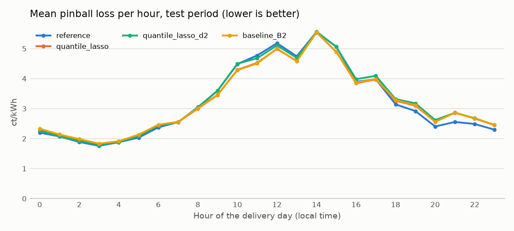
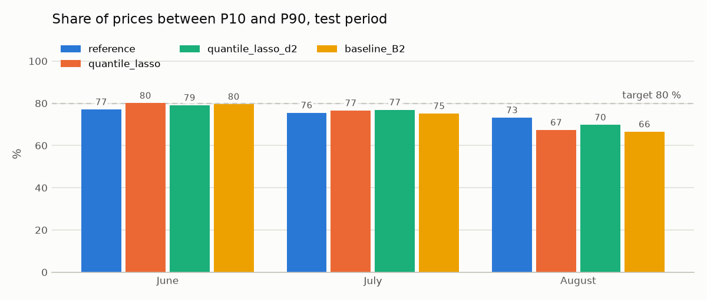

# Quantil-LASSO mit Daten bis D−2

**Status:** Test abgeschlossen, nicht in den Pool übernommen (Issue #27). Der Holdout ist nicht Teil dieses Issues und wurde nicht geöffnet.

## Hypothese

Ein Quantil-LASSO mit Preisniveau und Systembilanz bis D−2 hat einen tieferen Pinball Loss als dasselbe Modell nur mit den `B2`-Merkmalen und schlägt die Referenz. Das Tagesniveau des Preises hält sich über zwei Tage (Autokorrelation des Tagesniveaus nach 2 Tagen 0.36, gemessen auf Januar bis Mai), was den bisherigen Modellen mit Kalender und Wetter entgeht. Die L1-Strafe soll dabei nur die Merkmale behalten, die tragen, und bei rund 150 Trainingstagen eine Überanpassung verhindern.

Die Frage dahinter: Helfen Preise und Systembilanz bis D−2 der Prognose überhaupt? Ein negatives Ergebnis ist gültig und spricht auch gegen ein Sequenzmodell wie ein LSTM. Erwartet wurde wenig: Das Tagesniveau erklärt grob geschätzt knapp 2 % der Varianz.

## Modell und Features

`LinearQuantileModel` aus `models/shared/linear.py`, dasselbe Modell wie die Baseline: eine lineare Quantilregression pro Quantil P10, P50 und P90 mit L1-Strafe `alpha` (scikit-learn `QuantileRegressor`, Solver HiGHS, ohne Zufall). Die Merkmale werden vor dem Fit standardisiert, damit die Strafe alle gleich stark trifft. Ein Modell gilt für alle Viertelstunden zusammen: Klassisches LEAR schätzt pro Zeitschritt ein eigenes Modell, bei rund 150 Trainingstagen hätte hier jede Viertelstunde nur rund 150 Zeilen. Der Tagesverlauf kommt wie bei `B2` über Stunden-Dummies und den Verlauf innerhalb der Stunde in das Modell.

| Set | Inhalt |
|---|---|
| `B2` | Stunde, Verlauf innerhalb der Stunde, Wochenende, PV-gewichteter Feiertagsanteil, Strahlung und Strahlungsänderung × Position |
| `B3` | `B2` plus Preisniveau: Tagesmittel an D−2, Mittel der letzten 7 Tage bis D−2, P10, P50 und P90 derselben Viertelstunde über 56 Tage bis D−2 |
| `B4` | `B3` plus Systembilanz und Bewölkung: mittlere TSI und Anteil short an D−2, Richtung zur gleichen Uhrzeit an D−2 und D−7, Bewölkung aus dem Lauf D−2 18 UTC |

Alle Merkmale von `B3` und `B4` sind um D−1 11:00 bekannt (`known_at_issue()`, [Regel gegen Datenlecks](../../../../docs/data.md#1-die-regel-gegen-datenlecks)). Die Quantile über 56 Tage brauchen mindestens 28 Tage Historie, deshalb beginnt das Training von `B3` und `B4` am 30.01. statt am 01.01. ([Mindesthistorie](../../../../docs/data.md#mindesthistorie-der-preis--und-bilanzmerkmale)). Beim ersten Fit im Tuning sind das 60 statt 89 Tage.

**Bekannte Grenze:** Vergangene Preise sind in unseren Dateien final, um D−1 11:00 wären sie provisorisch gewesen. Das macht `B3` und `B4` eher zu optimistisch, nicht zu pessimistisch.

## Tuning April und Mai

61 Tage, 5'856 Viertelstunden, neun wöchentliche Fits, Training mit allen Daten bis D−2 (`expanding`). Raster: `feature_set` `B2`, `B3`, `B4` × `alpha` 0.001, 0.003, 0.01, 0.03. Das Raster ist feiner als bei der Baseline (0, 0.01, 0.1), die 0 gewählt hat. Alle Modelle werden auf denselben Viertelstunden bewertet; `gbm_quantile` wird mit seinem unveränderten `CHOSEN` neu gerechnet.

| Modell | Pinball Loss | MAE P50 | Coverage | Intervallbreite |
|---|---|---|---|---|
| `gbm_quantile` | **3.3087** | 9.7887 | 76.35 % | 25.69 |
| Baseline B2 (`alpha` 0) | 3.3112 | **9.7192** | 78.26 % | 25.82 |
| **`B2`, `alpha` 0.001** | 3.3228 | 9.7481 | 78.38 % | 25.62 |
| `B2`, `alpha` 0.003 | 3.3402 | 9.7925 | 78.77 % | 25.23 |
| `B2`, `alpha` 0.01 | 3.3912 | 9.9077 | 77.34 % | 23.78 |
| **`B4`, `alpha` 0.03** | 3.4262 | 9.8947 | 75.50 % | 23.53 |
| `B3`, `alpha` 0.03 | 3.4271 | 9.8946 | 75.41 % | 23.50 |
| Referenz | 3.4485 | 9.9821 | 77.60 % | 26.08 |
| `B4`, `alpha` 0.01 | 3.4519 | 10.0097 | 75.32 % | 25.75 |
| `B3`, `alpha` 0.01 | 3.4681 | 10.0306 | 75.07 % | 25.65 |
| `B2`, `alpha` 0.03 | 3.5336 | 10.2010 | 76.61 % | 22.56 |
| `B3`, `alpha` 0.003 | 3.6047 | 10.0871 | 73.51 % | 26.43 |
| `B4`, `alpha` 0.003 | 3.6105 | 10.1502 | 73.29 % | 26.52 |
| `B3`, `alpha` 0.001 | 3.6343 | 10.1687 | 73.77 % | 27.17 |
| `B4`, `alpha` 0.001 | 3.6465 | 10.2129 | 73.07 % | 27.12 |

Preise, Fehler und Breiten in ct/kWh. Diese Zahlen gelten nur für April und Mai und sind nicht mit den Testwerten vergleichbar.

**`CHOSEN`** wurde am 09.11.2026 vor dem Test festgelegt und wird danach nicht geändert:

| Variante | Setting | Grund |
|---|---|---|
| `quantile_lasso` | `B2`, `alpha` 0.001 | tiefster Pinball Loss im Raster |
| `quantile_lasso_d2` | `B4`, `alpha` 0.03 | tiefster Pinball Loss mit Daten bis D−2 |

Laut Issue sollte `CHOSEN` das beste Setting insgesamt und das beste mit `B2` enthalten. Beides ist hier dasselbe Setting. Damit der Test die Frage nach den Daten bis D−2 trotzdem beantwortet, ist der zweite Eintrag das beste Setting mit solchen Daten. `B4` liegt nur 0.0009 vor `B3` und prüft Preise und Systembilanz zusammen, wie es die Hypothese verlangt.

### Vergleich mit Unsicherheit

Tägliche Differenz des Pinball Loss, Mittel über 61 Tage, 95-%-Intervall aus einem Block-Bootstrap mit 7-Tage-Blöcken und 5000 Wiederholungen (`evaluation/scores.py`, wie in #21). Unter 0 ist das erste Modell besser.

| Modell | gegen | Differenz | 95-%-Intervall |
|---|---|---|---|
| `B2`, `alpha` 0.001 | Referenz | −0.126 | −0.198 bis −0.041 |
| `B2`, `alpha` 0.001 | Baseline B2 | +0.012 | −0.006 bis +0.035 |
| `B2`, `alpha` 0.001 | `gbm_quantile` | +0.014 | −0.028 bis +0.060 |
| `B4`, `alpha` 0.03 | Referenz | −0.022 | −0.062 bis +0.041 |
| `B4`, `alpha` 0.03 | `B2`, `alpha` 0.001 | +0.103 | +0.041 bis +0.164 |
| `B4`, `alpha` 0.03 | `B2`, `alpha` 0.001, ohne Karfreitag und Ostermontag | +0.074 | +0.026 bis +0.120 |
| `B3`, `alpha` 0.03 | `B2`, `alpha` 0.001 | +0.104 | +0.042 bis +0.166 |

### Welche Merkmale das Modell nutzt

Anteil der neun wöchentlichen Fits, in denen ein Merkmal einen Koeffizienten ungleich 0 behält (`reports/quantile_lasso/tune_surviving_features.csv`). Das beschreibt, was das Modell verwendet, nicht was den Preis verursacht. Korrelierte Merkmale können sich gegenseitig ersetzen.

| Merkmal in `B4`, `alpha` 0.03 | P10 | P50 | P90 |
|---|---|---|---|
| P50 derselben Viertelstunde über 56 Tage | 0 | 1.00 | 0 |
| P10 derselben Viertelstunde über 56 Tage | 1.00 | 0.44 | 0 |
| P90 derselben Viertelstunde über 56 Tage | 0 | 0 | 0 |
| Tagesmittel an D−2 | 0.78 | 0.89 | 0 |
| Mittel der letzten 7 Tage | 0 | 0.22 | 0.67 |
| mittlere TSI an D−2 | 0 | 0 | 0.33 |
| Anteil short an D−2, Richtung an D−2 und D−7 | 0 | 0 | 0 |
| Bewölkung | 0 | 0 | 0 |
| Strahlung | 1.00 | 0.44 | 0 |
| Strahlungsänderung × Position | 0.89 | 1.00 | 0 |
| Wochenende | 1.00 | 0 | 0 |
| Feiertagsanteil | 0.78 | 0 | 0 |
| 23 Stunden-Dummies, 24 Verlaufs-Merkmale | 0 | 0 | 0 |

`B3` mit `alpha` 0.03 nutzt dieselben Merkmale; einziger Unterschied ist das Tagesmittel an D−2, das bei P90 in einem von neun Fits bleibt. `B2` mit `alpha` 0.001 behält dagegen fast alle Merkmale in fast allen Fits, Wochenende, Feiertag und beide Strahlungsmerkmale in allen neun.

## Erkenntnisse aus dem Tuning

- **Auf April und Mai helfen die Daten bis D−2 nicht.** Das Tuning wählt `B2`. `B4` ist um 0.103 schlechter, das Intervall liegt ganz über 0, auch ohne die zwei Ostertage. Gegenüber der Referenz ist bei `B4` kein Vorteil belegt (Intervall schliesst 0 ein), bei `B2` schon.
- **Systembilanz und Bewölkung werden fast nie genutzt.** Bewölkung, Anteil short und Richtung bleiben in keinem Fit. Die mittlere TSI bleibt nur in drei von neun Fits bei P90. `B4` ist dadurch praktisch `B3`.
- **Mit Preismerkmalen ersetzt das LASSO den Tagesverlauf durch die Quantile der Referenz.** Bei `alpha` 0.03 fallen alle Stunden- und Verlaufs-Merkmale weg, P50 stützt sich auf den Median derselben Viertelstunde über 56 Tage. Diese Quantile enthalten den Tagesverlauf bereits (Schlussfolgerung, nicht gemessen). Das Modell ist damit nahe an der Referenz plus einer Korrektur durch Strahlung und Tagesniveau, und genau so liegt es auch: −0.022 gegenüber der Referenz.
- **Mit schwacher Strafe überanpassen `B3` und `B4` vermutlich.** Bei `alpha` 0.001 liegen beide bei 3.63 bis 3.65, schlechter als die Referenz. Sie haben mehr Merkmale bei weniger Trainingstagen. Auch ohne die Ostertage bleibt `B3` mit `alpha` 0.001 um 0.10 hinter `B2` (3.2356 zu 3.1355).
- **Beide gewählten Settings liegen am Rand des Rasters.** `B2` am unteren (`alpha` 0.001, die Baseline mit 0 ist noch etwas besser), `B3` und `B4` am oberen (0.03). Ein stärkeres `alpha` könnte `B3` und `B4` noch verbessern. Das wurde nicht geprüft; das Raster aus dem Issue bleibt unverändert.
- **Gegenüber der Baseline bringt das LASSO mit `B2` nichts Neues:** +0.012, Intervall schliesst 0 ein.

### Ungleicher Trainingsbeginn und Ostern

`B3` und `B4` beginnen am 30.01., `B2` am 01.01. Um das zu trennen, rechnet `diagnostics.py` zusätzlich `B2` ab dem 30.01. Diese Variante wird nur berichtet, nie ausgewählt.

| Pinball Loss April und Mai | alle 61 Tage | ohne 03.04. und 06.04. |
|---|---|---|
| `B2`, `alpha` 0.001, ab 01.01. | 3.3228 | 3.1355 |
| `B2`, `alpha` 0.001, ab 30.01. | 3.6936 | nicht gerechnet |
| `B4`, `alpha` 0.03 | 3.4262 | 3.2098 |

Der spätere Beginn macht `B2` scheinbar stark schlechter. Die Ursache ist fast nur Ostern:

- 99.6 % des Unterschieds stammen aus fünf Tagen, fast alles aus Karfreitag (03.04., +8.95) und Ostermontag (06.04., +12.79). Der Median der täglichen Differenz liegt bei +0.013.
- Ohne Januar fehlen im Training die grossen Feiertage 01.01. und 02.01. Der Koeffizient des Feiertagsanteils im ersten Fit (01.04.) springt bei P10 von −11.9 auf +29.7. Das Modell sagt an Ostern deshalb zu hohe Preise voraus. Bei `B3` und `B4` mit `alpha` 0.001 ist es dasselbe (+27.5 und +24.9), bei `alpha` 0.03 ist der Koeffizient im ersten Fit 0.
- Im letzten Fit (27.05.) ist der Koeffizient auch mit Trainingsbeginn 30.01. wieder negativ.
- Mit dem besten `alpha` für `B2` ab dem 30.01. (0.01, Pinball 3.4613) ist der Unterschied von `B4` klein: −0.035, Intervall −0.180 bis +0.072.

Der ungleiche Beginn erklärt den Rückstand von `B3` und `B4` also nur zu einem kleinen Teil. Im Test ist der Effekt fast verschwunden, weil das Training dann Ostern enthält: `B2` ab dem 30.01. liegt dort nur 0.006 hinter `B2` ab dem 01.01. (3.2229 zu 3.2165). Der Feiertagseffekt wird nicht nachträglich korrigiert: Eine Änderung nach Sichtung der Tuning-Ergebnisse wäre eine Anpassung an genau diese Ergebnisse.

## Ergebnis (Test Juni bis August)

Lauf vom 12.11.2026 mit dem unveränderten `CHOSEN`, 14 wöchentliche Fits, Commit `a3fc48e` mit sauberem Git-Stand, Daten `60431b5b921f`. 91 Tage, 8'736 Viertelstunden, für alle Modelle dieselben (der 24.06. fehlt wegen unvollständiger Wetterdaten). Referenz, Baseline B2 und `gbm_quantile` ergeben dieselben Werte wie in ihren eigenen Läufen.

| Modell | MAE P50 | Pinball Loss | Coverage | Intervallbreite |
|---|---|---|---|---|
| `gbm_quantile` | 9.7923 | **3.1633** | 74.08 % | 24.84 |
| Referenz | 9.9171 | 3.2018 | 75.21 % | 26.32 |
| `quantile_lasso` (`B2`, `alpha` 0.001) | 9.8001 | 3.2165 | 74.53 % | 25.38 |
| Baseline B2 | 9.8063 | 3.2254 | 73.60 % | 25.51 |
| `quantile_lasso_d2` (`B4`, `alpha` 0.03) | 9.9533 | 3.2668 | 75.17 % | 24.54 |

Preise, Fehler und Breiten in ct/kWh. `quantile_lasso` ist an 59.3 % der Tage besser als die Referenz, `quantile_lasso_d2` an 40.7 %.

| Modell | gegen | Differenz | 95-%-Intervall |
|---|---|---|---|
| `quantile_lasso` | Referenz | +0.015 | −0.055 bis +0.092 |
| `quantile_lasso` | Baseline B2 | −0.009 | −0.017 bis −0.003 |
| `quantile_lasso` | `gbm_quantile` | +0.053 | +0.026 bis +0.093 |
| `quantile_lasso_d2` | Referenz | +0.065 | +0.023 bis +0.114 |
| `quantile_lasso_d2` | `quantile_lasso` | +0.050 | +0.005 bis +0.091 |
| `quantile_lasso_d2` | `quantile_lasso`, ab 30.01. trainiert | +0.044 | −0.004 bis +0.086 |
| `quantile_lasso_d2` | `gbm_quantile` | +0.103 | +0.069 bis +0.146 |





Aufgeteilt (`reports/quantile_lasso/test_breakdowns.csv`), Pinball Loss:

| | Referenz | Baseline B2 | `quantile_lasso` | `quantile_lasso_d2` |
|---|---|---|---|---|
| long | 3.270 | 3.136 | 3.170 | 3.308 |
| short | 3.142 | 3.304 | 3.257 | 3.231 |
| Juni | 3.086 | 3.062 | 3.060 | 3.157 |
| Juli | 3.198 | 3.159 | 3.150 | 3.225 |
| August | 3.314 | 3.445 | 3.429 | 3.412 |
| 9 bis 15 Uhr (Mittel der Stunden) | 4.771 | 4.609 | 4.611 | 4.742 |
| übrige Stunden | 2.556 | 2.656 | 2.642 | 2.660 |

**Genutzte Merkmale im Test** (Anteil der 14 Fits, `test_surviving_features.csv`): `quantile_lasso_d2` nutzt wieder keine Stunden-, Verlaufs-, Systembilanz- oder Bewölkungsmerkmale. P50 stützt sich in allen Fits auf den Median derselben Viertelstunde über 56 Tage, P10 auf deren P10. **P90 hat in den ersten 7 Fits kein einziges Merkmal** und ist damit für alle Viertelstunden gleich; ab Mitte Juli nutzt es nur das P90 über 56 Tage. `quantile_lasso` behält 46 bis 50 der 51 Merkmale.

## Einordnung

- **Schlägt das Modell die Referenz? Nein.** `quantile_lasso` liegt 0.015 über der Referenz, das Intervall schliesst 0 ein; `quantile_lasso_d2` ist klar schlechter (Intervall ganz über 0). Wie bei der Baseline und dem Regime-Modell war das Tuning zu optimistisch: Dort lag `B2` 0.126 unter der Referenz.
- **Helfen Daten bis D−2? Nein, nicht in diesem Modell.** `quantile_lasso_d2` ist um 0.050 schlechter als `quantile_lasso`, das Intervall liegt ganz über 0. Mit gleichem Trainingsbeginn ist der Rückstand ähnlich gross (+0.044), das Intervall schliesst 0 knapp ein. Ein Vorteil der neuen Merkmale zeigt sich in keinem der beiden Vergleiche.
- **Wo `B4` hilft, hilft es wenig.** Bei short (3.231 zu 3.257), im August und an Feiertagen ist `quantile_lasso_d2` besser als `quantile_lasso`, bei long und im Juni deutlich schlechter. Das passt dazu, dass es die Referenz nachbildet: Die Referenz ist bei short und im August ebenfalls besser.
- **Die Strafe ist für `B4` zu grob.** `alpha` 0.03 ist auf dem Rand des Rasters gewählt und gilt für alle drei Quantile gleich. Bei P90 bleibt zeitweise nur der Achsenabschnitt übrig. Ein `alpha` pro Quantil oder ein feineres Raster wäre ein anderes Experiment; ob es die Merkmale bis D−2 retten würde, ist offen.
- **Kleine Strafe statt keiner bringt etwas, aber wenig.** `quantile_lasso` ist 0.009 besser als die Baseline B2, das Intervall liegt ganz unter 0. Das sind 0.3 %, und der Abstand zur Referenz bleibt.
- **Coverage weiter unter 80 %:** 74.5 % und 75.2 %, im August 67 % und 70 %.

**Grenze der Aussage:** Getestet ist ein lineares Modell mit einer gemeinsamen Strafe. Ein nichtlineares Modell könnte die Daten bis D−2 anders nutzen, etwa im Zusammenspiel mit der Uhrzeit. Vergangene Preise sind in unseren Daten final, um 11:00 wären sie provisorisch gewesen; das hätte die Merkmale vermutlich eher noch schlechter gemacht (Schlussfolgerung, Korrekturen nicht gemessen). Der Test ist nicht blind, Juni bis August wurden schon für andere Modelle ausgewertet.

**Entscheid:** nicht in den Pool von #25 aufgenommen, weil kein Setting die Referenz schlägt. Die Merkmale bis D−2 werden nicht als Kandidat für andere Modelle empfohlen. Das ist ein schwacher Hinweis gegen ein Sequenzmodell wie ein LSTM: Die Information der letzten Tage, die ein solches Modell nutzen würde, bringt hier im linearen Fall nichts. `CHOSEN` wird anhand dieses Tests nicht geändert.

## Starten

```bash
make backtest MODEL=quantile_lasso STEP=tune TRACK=1    # 12 Settings auf April und Mai
python -m energy_price.models.quantile_lasso.diagnostics --period tune
make backtest MODEL=quantile_lasso STEP=test TRACK=1    # CHOSEN auf Juni bis August, mit Grafiken
python -m energy_price.models.quantile_lasso.diagnostics --period test
```

Tuning und Test dauerten auf einem Laptop je knapp 5 Minuten. Der Test vergleicht nur dann mit der Baseline B2, wenn `reports/baseline_model/test_forecasts.parquet` existiert. Für diesen Lauf wurde die Datei mit `evaluate_period("baseline_model", ...)` erzeugt, ohne Grafiken und ohne W&B, damit die Grafiken der Baseline unverändert bleiben. `diagnostics.py` setzt die Prognosen des Backtests voraus, auch die der Baseline B2, und bricht sonst ab. Auf `tune` passt es die beste Variante pro Feature-Set neu an und prüft, dass die Prognosen mit dem Backtest übereinstimmen. Ergebnisse stehen in `reports/quantile_lasso/` (nicht versioniert). W&B enthält in der Gruppe `issue-27` die 12 Tuning-Varianten und die Baseline B2 sowie vier Testläufe (Referenz, `quantile_lasso`, `quantile_lasso_d2`, Baseline B2). Tests: `tests/test_quantile_lasso.py`, darunter ein Test, dass eine Änderung von Preisen und Systembilanz ab D−1 00:00 die Prognose für D nicht verändert.
