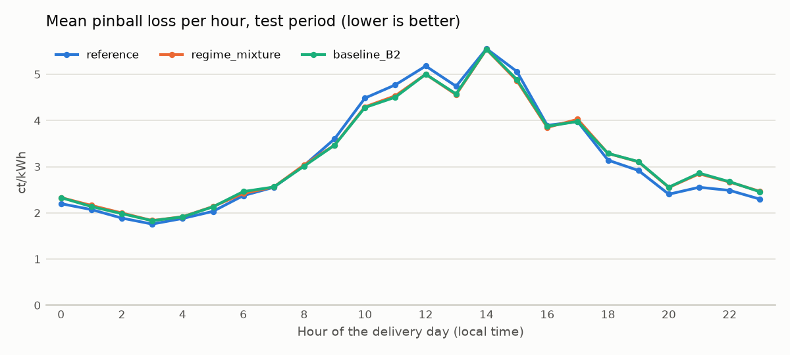
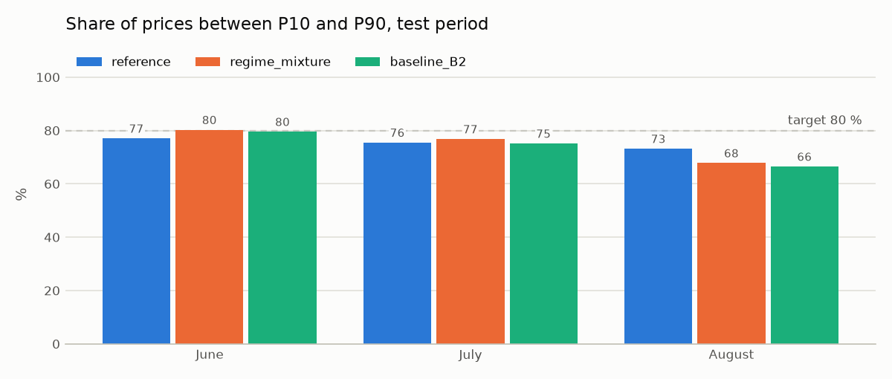
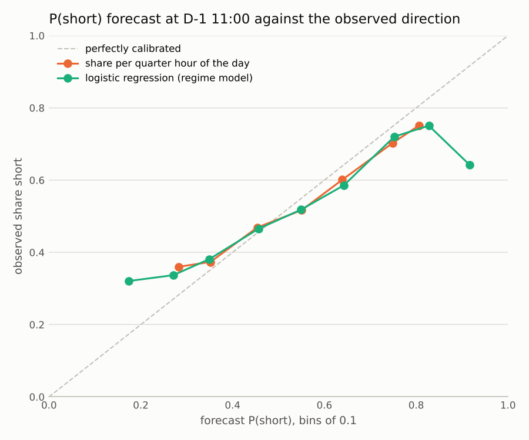

# Regime-Modell short/long

**Status:** Auswahl in der neuen Pipeline offen (#51) · **Verantwortlich:** Rodrigo Urech · **Issue:** #16 · **Ablauf:** [`docs/training_pipeline.md`](../../../../docs/training_pipeline.md)

## 1. Hypothese

Ein Modell, das zuerst schätzt, ob die Regelzone short oder long ist, und den Preis danach für beide Richtungen getrennt vorhersagt, schlägt die Referenz im Pinball-Loss.

## 2. Herleitung

- **Ausgangspunkt aus der EDA:**
    - Der Preis besteht aus zwei Wolken, bei short meist um 19 ct/kWh (Preis A), bei long um 6 ct/kWh mit negativen Ausreissern (Preis B)
    - Die Baseline landet mit ihrem Median dazwischen, wo kaum echte Preise liegen
    - Die Richtung hängt von Stunde und Position in der Stunde ab (H8), sie sollte sich also teilweise schätzen lassen
- **Aus dem Review:** Der Sprung des Preises bei unterdeckter Regelzone wurde als zentraler Punkt genannt
- **Zusatznutzen:** Die geschätzte Wahrscheinlichkeit für short zeigt, ob eine Bilanzgruppe bei einer Abweichung zahlt oder vergütet wird
- **Verworfene Alternative:** ein einzelnes Modell ohne Trennung, wie die Baseline. Es mittelt die beiden Situationen

## 3. Vorgehen

- **Modell in drei Schritten:**
    1. **Richtung:** logistische Regression für P(short) pro Viertelstunde. Das Label `short` (TSI < 0) ist wie der Preis nur Trainingsziel bis D−2, nie Feature
    2. **Preis je Richtung:** lineare Quantilregression wie in der Baseline, getrennt auf den short- und den long-Viertelstunden, für 13 Quantile von 2 % bis 98 %
    3. **Mischung:** $F(x) = p \, F_{\text{short}}(x) + (1-p) \, F_{\text{long}}(x)$. P10, P50 und P90 sind die Werte, bei denen $F$ 0.1, 0.5 und 0.9 erreicht
- **Features:** B1 (Kalender) oder B2 (Kalender plus Sonne) für beide Teile, wie die Baseline. Zusätzlich liefert das Modell `p_short`
- **Auswahl:** `GRID` = B1 und B2 (logistisch C = 1, ohne L1-Strafe), je mit `expanding`, `rolling_56d`, `rolling_90d`: 2 × 3 + 2 `window_mean` = **8 Kandidaten**, jeder mit 153 täglichen Ursprüngen. Gewählt wird der kleinste mittlere tägliche Pinball-Loss über alle Validierungstage
- **Neutraining:** täglich (`REFIT_EVERY` nicht gesetzt). Je Fit 27 Schätzungen (1 logistisch, 26 Quantilregressionen). Dauert `select` länger als 8 h, entscheidet Luca über `REFIT_EVERY`
- **Gewählt:** bis #51 provisorisch B2 mit `expanding` (Variante `regime_mixture`, aus der alten Pipeline)

**Wert der Richtung:** `diagnostics.py` behält die Preisteile des `select`-Laufs und tauscht nur $p$ aus: konstant, Anteil je Viertelstunde, Modell, bekannte Richtung (Schranke, am Vortag nicht verfügbar). Nur Validierungstage, keine Auswahl. Braucht ein einzelnes Fenster in `CHOSEN`, kein `window_mean`.

## 4. Ergebnisse (neue Pipeline)

Folgt nach den Auswahlläufen in #51.

## 5. Belege

- **Code:** `src/energy_price/models/regime_mixture/model.py`, `src/energy_price/models/regime_mixture/diagnostics.py`, Label in `src/energy_price/features/dataset.py`
- **Tests:** `tests/test_regime_mixture.py`, Label in `tests/test_features_dataset.py`
- **Ergebnisse:** `reports/regime_mixture/select_*` (nicht versioniert): `scores.csv` je Kandidat und Monatsblock mit Rang, `selection.json` mit `dropped_days`, `runtime.csv`, `forecasts.parquet`, `breakdowns.csv`. Diagnose: `validation_direction_scores.csv` und `_reliability.csv`. Grafiken in `docs/figures/regime_mixture/`

```bash
python -m energy_price.evaluation.experiment regime_mixture select --days 2026-04-01 2026-04-03   # Probelauf
make select MODEL=regime_mixture JOBS=2          # 8 Kandidaten auf allen Validierungstagen
python -m energy_price.models.regime_mixture.diagnostics   # Wert der Richtung, Kalibrierung von P(short)
# CHOSEN in model.py festhalten und committen, dann:
make compare
```

## Historie (alte Pipeline)

> Gewählt auf April und Mai, verglichen auf Juni bis August, wöchentlich neu trainiert, Fenster `expanding` oder 56 Tage. Juni bis August waren nicht mehr blind (#21). Ersetzt durch #36. Stand der Zahlen 05.11.2026, Issue und PR: #16, PR #29.

**Tuning April und Mai.** Gewählt: B2 mit allen Daten ab 01.01., vor dem Test als `CHOSEN` festgelegt.

| Variante | Pinball-Loss | gegenüber Referenz |
|---|---|---|
| Referenz | 3.449 | – |
| B1, alle Daten ab 01.01. | 3.496 | −1.4 % |
| B1, letzte 56 Tage | 3.732 | −8.2 % |
| **B2, alle Daten ab 01.01.** | **3.323** | **+3.7 %** |
| B2, letzte 56 Tage | 3.664 | −6.3 % |

**Test Juni bis August**, 91 Tage, ct/kWh. Gegenüber der Referenz −0.8 %, an 54 % der Tage besser.

| Modell | Pinball-Loss | MAE P50 | Coverage | Intervallbreite |
|---|---|---|---|---|
| Referenz | **3.20** | 9.92 | **75.2 %** | 26.3 |
| Baseline B2 | 3.23 | 9.81 | 73.6 % | 25.5 |
| Regime-Modell | 3.23 | **9.80** | 74.9 % | 25.9 |

**Wie viel ist die Richtung wert?** Gleiche wöchentliche Preisteile, nur $p$ getauscht (Test):

| $p$ | Bedeutung | Pinball-Loss | MAE P50 | Brier | AUC |
|---|---|---|---|---|---|
| konstant | Anteil short im Training | 3.321 | 10.30 | 0.249 | 0.50 |
| pro Viertelstunde | Anteil short je Uhrzeit und Position im Training | 3.236 | 9.86 | 0.240 | 0.61 |
| Modell | logistische Regression (`CHOSEN`) | 3.227 | 9.80 | 0.239 | 0.62 |
| bekannte Richtung | tatsächliche Richtung des Liefertags, 0 oder 1 | **1.954** | 5.57 | – | – |
| Referenz | | 3.202 | 9.92 | – | – |

| Pinball-Loss nach tatsächlicher Richtung | long | short |
|---|---|---|
| Referenz | 3.27 | 3.14 |
| Baseline B2 | 3.14 | 3.30 |
| Regime-Modell | 3.19 | 3.26 |

- **Die Trennung in zwei Richtungen ist richtig:** Mit bekannter Richtung sinkt der Pinball-Loss um 39 % unter die Referenz, an 99 % der Tage
- **Die Richtung ist am Vortag nur schwach vorhersagbar:** Brier 0.239 gegenüber 0.250 der naiven Prognose (Anteil short 0.556), AUC 0.62, Treffer bei Schwelle 0.5 59 %. Die Richtung von D−2 stimmt nur in 54 % mit dem Liefertag überein (H2). Von der möglichen Verbesserung nutzt das Modell nur $(3.321 - 3.227)/(3.321 - 1.954) \approx 7\,\%$
- **Das Muster in der Stunde ist echt, aber zu schwach:** Um 17 Uhr steigt P(short) von 0.21 (:00) auf 0.85 (:45), beobachtet 0.34 und 0.74 (H8). Über den Tag gemittelt liegt P(short) nahe beim Grundanteil von 0.55
- **P(short) ist in der Mitte gut kalibriert, an den Rändern zu sicher:** Bei einer Prognose um 0.17 war die Regelzone in 32 % der Fälle short, bei 0.83 in 75 %
- **Tageszeit:** Von 9 bis 15 Uhr Pinball-Loss 4.61 gegenüber 4.84 der Referenz, übrige Stunden 2.66 gegenüber 2.58. Das Modell verliert vor allem bei short. Wie bei der Baseline war das Tuning (+3.7 %) zu optimistisch
- **Entscheid:** Nicht übernommen, weil das Gradient Boosting (Pinball-Loss 3.16) besser ist. Am Vortag um 11:00 ist zu wenig über die Richtung bekannt, um den Sprung zwischen Preis A und Preis B auszunutzen. Für eine kurzfristige Prognose (Intraday-Handel, aktuelle Systembilanz) wäre es der wichtigste Ansatz. Ein Lauf dauerte auf zwei Kernen etwa 20 Minuten






