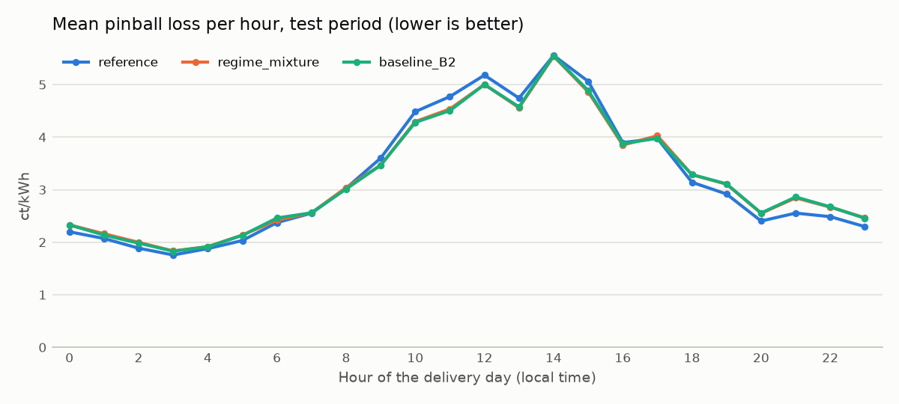
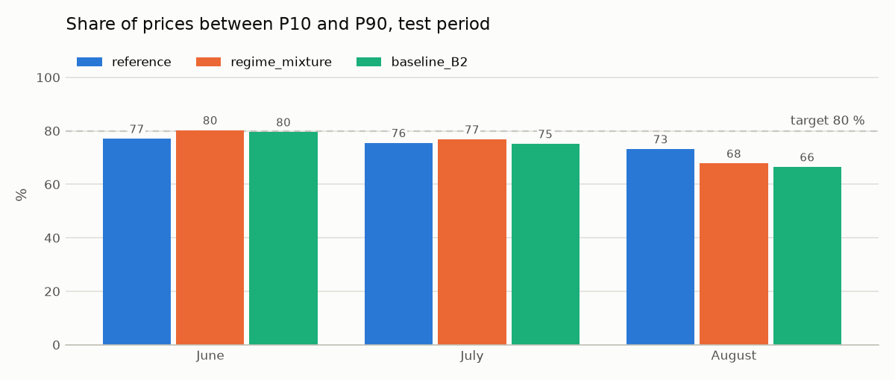

# Regime-Modell short/long

**Status:** Test abgeschlossen, nicht übernommen (Issue #16)

## Hypothese

Der Preis liegt bei short meist um 19 ct/kWh (Preis A), bei long um 6 ct/kWh mit negativen Ausreissern (Preis B). Die Baseline landet dazwischen. Ein Modell, das zuerst P(short) schätzt (EDA H8, Richtung hängt von Stunde und Position in der Stunde ab) und die Preise je Richtung getrennt modelliert, schlägt die Referenz im Pinball Loss.

## Modell und Features

1. **Richtung:** logistische Regression für P(short) pro Viertelstunde. Das Label `short` (TSI < 0) ist wie der Preis nur Trainingsziel bis D−2, nie Feature (`features/dataset.py`, Tests in `tests/test_features_dataset.py`).
2. **Preis je Richtung:** lineare Quantilregression wie in der Baseline, getrennt auf den short- und den long-Viertelstunden, für 13 Quantile von 2 % bis 98 %.
3. **Mischung:** $F(x) = p \, F_{\text{short}}(x) + (1-p) \, F_{\text{long}}(x)$. P10, P50 und P90 sind die Werte, bei denen $F$ 0.1, 0.5 und 0.9 erreicht.

Features für beide Teile: B1 (Kalender) oder B2 (Kalender plus Sonne), wie die Baseline. Zusätzlich liefert das Modell `p_short`, die Wahrscheinlichkeit, dass die Regelzone short ist.

## Tuning April und Mai

| Variante | Pinball Loss | gegenüber Referenz |
|---|---|---|
| Referenz | 3.449 | – |
| B1, alle Daten ab 01.01. | 3.496 | −1.4 % |
| B1, letzte 56 Tage | 3.732 | −8.2 % |
| **B2, alle Daten ab 01.01.** | **3.323** | **+3.7 %** |
| B2, letzte 56 Tage | 3.664 | −6.3 % |

B2 mit allen Daten ab 01.01. wurde vor dem Test als `CHOSEN` (Variante `regime_mixture`) festgelegt und danach nicht mehr verändert.

## Ergebnis (Test Juni bis August, 91 Tage)

| Modell | MAE P50 | Pinball Loss | Coverage | Intervallbreite |
|---|---|---|---|---|
| Referenz | 9.92 | **3.20** | 75.2 % | 26.3 |
| Baseline B2 | 9.81 | 3.23 | 73.6 % | 25.5 |
| Regime-Modell | **9.80** | 3.23 | 74.9 % | 25.9 |

| Klassifikator P(short) im Test | Wert |
|---|---|
| Brier Score Modell | 0.239 |
| Brier Score naive Prognose (Anteil short im Training, 0.556) | 0.250 |
| AUC | 0.62 |
| Treffer bei Schwelle 0.5 | 59 % |





## Einordnung

- **Gleich gut wie die Baseline, nicht besser als die Referenz:** Pinball Loss 3.23 gegenüber 3.20 (−0.8 %), an 54 % der Tage besser als die Referenz. Wie bei der Baseline war das Tuning (+3.7 %) zu optimistisch.
- **Die Richtung ist am Vortag nur schwach vorhersagbar:** Der Brier Score ist nur 4 % besser als die naive Prognose, die AUC liegt bei 0.62. Das bestätigt EDA H2 (Richtung von D−2 stimmt nur in 54 % mit dem Liefertag überein).
- **Das Muster in der Stunde ist echt, aber zu schwach:** Um 17 Uhr steigt P(short) von 0.21 (:00) auf 0.85 (:45), beobachtet 0.34 und 0.74 (EDA H8). Über den ganzen Tag gemittelt liegt P(short) aber nahe beim Grundanteil von 0.55. Die Mischung entspricht dann fast der unbedingten Verteilung beider Richtungen, und die Trennung bringt wenig.
- **Mittags besser, abends schlechter:** Von 9 bis 15 Uhr Pinball Loss 4.61 gegenüber 4.84 der Referenz, übrige Stunden 2.66 gegenüber 2.58. Gleiches Muster wie die Baseline, weil der Preisteil dieselben Features nutzt.
- **Coverage leicht besser als die Baseline** (74.9 % gegenüber 73.6 %), aber weiter unter dem Ziel von 80 %.

**Entscheid:** nicht übernommen. Das Gradient Boosting (`gbm_quantile`, Pinball Loss 3.16) ist besser. Der Ansatz bleibt als dokumentiertes negatives Ergebnis: Der Sprung zwischen Preis A und Preis B ist real, aber am Vortag um 11:00 ist zu wenig über die Richtung bekannt, um ihn auszunutzen. Eine bessere Richtungsprognose bräuchte Informationen, die erst kurz vor der Lieferung entstehen (Intraday-Handel, aktuelle Systembilanz).

## Starten

```bash
make backtest MODEL=regime_mixture STEP=tune   # Varianten auf April und Mai
make backtest MODEL=regime_mixture STEP=test   # CHOSEN auf Juni bis August, mit Grafiken
```

Ein Lauf dauert auf zwei Kernen etwa 15 Minuten (26 Quantilregressionen pro wöchentlichem Fit).
