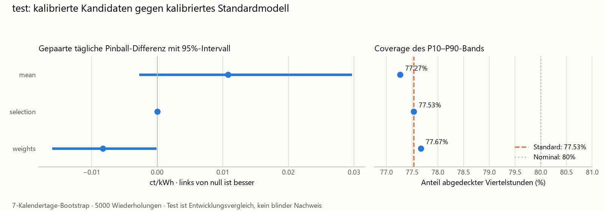

# Zeitabhängige Modellarchitektur · Issue #25

Stand 07.11.2026: Implementierung, April/Mai-Festlegung und Entwicklungsvergleich
Juni–August abgeschlossen. Der gemeinsame
Holdout bleibt bis zum endgültigen Pool-Freeze am 27.11. und zur Bestätigung
finaler Daten gesperrt. Juni–August sind Entwicklungsdaten, kein blinder Test.

## Pool und Struktur

`model.py` folgt dem Modellordner-Schema mit `MODEL`, `GRID`, `CHOSEN` und
`ISSUE`. Der zusätzliche `EXPERIMENT_RUNNER` verarbeitet OOS-Prognosen statt
Rohfeatures. Der normale Befehl funktioniert deshalb auch für dieses Modell:

```bash
make backtest MODEL=time_router STEP=tune JOBS=2
# Design prüfen und committen; die Testphase verlangt den Commit.
make backtest MODEL=time_router STEP=test JOBS=2 TRACK=1
```

Alternativ `make time-router STEP=pool|tune|test|readiness JOBS=2`.
`pool` erzeugt ausschliesslich Januar–Mai; `tune` erzeugt das Design.
`make time-router STEP=test JOBS=2 TRACK=1` reproduziert den gesamten erlaubten
Lauf aus Rohdaten und dem zuvor committeten Design mit einem Befehl.
Ohne GNU Make: `.venv/Scripts/python.exe -m energy_price.evaluation.time_router test --jobs 2 --track`
(vorher die verarbeiteten Datentabellen erzeugen).

Die vier Experten sind Referenz (56 Tage), lineare Baseline B2, Quantile Boosting
und Regime-Mischung. Ihre Einstellungen stammen unverändert aus ihren bisherigen
Experimenten auf April/Mai. Referenz bleibt täglich, die anderen Fits bleiben
wöchentlich mit den bisherigen Ankern: 30.01., 01.04. und 01.06. Historische
Preise und Richtungslabels reichen höchstens bis zum jeweiligen Fit-Tag minus
zwei Tage. Die tatsächliche Richtung wird vom Router ausschliesslich in der
nachfolgenden Auswertung verwendet.

`POOL` ist eine Einstellung, kein Namensschalter im Auswahlcode. Ein neuer
Experte benötigt einen Eintrag mit `module` und seinen eingefrorenen `settings`
(inklusive Trainingsfenster). Seine Modellklasse bietet `fit`/`predict` und
P10/P50/P90 wie die vorhandene Vorlage. Aufnahme erfordert zusätzlich den
Nachweis: gemeinsame Backtest-Folds, D−2-konforme Eingaben und ausschliesslich
auf April/Mai gewählte Einstellungen. Danach Design und Test neu rechnen;
vor dem finalen Freeze keine alten Gewichte oder Ergebnisse weiterverwenden.

Wiederverwendbare Bausteine liegen in `models/shared/forecast_pool.py`,
`models/shared/routing.py` und `models/shared/calibration.py`; die Ausführung
liegt unter `evaluation/time_router.py`. Der inhaltsbasierte Cache enthält
Trainings- und Prognoseeingaben, Einstellungen, Expertencode und Paketversionen.
Vorhandene Reportdateien anderer Experimente werden nicht ungeprüft übernommen.

## Festlegung ausschliesslich auf April/Mai

Diese Festlegung und `design.json` werden vor der ersten neuen
Juni–August-Auswertung committet und in Issue #25 verlinkt.

| Experte | Pinball April/Mai |
|---|---:|
| Referenz | 3.448507 |
| B2 | 3.311188 |
| Boosting | **3.308685** |
| Regime-Mischung | 3.322611 |

**Standardmodell: Boosting.** Die signierten P50-Fehler korrelieren zwischen den
Experten mit 0.987 bis 0.997. Das begrenzt die erwartbare Diversifikation; eine
hohe Korrelation allein beweist allerdings nicht, dass jede Kombination scheitert.

Fachliche Blöcke: 00–08 Uhr (Nacht/Frühmorgen), 08–16 Uhr (PV-Tagesabschnitt),
16–24 Uhr (Abend). Robustheit: 4×6 Stunden, ohne Werktag/Wochenende-Aufteilung.
Die vollständige Literaturentscheidung und die **vorab definierte** Power-Regel
stehen in [research.md](research.md).

Für einen Vorteil von 1 % und 80 % Power benötigen die gepaarten Vergleiche
auf Basis von April/Mai näherungsweise:

| Raster | Minimum benötigte Tage | Median | Maximum |
|---|---:|---:|---:|
| ein Tagesblock | 210 | 215 | 1930 |
| drei fachliche Blöcke | 363 | 862 | 3583 |
| vier 6-Stunden-Blöcke | 619 | 1019.5 | 6226 |

Vorhanden sind 61 Tage. Damit wird **kein Raster für diesen kleinen Effekt
ausreichend abgesichert**. Die Hauptvariante hat als Fallback einen Tagesblock;
sie behauptet keine belastbare Tageszeit-Spezialisierung. Vier 6-Stunden-Blöcke
bleiben eine diagnostische Robustheitsprüfung und dürfen nach Testeinsicht nicht
zum Hauptkandidaten befördert werden. Die Zahlen sind grobe Planungswerte mit
Normalapproximation, keine garantierte Stichprobengrösse bei Extrempreisen.

Die drei Kandidaten sind:

1. Gleiches Gewicht für alle Experten.
2. Auswahl eines Experten für alle drei Quantile gemeinsam. Wöchentlich nur
   wechseln, wenn das 95-%-Intervall der täglichen Pinball-Differenz unter null
   liegt; zusätzlich Bonferroni über `(Poolgrösse−1) × Blockzahl` je Fit.
   Sonst Standardmodell. Alle verfügbaren OOS-Fehler bis zum Wochenbeginn−2.
3. Konvexe Gewichte je zugelassenem Block und Quantil: Pinball-LP, letzte 56
   Kalendertage, 50 % Schrumpfung zum Standardmodell, mindestens 28 Tage.

Bootstrap: **7 Kalendertage**, **5000 Wiederholungen**, **Seed 0**. Fehlende Tage
bleiben Kalenderlücken. Vorhersagen einer Woche verwenden auch an ihren späteren
Tagen nur den Stand vom Wochenbeginn. Das ist konservativer als täglich D−2.

## Datenlecks, Kalibrierung und Nachvollziehbarkeit

Die lange Prognosetabelle enthält je Experte UTC-Zeitstempel, Prognose,
`fit_day` und `train_last_day`. Die Prüfung verweigert fehlende/duplizierte
Viertelstunden, widersprüchliche Zielwerte und eine verletzte D−2-Grenze.
UTC erhält die wiederholte Oktoberstunde. Fehlende Prognosen/Preise schliessen
den ganzen Tag für alle Experten und Kandidaten aus. Juni 24 bleibt so wie bei
den bisherigen Modellen wegen fehlenden Wetters ausgeschlossen.

Der Router sieht beobachtete Fehler ausschliesslich bis D−2. Seine Ausgabe
enthält `chosen_expert`, quantilspezifische `weights`, `block`, `fit_day` und
`error_last_day`. Nach quantilspezifischer Gewichtung werden Kreuzungen sortiert;
`preorder_q10/q50/q90` und `quantiles_reordered` machen diesen Schritt sichtbar.

Kalibrierung folgt **einmal nach der Auswahl**: 56 Tage, 6-Stunden-Gruppen,
separate 10-%-Schwanzkorrekturen und unverändertes P50 wie im GBM-Experiment #19.
Sie verwendet gespeicherte Ausgaben der damaligen Router-Fits, keine rückwirkend
mit heutigen Gewichten berechneten Prognosen. `calibration_last_day` weist die
Grenze aus. Rohe und kalibrierte Kandidaten werden auf identischen Viertelstunden
mit dem rohen beziehungsweise kalibrierten Standardmodell verglichen.

April/Mai legen auch das Standardmodell und die Expertenparameter fest. Die
Warmhistorie ist deshalb OOS hinsichtlich der einzelnen Modellfits, aber keine
vollständig vorab festgelegte Hyperparameter-Evaluation von Januar bis Mai.
Sie dient der Entwicklung und Kalibrierung; erst ab Juni gilt das eingefrorene
Design. Die historischen Swissgrid-Dateien enthalten überarbeitete Werte und
keine vollständigen damaligen Datenstände. D−2 verhindert zeitliche Lecks im
Backtest, beseitigt aber diese Einschränkung historischer Revisionen nicht.

## Juni–August und Entscheid

Festlegung vor dem Test: Commits `d1264d4` und `c61d016`, dokumentiert in
[Issue #25](https://github.com/ibidreli/energy_price_prediction/issues/25#issuecomment-6708782368)
und [Ergänzung vor den Scores](https://github.com/ibidreli/energy_price_prediction/issues/25#issuecomment-6708853111).
Alle Vergleiche verwenden **8736 Viertelstunden an 91 Tagen**, ohne 24.06.
Ein vorzeitig beendeter Befehl hatte nur Experten-Fits erzeugt; deren
inhaltsbasierter Cache wurde im vollständigen Lauf wiederverwendet.

| Variante | Pinball | MAE P50 | Coverage | Bandbreite |
|---|---:|---:|---:|---:|
| Boosting, roh | 3.163293 | 9.792303 | 74.08 % | 24.844705 |
| Gleichgewichte, roh | 3.169655 | 9.774233 | 75.98 % | 25.646652 |
| Auswahl, roh | 3.163293 | 9.792303 | 74.08 % | 24.844705 |
| Gelernte Gewichte, roh | 3.147265 | 9.766201 | 75.30 % | 25.146728 |
| Boosting, kalibriert | 3.125098 | 9.792303 | 77.53 % | 26.622195 |
| Gleichgewichte, kalibriert | 3.135896 | 9.774233 | 77.27 % | 26.177901 |
| Auswahl, kalibriert | 3.125098 | 9.792303 | 77.53 % | 26.622195 |
| **Gelernte Gewichte, kalibriert** | **3.116821** | **9.766201** | **77.67 %** | **26.419347** |

Loss, MAE und Breite in ct/kWh. Gegenüber dem jeweiligen Standardmodell:

| Kandidat | Tägliche Pinball-Differenz | 95-%-Intervall | Coverage-Differenz |
|---|---:|---:|---:|
| Gleichgewichte, roh | +0.006362 | [−0.008382, +0.025176] | +1.900 Prozentpunkte |
| Auswahl, roh | 0 | [0, 0] | 0 |
| Gewichte, roh | −0.016028 | [−0.024489, −0.008647] | +1.213 Prozentpunkte |
| Gleichgewichte, kalibriert | +0.010797 | [−0.002576, +0.029457] | −0.263 Prozentpunkte |
| Auswahl, kalibriert | 0 | [0, 0] | 0 |
| **Gewichte, kalibriert** | **−0.008277** | **[−0.015809, −0.000333]** | **+0.137 Prozentpunkte** |

**Für den Holdout nominiert: globale gelernte Gewichte mit anschliessender
Kalibrierung**, gespeichert in `nomination.json`. Der kalibrierte Pinball sinkt
im Entwicklungsvergleich um 0.265 %, die Coverage steigt leicht. Das Intervall
liegt knapp unter null; dieser bereits zur Kandidatenwahl verwendete Test ist
kein unabhängiger Signifikanznachweis. Die Coverage bleibt unter nominalen 80 %.
Es gibt noch keine Übernahmeentscheidung.

Die Auswahlregel wechselt in keiner der 14 Testwochen vom Standardmodell weg.
Sie ist auf dem Test exakt identisch zu Boosting. Auch die Boosting-Quantile
selbst stimmen auf allen gemeinsamen Testviertelstunden mit dem bisherigen
GBM-Experiment überein. Es wurden keine Expertenparameter angepasst.

Der kalibrierte Standard hat hier 3.125098 statt der 3.1254 aus #19. Die
Korrekturregel ist unverändert; ihre OOS-Fehler stammen jetzt aus der gemeinsamen
Prognosetabelle mit den etablierten April-/Juni-Fitankern. #19 erzeugt seine
inneren historischen Prognosen auf einem durchlaufenden Wochenraster ab 30.01.
Deshalb werden beide Seiten des neuen Vergleichs konsistent mit dem neuen
gemeinsamen OOS-Protokoll kalibriert; Werte unterschiedlicher Protokolle werden
nicht als gepaarter Vergleich ausgegeben.

**Domänenbezug:** Die hohe Fehlerkorrelation und die ausbleibenden belegten
Expertenwechsel sprechen gegen eine belastbare Tageszeit-Zuordnung mit dieser
Historie. Eine kleine globale Kombination kann trotzdem helfen. Die mittleren
Boosting-Gewichte liegen bei rund 79 % (P10), 68 % (P50) und 80 % (P90);
Referenz ergänzt vor allem die Ränder, B2 und Regime-Mischung stärker den Median.
Das sind beschreibende Gewichte, keine kausalen Beiträge.

Der kalibrierte Gewinn liegt im Juni (3.0019 statt 3.0162) und Juli (3.1231 statt
3.1351); im August ist die Kombination leicht schlechter (3.2181 statt 3.2170).
Auf tatsächlichen long-Viertelstunden verbessert sich der Loss von 3.2897 auf
3.2512, bei short verschlechtert er sich von 2.9803 auf 2.9986. Der Vorteil ist
also weder über Monate noch Richtungen gleichmässig. Daraus wird keine neue
monatliche oder richtungsabhängige Auswahlregel abgeleitet.

**Robustheit 4×6h, keine zusätzliche Wahlmöglichkeit:** Kalibrierte Gewichte
erreichen diagnostisch 3.111040 mit Intervall der Differenz
[−0.022240, −0.005348], Coverage 77.518 % gegenüber 77.530 % beim Standard
(eine Viertelstunde weniger abgedeckt). Dieses Raster war aufgrund der
April/Mai-Power-Abschätzung nicht für die Hauptvariante zugelassen und wird
nach Testeinsicht nicht übernommen. Auch hier schaltet die Auswahl nie um.



Grafik reproduzieren: `make time-router-figures STEP=test`.
Kuratierte CSV-Ergebnisse und W&B-Links liegen in
[`docs/exploration/time_router/results/`](../../../../docs/exploration/time_router/results/).
Vollständige Prognosen, Gewichte und Entscheidungen stehen zusätzlich als
W&B-Artefakte bereit: [kalibrierte Gewichte](https://forge.coreweave.com/wandb/fhnw-cds1/energy-price-prediction/runs/nekqk66k),
[kalibriertes Standardmodell](https://forge.coreweave.com/wandb/fhnw-cds1/energy-price-prediction/runs/ivxmx3iw),
Gruppe `issue-25`. Der bestehende Chartname `daily_pinball_vs_reference` meint
hier den jeweiligen Standardmodell-Vergleichspartner aus der Vergleichstabelle.

## Holdout: erst nach finalen Daten und Pool-Freeze

Der Nutzer hat am 07.11. bestätigt, den Zeitplan beizubehalten. Deshalb gibt es
hier noch **keinen Holdout-Lauf und keinen endgültigen Architekturentscheid**.
Der terminierte Abschluss ist als [Issue #32](https://github.com/ibidreli/energy_price_prediction/issues/32) nachgeführt.
26 fehlende ECMWF-Läufe wurden archiviert; die Wetterfeatures sind für alle
5860 erwarteten Viertelstunden September/Oktober vollständig. Preise fehlen
lokal noch für alle 5860 Viertelstunden, Richtungslabels für 2692.

```bash
make holdout-data-check
# Später: finale Swissgrid-XML September/Oktober einlesen, CAB-Snapshot holen.
make fetch-cab
make data
```

Finalität muss anhand der Swissgrid-Veröffentlichung bestätigt werden. Ein
Datum allein gilt nicht als Nachweis. Erwartet werden finale Oktoberpreise
etwa ab 20.11.; der geplante Pool-Freeze bleibt 27.11. Erweiterungen des Pools
vorher verlangen erneute Entwicklungsschritte. Die abschliessende Erklärung
`final_data.json` liegt lokal und enthält:

```json
{
  "final_prices_confirmed": true,
  "months": ["2026-09", "2026-10"],
  "source_url": "URL zur geprüften offiziellen Veröffentlichung",
  "verified_by": "Name des prüfenden Teammitglieds",
  "verified_on": "2026-11-27",
  "explanation": "Nachweis, dass beide XML-Dateien finale Preise enthalten",
  "data_fingerprint": "Wert aus holdout_readiness.json nach make data"
}
```

Erst dann:

```bash
make time-router STEP=freeze FINAL_DATA_EVIDENCE=final_data.json
git add src/energy_price/models/time_router/pool_freeze.json
git commit -m "exp: freeze final model pool and holdout inputs (#25)"
make time-router STEP=holdout JOBS=2 TRACK=1 FINAL_DATA_EVIDENCE=final_data.json
```

Der Freeze bindet Pool, Design, Nominierung und Daten-Hash. Ein atomar angelegtes
`holdout_protocol.json` verbraucht die Freigabe vor dem Rechnen. Auch nach einem
Abbruch erlaubt kein CLI-Schalter eine zweite Auswertung. Ein technischer
Fehler muss mit sichtbarem Protokoll untersucht werden. Die endgültigen
Einzelexperten und der nominierte Kandidat werden auf denselben Viertelstunden
bewertet; Monats-/Block-/Richtungstabellen entstehen erst nach der Prognose.

## Prüfung und Review

`tests/test_time_router.py` prüft manipulierte Zukunftspreise, tatsächliche
Richtung, wöchentliche Grenzen, historische Router-Ausgaben in der Kalibrierung,
einmalige Kalibrierung, neue Experten ohne Codeänderung, Quantilkreuzungen,
Blockpartition, UTC/DST, vollständige gemeinsame Quartale, Bootstrap,
eingeschränkte LP-Gewichte und die atomare Holdout-Sperre.

Die Branches aus #19 und #21 wurden in diesen Arbeitsbranch integriert. Das ist
keine Freigabe durch ein Teammitglied und kein Merge nach `main`. Teamreview
und der spätere gemeinsame Holdout bleiben offene Abschlussbedingungen.
Die Kalibrierung ist separat in [PR #31](https://github.com/ibidreli/energy_price_prediction/pull/31)
prüfbar; die explorative Vorarbeit bleibt in [PR #22](https://github.com/ibidreli/energy_price_prediction/pull/22).
Prüfstand: 297 Tests bestanden; zusätzlich die vollständigen Testprognosen auf
D−2-Grenzen, unveränderte GBM-Prognosen und Quantilordnung geprüft.
