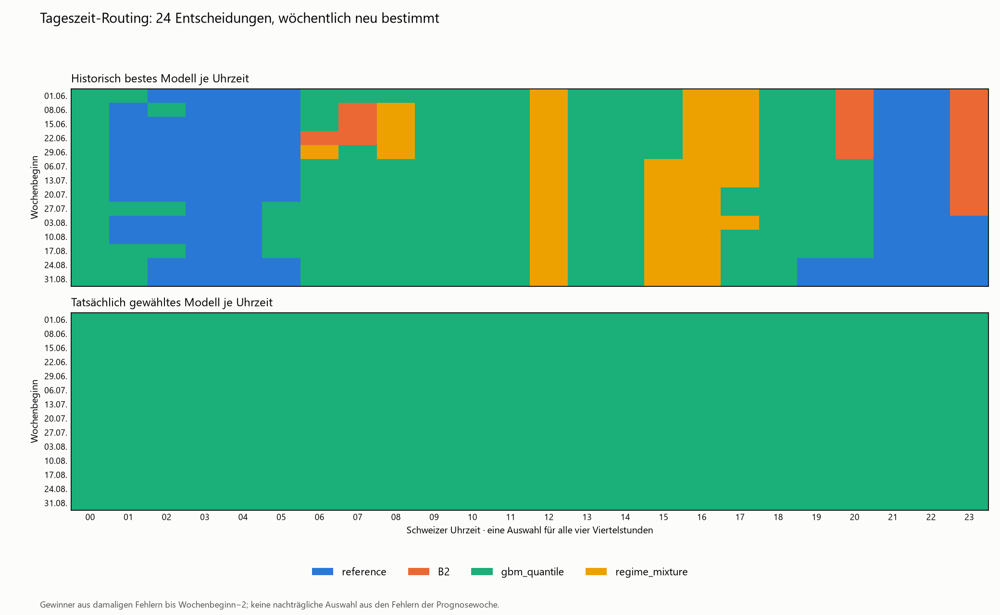

# Modellauswahl je Uhrzeit · Issue #25 · hourly_v2

Die Hauptvariante trifft **24 getrennte Entscheidungen für die Schweizer Uhrzeiten
00–01, 01–02, …, 23–24 Uhr**. Für 14 Uhr zählen ausschliesslich historische
Prognosefehler von 14:00, 14:15, 14:30 und 14:45. Die vollständige Stundentabelle
wird alle sieben Tage aktualisiert. Innerhalb eines Tages dürfen verschiedene
Modelle verwendet werden; für dieselbe Uhrzeit bleibt die Zuordnung innerhalb
des Wochenblocks fest.

Die Nutzerpräzisierung vom 09.11.2026 ersetzt die vorherige globale Hauptvariante.
Der [historische Stand v1](../../../../docs/exploration/time_router/history/global_v1_2026-11-07/)
bleibt erhalten. Eine schwache Power darf die Stundenauflösung nicht automatisch
wieder auf einen ganzen Tag reduzieren.

## Ablauf

1. Referenz, Baseline B2, GBM und Regime-Mischung erzeugen ihre unveränderten
   OOS-Prognosen. Die Historie beginnt am 30.01.2026.
2. Je Wochenbeginn, Uhrzeit und Experte wird der mittlere tägliche Pinball über
   P10/P50/P90 berechnet. Verwendet werden ausschliesslich bekannte Fehler bis
   Wochenbeginn minus zwei Tage. Die Auswahlhistorie wächst seit dem 30.01.
3. Ein gewählter Experte liefert P10, P50 und P90 gemeinsam für alle vier
   Viertelstunden seiner Stunde.
4. Anschliessend wird die ausgegebene Prognose einmal kalibriert: 56 Tage
   historischer Router-Ausgaben, getrennte Schwanzkorrekturen, 6-Stunden-Gruppen.
   P50 bleibt unverändert.

## Historischer Gewinner und Wechselregel

Die Stundenauflösung und die Wechselbedingung sind getrennte Einstellungen:

| SELECTION_MODE | Tatsächlich gewähltes Modell je Uhrzeit |
|---|---|
| empirical | Niedrigster vergangener Pinball in genau dieser Stunde; Unsicherheit separat ausweisen. |
| significant | Wechsel von GBM nur bei vollständig negativem bereinigtem Bootstrap-Intervall; sonst GBM für diese Stunde. |

Aktuell bleibt die ursprüngliche Regel significant aktiv. Die Frage an den
Nutzer, ob die direkten historischen Gewinner verwendet werden sollen, ist offen.
Beide Regeln sind implementiert. Ein historischer Gewinner ist keine Behauptung
statistisch abgesicherter Überlegenheit.

Bootstrap: 7 Kalendertage, 5000 Wiederholungen, Seed 0. Die Bonferroni-Korrektur
berücksichtigt je Wochenbeginn (Poolgrösse−1) × 24 Vergleiche. Bei weniger als
28 beobachteten Tagen gilt der Standardexperte für die betroffene Stunde.
Unterschiedliche Modelle werden nicht künstlich erzwungen.

Die drei Varianten sind Gleichgewichte, stundenweise Auswahl und stundenweise
gelernte Quantilgewichte. Die Gewichte minimieren Pinball auf den letzten 56
verfügbaren Kalendertagen, sind nichtnegativ und summieren sich zu eins. Die
Lösung wird zu 50 % zum Standardmodell geschrumpft.
**Primärer Kandidat ist die verlangte stundenweise Einzelmodellauswahl.**
Die Vergleichsvarianten ersetzen sie nicht automatisch durch eine globale
Mischung. Eine Übernahme erfordert den späteren blinden Holdout.

## Sichtbare Stundentabellen

Die Dateien unter reports/time_router/ enthalten:

| Datei | Inhalt |
|---|---|
| tune_hourly_best.csv | 24 empirische Gewinner ausschliesslich auf April/Mai; Diagnose. |
| test_routing_schedule.csv | Pro Woche, Strategie und Stunde die tatsächliche Zuordnung. |
| test_latest_hourly_schedule.csv | Die 24 Zuordnungen der letzten Testwoche; keine Live-Prognose für November. |
| test_decisions.csv | Paarvergleiche und Unsicherheitsintervalle zur damaligen Auswahl. |
| test_forecasts.parquet | P10/P50/P90 und Auswahl-/Kalibrierungsgrenzen je Viertelstunde. |

Die Stundentabelle enthält fit_day, valid_through, start_hour, end_hour,
empirical_best, chosen_expert, history_last_day, n_history_days, historische
Expertenverluste, Auswahlgrund und die Kennzeichnung eines abgesicherten Vorteils.
So bleiben beobachteter Gewinner und tatsächlich gewählter Experte unterscheidbar.

Jede Woche entsteht eine vollständige Karte mit 24 Einträgen. Für 06 Uhr, 14 Uhr
und 21 Uhr gibt es jeweils eine eigene Entscheidung. In der nächsten Woche
werden diese drei Zuordnungen wieder getrennt aus derselben Uhrzeit gelernt.
Keine Modellnamen werden für bestimmte Uhrzeiten hart codiert.

## Methodik und zeitliche Grenzen

April/Mai bestimmen weiterhin den Standardexperten und die Diagnosen. Die
Stundenauflösung und die primäre Auswahl folgen der Nutzerpräzisierung.
Die 1-%-/80-%-Power-Planung wird auch für 24 Stunden als Einschränkung berichtet;
sie ist keine Bedingung für eine gröbere Hauptvariante.
[research.md](research.md) beschreibt Literatur und die Änderung der Planung.

Juni–August wurden bereits für v1 betrachtet und sind ausdrücklich
**Entwicklungsdaten**. Die Revision begründet keinen nachträglich blinden Test.
Code und Design werden vor ihren neuen Scores committet. Am September/Oktober-
Holdout wird nichts abgestimmt.

Training, Auswahl und Kalibrierung verwenden keine Zielwerte nach der jeweiligen
D−2-Grenze. Die Referenz bleibt täglich aktualisiert, die anderen Experten nutzen
die bisherigen Wochenanker. Tatsächliches short/long dient beim Router
ausschliesslich der späteren Auswertung. Fehlende Tage werden für alle Varianten
gemeinsam ausgeschlossen. UTC-Schlüssel erhalten die doppelte Oktoberstunde.

Die Kalibrierung nutzt Ausgaben der damaligen Router-Fits, keine mit heutigen
Entscheidungen rückwirkend berechneten Prognosen. Quantilkreuzungen der
Gewichtsvariante werden sortiert und mit Originalwerten protokolliert.
Revisionen historischer Swissgrid-Dateien bleiben eine Einschränkung: Die
D−2-Grenzen rekonstruieren keine fehlenden damaligen Datenstände.

## Ausführung und Struktur

    make time-router STEP=tune JOBS=2
    # Stundenraster und Regel prüfen, Design und Code committen.
    make time-router STEP=test JOBS=2 TRACK=1
    make time-router-figures STEP=test

Alternativ funktionieren make backtest MODEL=time_router STEP=tune|test und
.venv/Scripts/python.exe -m energy_price.evaluation.time_router test --jobs 2 --track.
Pool und tune erzeugen ausschliesslich Warmhistorie und April/Mai.

Gemeinsame Bausteine: models/shared/forecast_pool.py, routing.py und calibration.py.
Ausführung: evaluation/time_router.py. Pool, Auflösung, Wechselregel und primäre
Strategie: time_router/model.py. Festgelegtes Design: design.json.
Nominierung: nomination.json. Der Cache bindet Expertencode, Einstellungen,
Fit-/Prognoseeingaben und Paketversionen; unveränderte Expertenfits werden
wiederverwendet. Neue geeignete Experten benötigen einen Konfigurationseintrag
mit April/Mai-basierten Einstellungen; danach Entwicklung und Design wiederholen.

## Entwicklungsresultate hourly_v2

Die Stundenauflösung und Regeln wurden in Commit 8a316a8 festgehalten und
[vor den neuen Scores in Issue #25 dokumentiert](https://github.com/ibidreli/energy_price_prediction/issues/25#issuecomment-6742982196).
Der Lauf verwendet 8736 gemeinsame Viertelstunden an 91 Tagen Juni–August;
der 24.06. bleibt wegen fehlenden Wetters für alle ausgeschlossen.

Es entstehen **14 Wochenkarten mit je 24 Entscheidungen**, insgesamt 336
Stundenzuordnungen. Als historische Gewinner kommen alle vier Experten vor.
Die ursprüngliche statistische Wechselbedingung lässt jedoch keinen Wechsel zu:
Alle 336 tatsächlich gewählten Experten sind GBM. Keines der 1008 bereinigten
Vergleichsintervalle liegt ganz unter null. Die direkte historische Bestwahl ist
implementiert und funktional getestet; sie wurde ohne Antwort auf die offene
Regelfrage nicht als Hauptlauf aktiviert.

| Variante | Pinball | MAE P50 | Coverage |
|---|---:|---:|---:|
| GBM, roh | 3.163293 | 9.792303 | 74.08 % |
| Stundenauswahl mit Nachweisschwelle, roh | 3.163293 | 9.792303 | 74.08 % |
| GBM, kalibriert | 3.125098 | 9.792303 | 77.53 % |
| Stundenauswahl mit Nachweisschwelle, kalibriert | 3.125098 | 9.792303 | 77.53 % |
| Stundenweise Quantilgewichte, kalibriert (Vergleich) | 3.111396 | 9.744212 | 77.55 % |

Die Gewichtsvariante kombiniert Modelle. Sie ersetzt die verlangte Stundenauswahl
nicht automatisch. Ihr Intervall der täglichen Differenz zum kalibrierten GBM
ist [−0.023220, −0.002784]; die Coverage bleibt unter 80 %.

Die Power-Näherung für einen Planungseffekt von 1 % ergibt für die Stundenvergleiche
532 bis 27578 benötigte Tage (Median 4452.5), vorhanden sind 61 April/Mai-Tage.
Das sind grobe Planungswerte, keine garantierten Stichprobengrössen bei veränderlichen
Preisverteilungen. Sie lösen keine automatische globale Zuordnung mehr aus.

Die obere Stundenkarte verwendet nur Fehler bis zum damaligen Wochenbeginn−2;
sie zeigt keine aus der Prognosewoche im Nachhinein gewählten Sieger. Die untere
Karte macht die Nachweisschwelle sichtbar. Alle Viertelstunden stimmen mit ihrer
Stundenkarte überein; D−2 und Quantilordnung wurden auf den tatsächlichen Ausgaben geprüft.

W&B: [Stundenauswahl](https://forge.coreweave.com/wandb/fhnw-cds1/energy-price-prediction/runs/8tdp0pgc),
[kalibriertes GBM](https://forge.coreweave.com/wandb/fhnw-cds1/energy-price-prediction/runs/57k9tnuy),
[stundenweise Gewichte](https://forge.coreweave.com/wandb/fhnw-cds1/energy-price-prediction/runs/6yfaasao).
Laufnamen time_router/hourly_v2/<variante>, Gruppe issue-25. Artefakte enthalten
die vollständigen Wochen-/Stundentabellen; CSVs und Prüfprotokoll stehen unter
docs/exploration/time_router/results/. Juni–August bleiben Entwicklungsdaten.

## Holdout bleibt gesperrt

Kein Holdout wurde für diese Korrektur ausgeführt. Der vereinbarte Pool-Freeze
bleibt frühestens am 27.11.2026; finale Preise müssen offiziell bestätigt und
alle Eingaben vollständig sein. Die 26 fehlenden Oktober-Wetterläufe wurden
zuvor archiviert. Preise und aktualisierte Richtungslabels sind vor dem
gemeinsamen Lauf bereitzustellen.

[Issue #32](https://github.com/ibidreli/energy_price_prediction/issues/32) hält den
einmaligen Abschluss fest. Readiness prüft nur Vollständigkeit:

    make holdout-data-check
    make time-router STEP=freeze FINAL_DATA_EVIDENCE=final_data.json
    # pool_freeze.json committen
    make time-router STEP=holdout JOBS=2 TRACK=1 FINAL_DATA_EVIDENCE=final_data.json

final_data.json enthält final_prices_confirmed, beide Monate, source_url,
verified_by, verified_on, explanation und data_fingerprint aus dem Readiness-
Bericht. Ein atomisches holdout_protocol.json verbraucht die Freigabe beim Start;
ein Abbruch berechtigt nicht zum stillen Wiederholen. Übernahme erfordert
niedrigeren Pinball, ein ganz negatives Intervall der täglichen Differenz und
mindestens gleiche Coverage.

## Prüfung und Review

Tests prüfen unterschiedliche Experten je Uhrzeit innerhalb desselben Tages,
vier zusammengehörige Viertelstunden, wöchentliche Konstanz der Stundenkarte,
Lernen nur aus derselben Uhrzeit, Zukunftspreis-Poisoning, Unsicherheitsausweis,
Quantilordnung, damalige Router-Ausgaben in der Kalibrierung, DST und Einmal-Sperre.
Gesamtlauf vor der Auswertung: **302 Tests bestanden**.

Die Korrektur liegt auf exp/25-hourly-model-selection. Der frühere PR #33 ist
geschlossen und wird nicht wieder geöffnet. Teamreview und der spätere blinde
Architekturentscheid bleiben Abschlussbedingungen.
